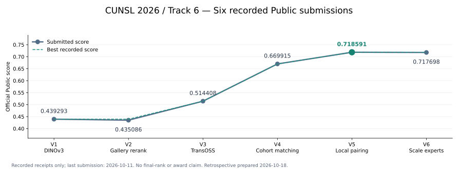
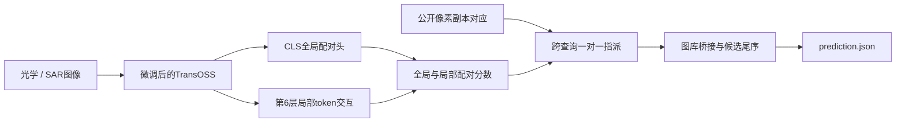

<h1 align="center">CUNSL 2026 · Track 6</h1>

<p align="center">
  <strong>多源卫星跨模态舰船重识别 · 初赛方案与实验复盘</strong>
</p>

<p align="center">
  
  
  
  
</p>

<p align="center">
  <a href="https://www.heywhale.com/home/competition/6aba33ce6e5beff2fca53add">赛题主页</a> ·
  <a href="#正式提交与成绩">提交成绩</a> ·
  <a href="#最佳方案v5">最佳方案</a> ·
  <a href="#快速开始">快速开始</a> ·
  <a href="#实验与研究入口">实验记录</a>
</p>

> [!NOTE]
> **归档状态 · 2026-10-18**：本仓库开始整理初赛参赛总结，保留实现、正式回执和研究证据。
> 已留存六次已评审提交，最好版本为 **V5，Public 0.7185908013668432**；最后一次已记录提交为2026-10-11的V6。
> 最终名次和获奖结果尚未核验，赛程及正式结果以主办方公告为准。

这是CUNSL 2026第6题的参赛队伍研究仓库。项目围绕TransOSS完成光学/SAR身份检索、学习式全局与局部配对、跨查询联合匹配，以及后续训练与非训练方法的对照实验。

README汇总已完成的工作；逐轮记录、失败配置和指标定义保存在[研究文档](docs/)与[匿名证据](docs/evidence/README.md)。本仓库为非官方实现。

## 比赛简介

给定一张舰船图像，从目标图库中找出同一艘船的其他观测，返回前10个候选。任务覆盖光学与SAR之间的跨模态检索，以及光学图像之间的同模态检索，要求对训练中未见的舰船身份进行识别。

| 方向 | 查询图像 | 目标图库 | 初赛查询数 | 总分权重 |
|---|---|---|---:|---:|
| O2S | 光学 | SAR | 120 | 45% |
| S2O | SAR | 光学 | 120 | 45% |
| O2O | 光学 | 光学 | 27 | 10% |

每方向得分为 `(R@1 + mAP@10) / 2`，总分按上表加权。初赛共267张查询、1,800张图库图像，每个方向有900张目标模态候选。提交文件为覆盖全部查询的 `prediction.json`，每条查询包含10个不同且合法的图库ID。

本地评估同时记录不同AP分母口径；未取得官方评分程序时，不把自实现指标直接等同于平台评分。详见[比赛规则](docs/01-contest.md)与[验证协议](docs/07-validation.md)。

## 正式提交与成绩



| 版本 | 提交时间（北京时间） | 主要变化 | 官方Public | 记录 |
|---|---|---|---:|---|
| V1 | 10-07 14:52 | DINOv3独立入口微调基线 | 0.439293403 | [回执](docs/evidence/2026-10-07-first-submission.json) |
| V2 | 10-07 15:37 | 在V1上加入固定图库重排序 | 0.435085813 | [回执](docs/evidence/2026-10-07-score-research.json) |
| V3 | 10-07 17:30 | 改用TransOSS，全骨干微调与早停 | 0.514407766 | [回执](docs/evidence/2026-10-07-third-submission.json) |
| V4 | 10-08 20:35 | 公开像素对应关系与跨查询联合匹配 | 0.669915206 | [回执](docs/evidence/2026-10-08-fourth-submission.json) |
| **V5** | **10-08 23:36** | **学习式全局/局部配对头，与V4联合匹配组合** | **0.718590801** | [回执](docs/evidence/2026-10-08-fifth-submission.json) |
| V6 | 10-11 20:30 | 原尺度与重叠patch全模型专家融合 | 0.717697944 | [回执](docs/evidence/2026-10-11-sixth-score.json) |

两次主要的正式增益：

- **V3→V4：+0.155507**。复用已有模型，通过查询之间的联合决策取得提升，没有新增训练。
- **V4→V5：+0.048676**。引入学习式局部交互及独立局部辅助判别，再与原联合匹配流程组合。
- V6比V5低0.000893，因此保留V5作为已记录的比赛最佳版本。

本表只收录已保存回执的六次提交，不使用提交期间的临时排名推断最终名次。完整精度与图表来源见[成绩汇总](docs/evidence/2026-10-18-submission-summary.json)。

## 我们的工作

| 方向 | 完成内容 | 主要产物 |
|---|---|---|
| 数据与验证 | 全量TIFF解码、身份与模态核对、重复/异常审查、身份及近重复组件隔离 | [数据审查](docs/02-data.md)、[验证协议](docs/07-validation.md) |
| 表征与配对 | 接入作者TransOSS配对预训练，适配方形输入；全骨干微调、早停、学习式CLS及局部配对 | [TransOSS](docs/13-transoss.md)、[局部配对](docs/24-local-pair-verifier.md) |
| 联合决策 | 使用公开像素对应关系连接查询与图库，比较完整/部分指派和不重合压力 | [任务结构](docs/18-task-structure.md)、[公开查询研究](docs/20-public-cohort.md) |
| 实验与复现 | 源码/数据/权重摘要绑定、检查点重载、独立评分、GPU互斥、原始结果归档及科学图 | [工具说明](tools/README.md)、[证据索引](docs/evidence/README.md) |

## 最佳方案：V5



1. **TransOSS表征。** 从作者公开的光学/SAR场景配对预训练初始化，在本题训练身份上微调。位置网格适配256×256方形输入；缺少有效GSD/物理尺寸时禁用对应尺度信息。
2. **学习式全局/局部配对。** 冻结已微调骨干，训练CLS配对头和基于第6层token的局部交互分支。局部分支额外承担独立的正负配对判别，避免只依赖全局分数修补残差。
3. **跨查询联合匹配。** 结合公开像素副本对应，对光学与SAR查询进行联合指派，再桥接到目标图库；候选尾序继承既有检索结果。
4. **固定选择与核验。** V5局部头按development分数选择seed=20261009、第10轮；生成前重放验证成本及已有公开预测控制，校验267条查询与每条10候选的契约。

这里的查询集合共同身份及互异性是联合匹配采用的条件假设，未获隐藏身份标签验证；不能从查询数量相等直接推出。局部节点是特征网格，不视作已经分割或物理配准的舰船构件。

完整实现与边界见[局部配对实验](docs/24-local-pair-verifier.md)、[公开任务联合匹配](docs/20-public-cohort.md)和[提交证据](docs/evidence/2026-10-08-fifth-submission.json)。

## 实验复盘

### 哪些收益得到了官方支持

领域配对预训练、全骨干微调使V3超过早期DINO基线。后续最明显的正式收益来自**查询集合的联合决策**和**学习式局部配对**。本地研究版本已转向TransOSS；DINO路线的历史方法与成绩继续保留在文档中。

V5之后的训练、输入处理和推理研究保留为实验记录，未取得比V5更好的已记录官方成绩。固定代理融合等方法存在本地小幅收益，不能当作新的官方提分。

### V6：本地改善没有转化为正式收益

| 对比口径 | V5 | V6 | 变化 |
|---|---:|---:|---:|
| 完整本地检索 | 0.645383 | 0.652339 | +0.006956 |
| 原40条件场景 | 0.834800 | 0.864183 | +0.029383 |
| 报告20条件场景 | 0.859555 | 0.860265 | +0.000710 |
| 官方Public | 0.718591 | 0.717698 | −0.000893 |

这些口径不能互换。旧验证身份长期参与研究，重复抽取40个场景不构成40个独立验证集；困难27组的1,080次出现也只涉及44个不同身份。V6说明，不能只依据最有利的一组模拟决定方案，更不能把局部增量加到官方分数上。

具体归因仍有限：平台总分没有分方向或逐查询反馈，现有审计未找到错文件或生成错误证据。我们没有据此断言某个专家、融合权重或处理域就是唯一原因。详见[V6方案](docs/35-v6-integration.md)与[迁移落差分析](docs/36-v6-transfer-gap.md)。

### 多代理三方一致性：召回提高，选择反而变差

保留多个光学代理，让光学查询、另一张光学图和SAR共同决定关系，已经完成冻结缓存的CPU对照。它提高了正确代理的前五覆盖率，但新增的高分解释经常指向错误身份：

- 纯光学首选代理正确率81.9%；前五候选包含正确代理的覆盖率95.2%。
- 即使指定真实SAR，条件最高能量代理也只有66.1%正确。
- 最大能量规则将238次正确代理改错，只救回13次代理错误。
- 补上已占用源副本排除、代理图像容量与null弃权后，仍未超过V5和固定代理对照。

因此，三角能量更高、全局指派可行或输出更整齐，都不能单独证明身份更准确。该轮规则停止扩大，完整结果和可视化见[三方联合研究](docs/41-triangle-matching.md)。

## 数据与验证

初赛包原始训练部分有**7,422张图像、3,534个双模态身份**；全包图像均为256×256 TIFF。身份多数每模态只有一张真实观测，不能把随机增强副本当作多次真实拍摄。

```text
data/stage1.zip
├── 训练数据/
│   ├── optical/
│   ├── sar/
│   └── labels.csv
└── 初赛测试数据/
    ├── query/
    ├── gallery/
    └── task.json
```

训练中的冲突精确副本和全黑样本按审查规则排除，身份与近重复组件整体划分，原始文件不改写。测试中的副本保留，提交仍覆盖全部原始查询。数据结构与数量以[全量审查](docs/02-data.md)为准。

原始数据、身份清单、逐图分析、权重、特征及预测存放在Git忽略的 `data/`、`local/`。获取比赛数据需遵循主办方的访问与使用要求；仓库只发布代码、文档、匿名统计和图表。

## 快速开始

> [!IMPORTANT]
> 本次提交发布README、研究总结、图表和回执。TransOSS训练、推理及后续实验实现仍待单独提交；下方命令对应本地研究版本，暂不能在新克隆的仓库中直接执行。

建议使用Python 3.12；基础工具要求Python 3.11及以上。数据依赖见[requirements-data.txt](requirements-data.txt)，训练与GPU推理需要已有兼容的PyTorch。比赛期间Windows环境的精确版本另见[本地GPU依赖](requirements-local-gpu.txt)，其中的wheel绑定CPython 3.12和Windows，不直接用于其他平台。

### 1. 审查数据与准备初始化

先将授权取得的初赛包放到 `data/stage1.zip`：

```bash
python -m pip install -r requirements-data.txt

python tools/audit_data.py data/stage1.zip --output-dir local/data-audit
python tools/make_split.py data/stage1.zip --audit-dir local/data-audit --output local/splits/identity-v1.json
python tools/fetch_weight.py resources/transoss-paired-vitb16.json data/weights/transoss-vit-b512-pre.pth
```

权重下载使用已登记的固定来源并核对SHA-256。作者代码、权重版本、公开日期及许可分别见[外部资源登记](resources/README.md)。

### 2. 训练、评估与生成基线预测

以下是**独立TransOSS基线**的流程。训练与推理共用GPU锁，记录源码状态、环境和运行日志；生成预测与上传分开执行。

```bash
python tools/run_job.py --name transoss-train --gpu-lock local/local-gpu/gpu.lock -- python tools/train_transoss.py data/stage1.zip --split local/splits/identity-v1.json --weights data/weights/transoss-vit-b512-pre.pth --output-dir local/transoss/run1

python tools/run_job.py --name transoss-predict --gpu-lock local/local-gpu/gpu.lock -- python tools/predict_transoss.py data/stage1.zip --split local/splits/identity-v1.json --checkpoint local/transoss/run1/reid.pt --output-dir local/transoss/predict1 --predict-test

python tools/check_metrics.py data/stage1.zip --split local/splits/identity-v1.json --run-dir local/transoss/predict1 --output local/transoss/predict1/verification.json
python tools/validate_submission.py data/stage1.zip local/transoss/predict1/prediction.json
```

训练默认读取 `configs/transoss.toml`，支持逐轮验证、早停和恢复最佳检查点。省略推理命令的 `--predict-test` 则仅评估验证集。输出目录必须是新的空目录。

### 3. 定位V5与其他研究入口

V5组合的生产入口为 `tools/build_local_pair_submission.py`，局部头训练和核验入口为 `tools/train_local_pair_verifier.py`、`tools/study_pair_verifier.py`。它们依赖比赛期间对应的检查点、缓存、第三版排名及摘要绑定；这些产物未随仓库发布。

因此，上述基线命令提供训练/推理通路，**不等于一条命令重现V5正式成绩**。完整依赖顺序和命令见[工具说明](tools/README.md)。部分后续研究脚本固定绑定已有缓存，迁移到新机器时需同步核对路径和来源。

### 4. 检查

```bash
python -m unittest discover -s tests -v
```

检查覆盖数据协议、指标、配置、模型恢复、配对、联合决策及实验机制。部分检查需要PyTorch或GPU，按运行环境执行或跳过；历史测试数和运行结果分别保存在对应证据中。

## 实验与研究入口

实现路径指本地研究版本，相关源码待单独提交；本次发布的研究文档可直接查看。

| 研究方向 | 实现或配置 | 结果记录 |
|---|---|---|
| TransOSS基线、采样与早停 | `track6/training.py`、`configs/transoss.toml`（配置） | [第13章](docs/13-transoss.md) |
| 困难负样本与局部匹配 | `track6/matching.py`、[配置目录](configs/) | [第16章](docs/16-hard-negatives-local-matching.md) |
| DSMCL适配与退化前提检查 | `track6/dsmcl.py`、四组DSMCL配置 | [第17章](docs/17-dsmcl.md) |
| 学习式CLS与局部配对 | `track6/pair_verifier.py`、`track6/local_pair_verifier.py` | [第23章](docs/23-pair-verifier.md)、[第24章](docs/24-local-pair-verifier.md) |
| 集合配对训练与关系交互 | `track6/set_pairing.py`、`track6/relation_pairing.py` | [第26章](docs/26-set-pairing.md)、[第29章](docs/29-relation-graph-pairing.md) |
| 输入处理、尺度、元训练、SAM与均值对齐 | `track6/axial_matching.py`、`track6/modality_alignment.py`及相关工具 | [第34章](docs/34-domain-axial-matching.md) |
| V6融合与迁移诊断 | `tools/build_v6_submission.py`（V6生产器）、`tools/audit_v6_submission.py`（独立审计） | [第35章](docs/35-v6-integration.md)、[第36章](docs/36-v6-transfer-gap.md) |
| 覆盖协议与新留出研究 | `track6/coverage_research.py` | [第37章](docs/37-coverage-research.md) |
| 多假设、三方匹配与代理容量 | `track6/triangle_matching.py`及[工具说明](tools/README.md) | [第39章](docs/39-inference-research.md)、[第41章](docs/41-triangle-matching.md) |
| 视觉大模型验证盲测 | `tools/prepare_vlm_blind_pilot.py`（准备图板）、`tools/score_vlm_blind_pilot.py`（评分） | [第40章](docs/40-vlm-blind-pilot.md) |

表中各实验的完成范围、训练设置和失败结论分别以原记录为准，不能因为实现位于仓库就视为已部署或已验证有效。文献研究与跨领域方案整理见[第38章](docs/38-literature-research-plan.md)。

## 项目结构

```text
configs/        TransOSS训练与对照配置
track6/         数据协议、模型适配、训练、推理、配对与评估
  vendor/       固定版本的TransOSS作者骨干与原许可
tools/          数据审查、实验、预测、审计与绘图入口
tests/          数据契约、模型恢复及研究机制检查
resources/      预训练来源、固定版本、许可与摘要
docs/           研究记录、匿名证据与科学图
data/           原始数据和初始化权重（Git忽略）
local/          实验缓存、日志、检查点及预测（Git忽略）
```

较早的DINO研究见[历史配置与资源](docs/archive/dino-settings.md)。实验实现与历史代码清理不纳入本次文档提交。研究阶段逐项追加的旧README保留为[历史快照](docs/archive/readme-research-log.md)，不作为当前使用指南。

## 致谢与资源

- **TransOSS / HOSS-ReID**：Han Wang等，*Cross-modal Ship Re-Identification via Optical and SAR Imagery: A Novel Dataset and Method*，ICCV 2025。[作者代码](https://github.com/Alioth2000/Hoss-ReID)、[论文](https://arxiv.org/abs/2506.22027)、[公开预训练](https://huggingface.co/Alioth2000/TransOSS)。
- **来源与许可**：固定作者骨干的MIT许可保留在[TRANSOSS_LICENSE](track6/vendor/TRANSOSS_LICENSE)；预训练模型仓库声明CC-BY-4.0，具体版本及使用边界见[资源清单](resources/transoss-paired-vitb16.json)。本题适配不宣称完整复现作者论文。
- **README组织参考**：[Puiching-Memory/TAAC_2026](https://github.com/Puiching-Memory/TAAC_2026)。采用集中展示成果、快速导航和实验入口的写法，保留本项目实际证据与复现限制。
