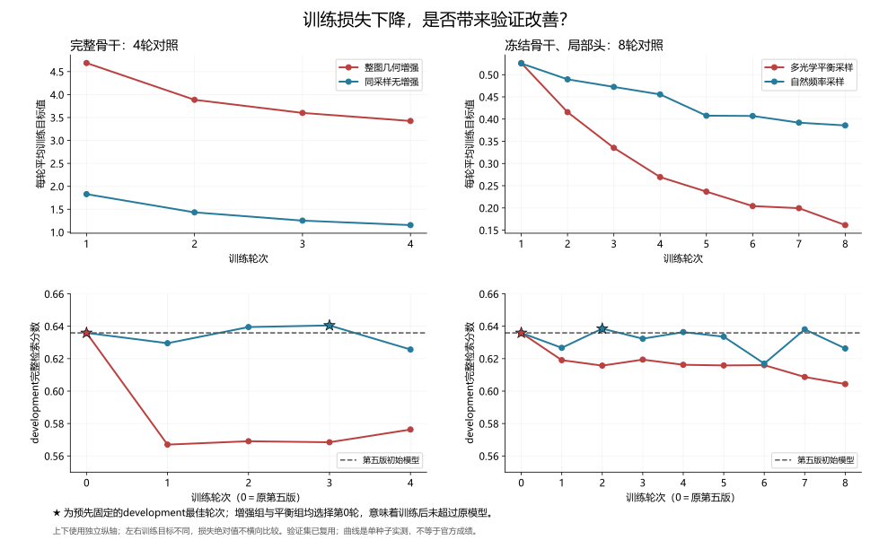

# 转向额外光学观测的跨模态识别

2026-10-09。用户同意转换思路：不继续扩大已阴性的尾序、关系图和无增强后段微调。官方最好第五版0.7185908013668432。此前native条件诊断中27张缺图库副本查询占22.5%、贡献约56%误配；必须重新检查第五版的该组，而不能默认误差结构仍相同。

## 假设与边界

原TransOSS骨干训练只做随机水平翻转；上一轮前缀缓存后段训练不做增强、不能更新两个stem与前3层。新实验从同一原生最佳骨干与第五版头起步，使用完整训练图像，更新双stem、模态/位置嵌入、12层和final norm。分类头/BN与原CLS配对头冻结，作为既有特征约束；局部判别器可训练。两组都开启原DropPath。

每个训练身份取2张光学和1张SAR；有多个光学观测时两张无放回选择，只有一张时复制为两个输入。第一光学保留原图，第二光学在实验组独立做D4旋转/翻转、1/0.875/0.75缩小和完整画布内随机位置，新增边框填图像边缘中位颜色，SAR保持原图。无增强对照输入同样的3张源图、消耗相同增强计划RNG但不应用变换。没有裁切船体或辐射噪声增强。

这些是合成二维变换，不能生成真正的新相机视角、海况或SAR成像几何。此轮检验朝向、比例和位置的鲁棒性；不把数据复制称为新增独立观测。不会修改公开测试图、生成隐藏身份标签或把验证身份加入训练。

## 预先固定的对照

种子20261010、增强计划种子20261011，同一训练身份CLS均值难组，每批16个不同身份、48张图，每轮177步，上限4轮。骨干AdamW1e-5、局部头AdamW1e-4、weight decay0.01；目标保持双向配对CE＋0.5局部独立CE＋0.5冻结分类头身份CE。每张光学视图分别组成16×16双向CE，再等权平均；同身份第二视图不会被当负样本，也不能靠easy-positive的logsumexp掩盖难视图失败。

每轮完整原development选严格最佳，含第0轮；原生前50候选/O2O、条件集合尾序与桥接固定。完成后独立复算全体、复用报告半组及40个既有共同身份条件场景，并分开统计27张额外光学与93张源光学配对准确率。只在完整检索或条件均分至少增加0.03、报告与另一指标退步不超过0.005，且困难组绝对准确率增加至少0.05、其余93组退步不超过0.01时扩大第二种子；门槛仅作研究筛选，非官方预测。

用原生模块引用与逐层activation checkpoint控制本地16GB内存，[PyTorch说明](https://docs.pytorch.org/docs/2.12/checkpoint.html)的use_reentrant=False模式用于训练；vendor文件不改。原始CLS、第6层fp16节点及完整第五版配对矩阵在第0轮全量精确核对；分类/全局头不变，最佳checkpoint重载和矩阵重复推理核对。快照绑定执行代码和协议。

## 实现核验与最终结果

4项CPU测试已通过：整图D4、缩小后的完整画布范围、计划可重放/非法值拒绝、两视图都受到识别监督、checkpoint前向一致且两个stem梯度非零。真实GPU两步检查与两组完整4轮训练均已完成，没有使用付费算力或提交。

第五版分组复核：额外27光学配对准确率0.475926、源93光学0.926613，额外组贡献0.674613误配；原native分别0.429630/0.868011、误配份额0.556459。新增分组统计时原8组完整排名标量和40个native控制通过，原全部方法40场景分数和正确对数精确复现；报告另存observation-baseline.json，不覆盖历史verification。

真实GPU两步检查已通过：1,483验证图native CLS和节点、550k第五版成本初始重放均精确一致；两个stem与首层收到非零有限梯度，分类/全局头不变，最佳重载矩阵精确重复。耗时50.89秒、峰值allocated2,574MiB；仅两步且选择epoch0，因此不报告为新模型收益。第一次检查在GPU中位数运算因确定性限制中止、零优化器更新；随后用稳定排序取得同一低位中位数，确定性要求保持，两步重跑成功。

| 组别 | 最佳轮次 | 全体验证 | 复用报告组 | 条件场景均分 | 困难27组配对准确率 |
|---|---:|---:|---:|---:|---:|
| 原第五版 | 0 | 0.645383 | 0.653146 | 0.834800 | 47.59% |
| 整图几何增强 | 0 | 0.645383 | 0.653146 | 0.834800 | 47.59% |
| 同采样无增强 | 3 | 0.638344 | 0.634407 | 0.835235 | 49.17% |

增强组训练损失4.688→3.424，但训练后的development分数均低于原第五版；按预先固定的选择规则退回第0轮。无增强组development选择第3轮，但全体和报告组回退，条件收益仅0.000435。两个组均不通过显著筛选，不扩大第二种子。共708步/组，采样与增强计划摘要一致；两模型重载、完整排名独立评分与80个native控制已核验。原始汇总见[证据](evidence/2026-10-09-observation-invariance.json)。

左列为本章对照，右列为[真实观测暴露对照](31-real-observation-exposure.md)。损失与验证使用独立纵轴，左右目标不同，不横向比较损失绝对值。星形标记是development最佳轮次，不是另一份独立验证。

## 同时检查真实第二观测的识别信息

合成变换不等于新拍摄视角，额外检查直接利用既有光学图库观测。对缺源副本的27张查询，沿用原native O2O首选作第二观测；其余93张使用自己的公开源副本。用第五版完整验证配对银行分别计算原查询与SAR、第二观测与SAR的学习式分数，固定等权平均。只改变查询配对成本，尾序/桥接/O2O仍固定。

这与此前仅用native/joint余弦和第二观测的实验不同，检验已实测有效的局部头能否更充分识别第二观测。预先固定等权与仅代理两个版本，不扫描权重；另保留native及native等权第二观测控制。只评估既有40条件场景，困难组/源93组分别统计。若至少+0.03条件分、困难组准确率至少+0.05且源93组不退超过0.01，再用另一原局部头种子检查复现。代理是否同身份只用于验证诊断，不用于选代理。无GPU或公开测试推理。

09头先导已完成：等权第二观测条件分0.847566（+0.012766），困难27组54.72%；仅代理0.839475（+0.004675）。没有达到+0.03门槛，停止扩大。随后[第31章](31-real-observation-exposure.md)发现条件组的身份选择混杂：困难27组强制来自多光学身份，不能把差异单独归因于额外视角。数值图、条件身份簇区间与真实验证案例见[第32章](32-visual-observation-analysis.md)。
