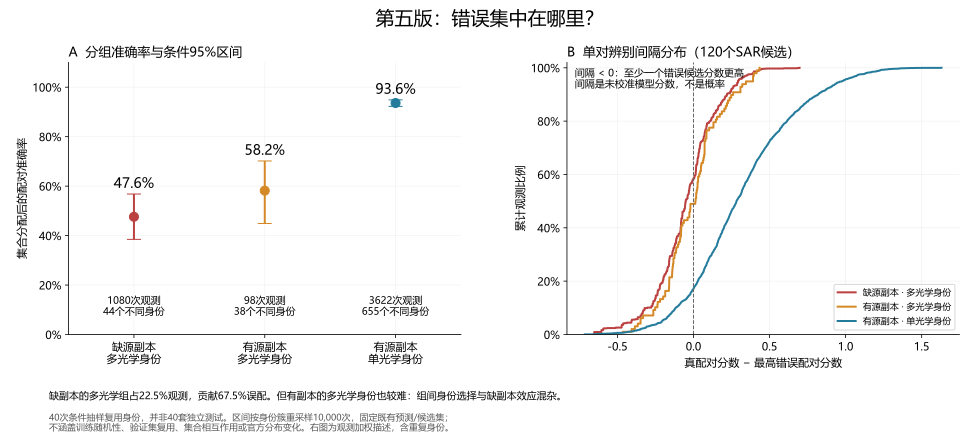

# 用图检验错误结构、训练行为与实际错配

2026-10-09。用户指出此前研究缺少科学分析图。本章从已完成实验重新生成可复核图像，补充对现有结论的检验。没有启动训练、读取测试图像、生成预测或提交；官方最好仍为第五版0.7185908013668432。

## 分组误差与不确定性



用原第五版成本重建40个既有条件场景，各场景120个共同身份；所有正确配对数量与历史报告精确一致。配对准确率与比赛检索分数不同，图中的百分比不能换算成官方成绩。

| 条件组 | 累计观测 | 不同身份 | 准确率 | 固定预测下身份簇95%区间 |
|---|---:|---:|---:|---:|
| 缺源副本、多光学身份 | 1,080 | 44 | 47.59% | 38.46%–56.80% |
| 有源副本、多光学身份 | 98 | 38 | 58.16% | 44.87%–70.18% |
| 有源副本、单光学身份 | 3,622 | 655 | 93.59% | 92.25%–94.85% |

40次抽样反复出现同一身份。区间按身份簇重采样10,000次，种子20261009，一个身份在不同场景和分组中的所有记录一起保留。它只描述固定模型、固定候选集下身份组合的不确定性，没有重跑全局分配，不包含集合相互作用、训练随机性、验证复用或官方分布变化；不是总体置信度或预计提分区间。

困难27组占22.5%观测、贡献67.46%误配。但有副本多光学组也较难，且两个多光学组区间重叠。条件生成器强制27组来自多光学身份，另外93个身份主要单光学。现有证据支持研究多光学身份的困难结构，尚不能单独证明缺副本或额外视角是低准确率原因。

右图的单对间隔为真SAR成本减最高错误SAR成本，候选为每个120集合；成本是未校准模型分数。缺副本多光学组58.52%的观测为负间隔，有副本多光学48.98%，单光学17.12%。累计分布为重复观测加权描述，不能当独立样本的显著性检验。

## 单对识别错误与全局分配错误

仅改变决策规则：在同一120候选中比较第五版逐查询argmax与原全局一对一分配。原特征、成本和候选不变。

| 条件组 | 单对首选准确率 | 全局分配准确率 | 原错→正确 | 原正确→错 |
|---|---:|---:|---:|---:|
| 缺源副本、多光学 | 41.48% | 47.59% | 154 | 88 |
| 有源副本、多光学 | 51.02% | 58.16% | 14 | 7 |
| 有源副本、单光学 | 82.88% | 93.59% | 452 | 64 |

全局分配累计救回620次、改错159次，净增加461/4,800＝9.60个百分点。分配后839次误配中159次原单对首选正确，其余680次单对首选已经错误。说明需要区分两个问题；取消分配会丢掉更多正确配对。159次也不是可自动恢复的收益上限：测试中未知哪些首选正确，改变一个分配会影响其他查询；这些数字不是官方分数。

## 训练目标与检索表现的脱节


完整骨干的几何增强损失4.688→3.424，训练后development分数约0.567–0.576，初始0.635904；平衡采样局部头损失0.526→0.161，末轮development0.604346。两组都按预先固定的development完整检索选择回到第0轮。无增强与自然采样分别选第3/2轮，但没有稳定显著收益。

这些单种子曲线能说明本轮目标下降没有转换成检索改善，不能区分过拟合、训练/推理目标差异、表征漂移等机制，也不能证明某个方向普遍无效。左右训练目标不同，损失值不横向比较。细节见[完整骨干对照](30-observation-invariance.md)和[真实观测暴露对照](31-real-observation-exposure.md)。

## 真实图像案例

原始光学/SAR图只保存在Git忽略的`local/research-figures/2026-10-09/private-validation-cases.png`。固定条件种子20261007，按图像ID字典序选择前两个困难错误、一个困难正确、一个单光学错误；选择规则和真实ID另存private-case-selection.json。未裁切、调亮或叠加解释性热图。第二列同身份另一光学由验证标签选择，只用于诊断，不能成为测试推理输入。

案例A真SAR单对排名第1、成本0.643，但全局分配到成本0.481的错误SAR；案例B真SAR排第10、成本0.174，错误分配成本0.495。这两个案例直观区分了分配牺牲与单对辨别失败。C为正确对照，D为单光学身份错误。仅四个确定性选例，不代表总体比例；不能凭外观看出多观测组总体的成像来源或数据标签质量。

## 对后续研究的约束

后续[像素干预研究](33-pixel-interventions.md)进一步发现全部多光学图属于黑边处理域，单光学同域也较难；训练集有同样结构。图像处理方式又是一项混杂，不能继续只围绕观测数量解释困难。

下一项应围绕明确错误类型设假设，先画正负分数/间隔和正确→错误迁移，再设计对照。既有一对一分配有明显净收益，不能因个别错配取消；多光学身份表现较弱，但身份池与观测角色混杂，需要另行控制。简单继续几何增强、增加采样或延长同目标训练没有本轮大幅信号，因此不扩大这些配置。

每个新实验保存逐轮曲线、成对损益、身份样本量与预先固定的验证案例；条件区间必须说明覆盖哪些不确定性。继续保持显著收益筛选，不能用漂亮图像代替独立证据。

## 复现与绑定

```powershell
python tools/plot_observation_research.py --output-dir local/research-figures/2026-10-09
```

需要既有NumPy、Matplotlib、Pillow及验证缓存；Windows图像字体为微软雅黑，未安装时使用Matplotlib默认字体。脚本拒绝向local之外输出带真实像素的案例。每张图保存PNG和SVG，匿名统计保存anonymous-figure-data.json，绑定脚本/身份划分/第五版成本/两份实验汇总的SHA256。公开文档只保留两张无身份编号、无原始像素的统计SVG与[匿名证据](evidence/2026-10-09-visual-observation-analysis.json)。
