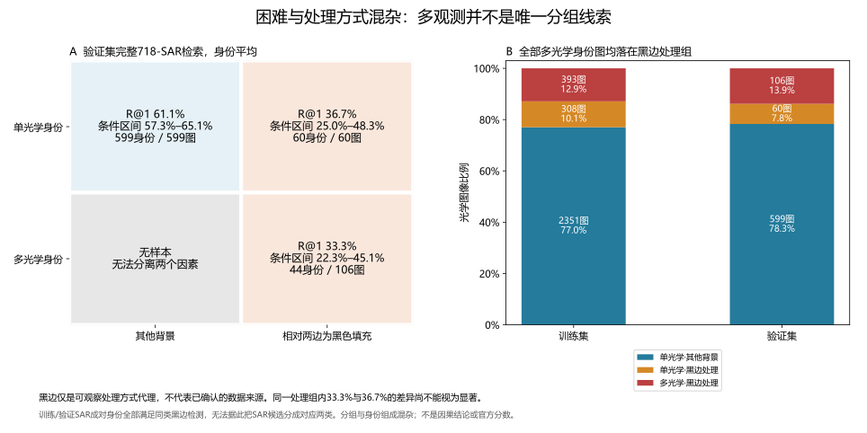
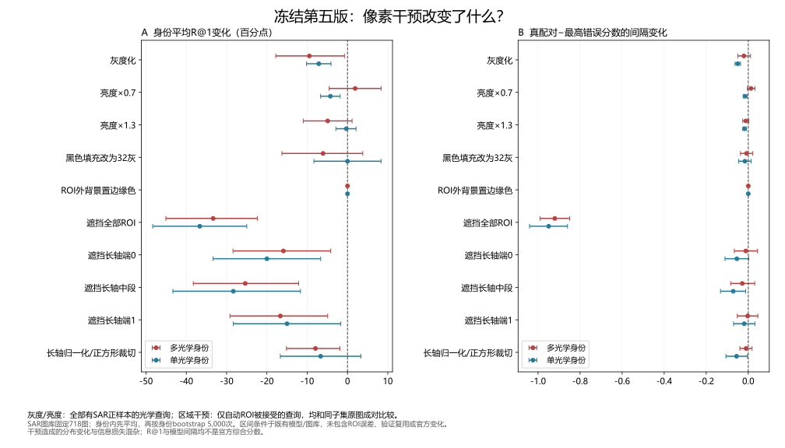

# 像素干预：处理方式混杂与局部匹配器的分组差异

2026-10-09。对“模型是否依赖颜色/背景，船体结构对齐是否值得研究”做冻结第五版诊断。全部765张验证光学查询、718张固定验证SAR候选；没有短名单重选、训练更新、公开测试访问或提交。下文为身份平均完整图库R@1/R@10和模型间隔，与前章120个条件候选、比赛综合指标均不同。官方最好仍为0.7185908013668432。

## 更具体的混杂：多观测身份全部属于黑边处理图

检测规则仅用像素：左右或上下相对两个边缘中至少98%的像素，RGB最大通道值不超过8。它是可观察的黑色填充/处理方式代理，没有确认真实来源。

| 验证分组 | 图像 / 身份 | 身份平均R@1 | 条件身份区间 | R@10 |
|---|---:|---:|---:|---:|
| 单光学、其他背景 | 599 / 599 | 61.10% | 57.26%–65.11% | 94.32% |
| 单光学、黑边处理 | 60 / 60 | 36.67% | 25.00%–48.33% | 81.67% |
| 多光学、黑边处理 | 106 / 44 | 33.33% | 22.35%–45.08% | 86.74% |
| 多光学、其他背景 | 0 / 0 | 无样本 | — | — |

训练集也有同样结构：2,351个单光学身份为其他背景，308个单光学身份为黑边处理，160个多光学身份的393张光学图全部黑边处理。黑边域共有468个训练身份，不只是此前平衡采样的160个多光学身份。

同处理组中的33.33%与36.67%区间高度重叠，而单光学不同处理组差异很大。这进一步削弱“因为多观测或新视角所以困难”的单因素解释。身份、裁切、图像来源、分辨率等仍混杂，不能认定黑边本身造成困难。没有多光学其他背景对照，不能分离两个因素。

训练/验证成对身份的所有SAR都通过该黑边检测，因此这个可见属性不能把SAR候选拆成与两类光学一一对应的图库，更不能从中推出隐藏身份泄露规则。

## 冻结干预的设计与区域质量检查

原始图不变的对照必须精确重放已有765×718第五版矩阵。每项只改光学输入；所有未改SAR的CLS和节点逐元素不变。灰度化使用固定RGB亮度系数，亮度乘0.7或1.3后量化/截断。区域干预包括改黑色填充为32灰、ROI外置边缘中位色、遮全部ROI或长轴三段、长轴旋转归一化后保纵横比裁切到正方形。

初版通用边缘RGB对比/最大连通区域在真实叠加图上将港口和亮斑当船体，未运行GPU评分。第二版要求整体边框干净，只接受2张图。最终在任何模型评分前收窄到相对两边为黑色填充的图；取最大8连通非黑内容（覆盖非黑支持至少90%），再用PCA长轴和完整范围加8/6像素余量形成矩形，限制面积/细长度。接受166张，恰好为60张单光学和106张多光学处理图。

这些矩形是处理后的内容条带，可能包含海面，不是真实船体分割；长轴端0/端1没有船艏、船艉标签。区域规则在验证像素上做过可视化QA修订，因此区间不含区域选择误差。v1/v2材料保留在local，不能将它们的“接受”数量当语义分割质量。

## 干预结果

先在身份内平均全部光学图，再对身份平均差值；按同一身份成对bootstrap 5,000次。光度干预使用全部配对查询；区域干预仅使用接受ROI的黑边组，并对同一子集原图比较。单光学列的两个分母分别是659和60，不能直接横向当同一人群。

| 干预 | 单光学R@1变化 | 多光学R@1变化 | 解释范围 |
|---|---:|---:|---|
| 灰度化 | −7.13个百分点 | −9.47个百分点 | 全体光学；不支持直接去颜色 |
| 亮度×0.7 | −4.25个百分点 | +1.89个百分点 | 多光学增量区间跨零，没有显著信号 |
| 亮度×1.3 | −0.30个百分点 | −4.92个百分点 | 全体光学；无稳定改善 |
| 黑色填充改32灰 | 0.00个百分点 | −6.06个百分点 | 仅处理图；不能将分布变化当捷径证明 |
| ROI外置边缘色 | 0.00个百分点 | 0.00个百分点 | 近乎空干预，见下文 |
| 遮全部ROI | −36.67个百分点 | −33.33个百分点 | 黑边组原R@1全部丢失 |
| 遮长轴端0 | −20.00个百分点 | −15.91个百分点 | 处理后内容ROI，不是标注船艏 |
| 遮长轴中段 | −28.33个百分点 | −25.38个百分点 | 描述性破坏最大，尚未做段间显著性检验 |
| 遮长轴端1 | −15.00个百分点 | −16.67个百分点 | 处理后内容ROI，不是标注船艉 |
| 长轴归一化/正方形裁切 | −6.67个百分点 | −7.95个百分点 | 不支持直接修改输入几何 |

必须注意负控制：ROI外置边缘色对60张单光学是完全空操作；106张多光学里104张也完全不变，平均仅0.0174%像素变化。因此“准确率不变”不能说明自然背景无用；当前区域分析没有覆盖其他背景599图。

## 已有局部头的收益并不均匀

固定同一完整SAR图库，不改变成本，只比较三个已有模型：

| 模型 | 单光学其他背景R@1 | 单光学黑边R@1 | 多光学黑边R@1 |
|---|---:|---:|---:|
| 原native余弦 | 49.42% | 31.67% | 30.68% |
| 原CLS配对头09 | 50.92% | 31.67% | 37.88% |
| 第五版局部头09 | 61.10% | 36.67% | 33.33% |

第五版局部头相对CLS头改善主要来自其他背景；黑边多光学组的R@1反而下降4.55个百分点。但其R@10为86.74%，大多数真身份尚在前十，值得针对细粒度候选辨别和排序做新实验。这是分组诊断，未给出新独立数据上的差值区间，也不能据此选择一个按验证身份数门控的模型：测试身份的光学观测数未知，可见黑边门控也会同时覆盖308个训练单光学处理身份。

## 实际等面积遮挡图

四个此前固定案例A–D每次遮挡一个64×64区域，替换成该图边缘中位色；以同一718-SAR图库中“最高真分数−最高错误分数”的变化画4×4热图，文件为local/visual-interventions/v4/private-spatial-sensitivity.png。

A、C的有效位置集中在主体内容条带；黑色空区遮挡基本是空操作。B的内容格子多数为蓝色：遮后负间隔改善，提示其内容正在支持错误候选，而不能解释为“模型不看船体”。D的不同部位影响有正有负。四例只用于机制展示，没有代表总体比例。

重复案例原图在同一批次的结果完全相同；与原完整矩阵的最大绝对漂移2.645×10⁻⁷，来自推理批次/float32舍入量级，远小于这些热图约0.1–0.37的变化。全验证原矩阵仍逐元素精确重放，不能将两个检查混为一谈。

## 下一项可证伪实验

优先假设：同一局部头对两类光学处理方式的空间表征适配不足。先在处理域的468个训练身份上设计对照，保留原图和CLS：原4×4局部聚合控制，对比细粒度tokens沿内容长轴的8×2聚合；节点数同为16，匹配器容量、负样本、更新数和选择规则保持。以可见像素属性决定适用域，不使用测试身份标签或观测数量门控。

先检查SAR自动区域的覆盖与实际质量，再决定是否能使用对应长轴坐标。SAR负样本仍需覆盖全部训练身份，防止只在468个同域SAR上学会较容易的子问题。任何新的专家成本都要在完整O2S/S2O与集合分配中验证，不能承诺原其他背景排名不变：改变一部分光学成本也会改变SAR反向检索和全局分配。

本章完成时这一项尚未实现或训练；后续三组匹配对照、固定融合及负面结果见[第34章](34-domain-axial-matching.md)。预先固定development选模和报告复核，保留显著收益门槛；本轮没有支持直接灰度化、改填充或输入裁切的可提交候选。

## 复现与核验

入口为tools/study_visual_interventions.py，先用--prepare-only生成新目录、检查ROI叠加图，再用tools/run_job.py持local/local-gpu/gpu.lock运行冻结GPU诊断。随后study_processing_population.py --run-dir 实验目录生成训练/验证处理分组，verify_visual_interventions.py --run-dir 实验目录独立复算矩阵与像素变化，plot_visual_interventions.py --run-dir 实验目录绘制匿名统计和私有像素图。完整数值与协议见[匿名证据](evidence/2026-10-09-pixel-interventions.json)。

10份保存矩阵用独立标量排序复算每张图的R@1、R@10、间隔及身份平均差，全部一致；源快照与协议绑定通过。4项区域/遮挡CPU测试和静态检查通过。成功GPU任务112.8秒、峰值allocated805MiB，无优化器或付费算力，任务结束后无GPU计算进程。此前一次准备运行因反复解压整个掩码缓存中止，修正为一次读取数组后重跑；没有产生模型结果，旧manifest标记interrupted。

私有像素、真实图像ID、逐查询分数和区域掩码全部留在Git忽略的local。文档仅保存匿名统计SVG。区间条件于既有模型和图库，未覆盖验证复用、训练随机性、区域选择/分割误差及官方分布变化。
