# 处理域专家与沿轴局部匹配

2026-10-09。用户授权继续自主研究显著提分；本轮使用本地16GB GPU，不启用付费实例，不生成或上传提交。官方最好为第五版0.7185908013668432。

## 评分前固定的研究设计

先用既有像素规则审查全部训练/验证图像的区域覆盖和实际质量。区域是非黑内容条带而非船体标注，不按验证身份或成绩修改区域阈值。若SAR定位不能可靠覆盖，采用光学单侧沿轴聚合、SAR保留原4×4节点；不得把失败定位强行当物理对应。

低成本筛选包含：原4×4普通采样的继续训练控制；原4×4处理域专家；沿轴8×2处理域专家。冻结同一TransOSS骨干与CLS配对头，从同种子已有第五版局部头初始化；沿轴组仅改变局部节点的聚合和对应距离，不改变图像输入或CLS。处理域由公开像素检测，不用身份观测数量。SAR困难负样本覆盖全部训练身份。

先导种子20261009，固定24轮、每2轮development原完整检索综合分选模，包含第0轮。三组使用同一优化器AdamW、局部参数lr1e-4、weight decay0.01、11候选CE与0.5局部独立辅助CE、每轮相同89次更新。控制从全部成对身份均匀抽取；专家从处理域成对身份抽取，反向候选可以来自全部光学域，非处理光学的分数由冻结旧头提供，保持推理门控一致。前向SAR负样本来自全部训练SAR。专家部署时仅替换黑边光学行，但可能影响SAR反向排序与全局分配。

以原development独立检索选模，随后复核完整检索、复用报告组、40个固定共同身份条件集合、处理域首位/前十命中率和正确/错误迁移。门槛沿用显著收益筛选：完整检索或条件集合至少+0.03，另一项和报告组退步不得超过0.005，才扩第二种子20261008；大幅潜力必须由第二种子确认，不能根据单个较好的组事后改选择规则。沿轴第0轮的分布变化单独报告；不能将改变输入表示后的初值称为旧模型精确重放。

第0轮原4×4控制必须精确重放原同种子矩阵。所有组保存采样摘要、源快照、逐轮曲线、模型重载、独立评分检查及失败运行。验证身份此前反复使用；这些结果只作方法筛选，不是独立泛化证明或官方分数预测。

若低成本筛选不出现信号，不直接叠加结构损失、模态对齐与完整骨干训练；先定位失败是区域无效、沿轴表征变化、样本不足还是配对分数漂移。结构约束下一阶段需要新的对照设计，尚无结果。

## 训练后追加的互补性检查

三组已完成24轮：控制完整0.642111、域专家0.652251、沿轴专家0.647397，相对第五版0.645383均未跨过显著收益门槛。域专家的单/多光学黑边R@1为30.0%/40.15%，沿轴为41.67%/32.95%，呈相反描述性变化；成对身份区间均跨零。为检验这种差异是否有互补价值，只追加一次两个选中专家成本的固定等权平均，不扫描权重、域阈值或轮次。该项在看过三组结果后提出，属于探索性检查，不作独立确认。检查相同完整检索与40场景联合配对，仍沿用+0.03门槛；没有明显信号就结束这一轮低成本路线。

## 区域质量与实际聚合

像素区域审核覆盖7,409张训练/验证图。光学接受训练696/3,052、验证166/765；SAR接受训练2,364/2,874、验证577/718。按公开图像ID排序，分别保存两模态/两划分的接受和拒绝图叠加板并人工查看：接受SAR大多覆盖主体，拒绝样本包含散射碎片，不能把这些矩形称精确船体分割。

原始256×256图不旋转、不裁切，第6层16×16原tokens按内容长轴8×2分区、每区3×3样点双线性插值后平均。减去原全图token均值并归一化，与旧缓存相同float16特征量化后存储；失败区域使用原4×4特征。每个区域附加相对坐标，两个模态分别计算自身距离矩阵后进行关系读出；专家与原头的训练参数数量相同。匹配对节点和坐标的联合置换不变，因此长轴端点反向无需手工船艏标签。相对坐标及混合网格属于设计假设，并非真实物理配准。

7,409张原CLS和4×4节点逐元素精确重放，骨干检查点未改变；训练/验证缓存和区域文件均绑定来源摘要。新缓存只改变局部组织，未增加原图可用像素或骨干知识。

## 结果与明确取舍

| 方法 | 选中轮次 | 完整本地检索 | 相对第五版 | 40场景联合分 | 相对第五版 | 复用报告组 |
|---|---:|---:|---:|---:|---:|---:|
| 第五版原头 | 原10 | 0.645383 | — | 0.834800 | — | 0.653146 |
| 普通采样继续训练 | 4 | 0.642111 | −0.003271 | 0.836210 | +0.001410 | 0.644111 |
| 原4×4处理域专家 | 12 | 0.652251 | +0.006869 | 0.836782 | +0.001982 | 0.658651 |
| 沿轴8×2处理域专家 | 4 | 0.647397 | +0.002015 | 0.838511 | +0.003710 | 0.657031 |
| 两专家固定等权平均，探索性 | 固定前两专家 | 0.652977 | +0.007594 | 0.842592 | +0.007792 | 0.657338 |

三训练组各24轮/2,136步，域/沿轴的24份样本摘要完全一致，三组更新次数完全一致。第0轮网格组精确重放原分数；沿轴初值的development从0.635904降到0.626323，单光学黑边R@10从81.67%降到68.33%，多光学黑边86.74%降到63.64%，说明直接聚合变换首先破坏了已有判别器的输入分布。训练后多光学R@10恢复86.74%，R@1仍约32.95%，并未解决其首位辨别。不能只看损失1.237→0.096便宣称模型改善。

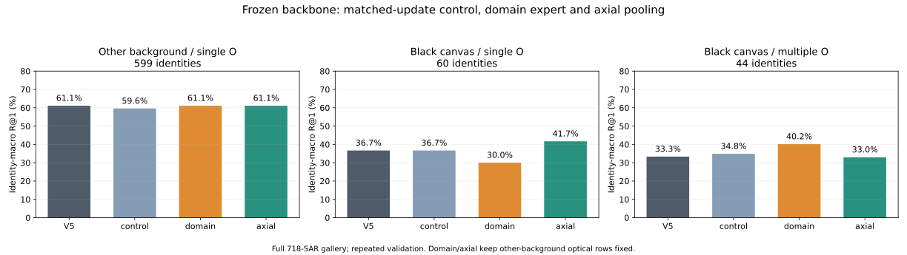

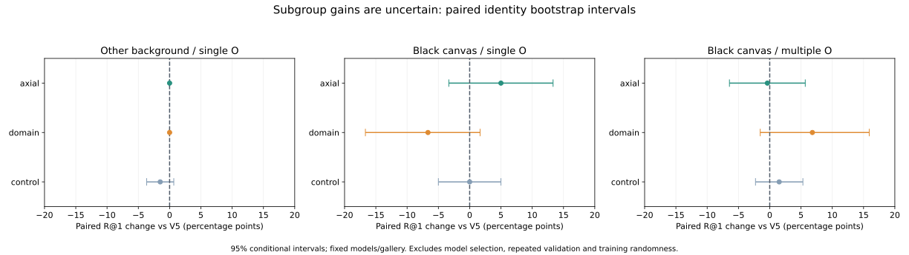

同一黑边域内部出现相反描述性响应：域专家对多光学+6.82个百分点、单光学−6.67；沿轴对单光学+5.00、多光学−0.38。全部新分组R@1差值的条件区间跨零，不能确认普遍改善，也不能事后用测试身份的观测数量选择模型。黑边是粗分组代理，尚不足以定义统一困难机制。

作为训练后诊断，134张处理光学至少一个真SAR接受区域，在90身份上的R@1从36.30%到39.07%；其余32张/14身份从28.57%到30.95%。这些小样本、复用标签的描述不足以归因，但未显示“只要SAR区域有效就有大幅收益”。原始像素、真实ID和逐查询结果留在local。

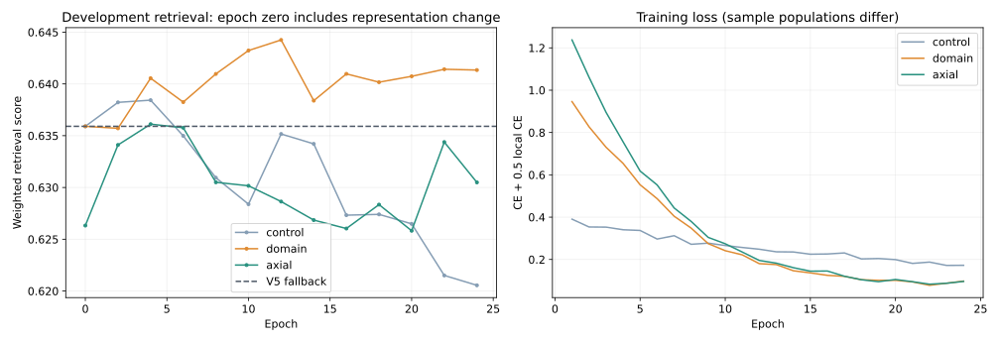

所有组都未跨+0.03筛选门槛，**不扩第二种子、不生成新提交，停止当前冻结特征/域门控/8×2配置的扩大。** 本轮没有证明其他沿轴方法或结构训练无效。此前提出的骨干中层结构约束尚未实现或训练；用户要求先找到有更强证据的方向后，停止将它列为下一项主攻。

## 主攻方向证据重审，2026-10-09

本轮重新查阅公开方法、代码、复现反馈和原生训练配置，**仍未找到可以高信心支持大幅比赛提分的新方案**。先前给出的20%–30%成功概率是未经校准的主观判断，不能用作投入依据。没有启动新训练、下载新权重、生成或上传预测。

[SDF-Net论文v2的同配置消融表III](https://arxiv.org/html/2603.12588v2)比主表更适合判断结构约束的独立价值：单加SCL，O2S R1从32.3%到32.3%，S2O从38.8%到37.3%；完整模型的S2O R1也为38.8%。这不能证明本题无效，但不支持把SCL当作有把握的大幅首位提分机制。

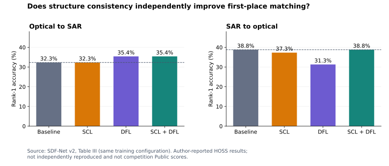

[MOS作者仓库](https://github.com/yjzhao1019/MOS)提供代码和识别权重，但伪SAR样本于2026年9月发布，不能沿用作本题截止日前资源。[公开复现报告#5](https://github.com/yjzhao1019/MOS/issues/5)称S2O R1为40.3%，低于论文46.3%；这是单个使用者报告，本轮未独立复现，不能认定论文错误。生成权重的[请求#4](https://github.com/yjzhao1019/MOS/issues/4)也未显示解决记录。MOS目前不构成现成、完整且已在本题验证的强基线。

[TransOSS作者配置](https://github.com/Alioth2000/Hoss-ReID/blob/bd9b9028e8690c0929ada06beead500acde19aca/configs/hoss_transoss.yml)的基础SGD学习率同为0.0005，标签平滑关闭，CE加无margin triplet与当前主训练一致。输入形状、四实例采样、增强、偏置学习率和调度存在差别，值得核对；尚无实测证明补齐这些差别能大涨。没有找到可以直接归因为“基础学习率设错”的缺陷。

目前最强的大幅收益证据仍是同一TransOSS上的查询集合配对：第三到第四版官方+0.155507，随后局部学习配对第四到第五版+0.048676。这证明已经实施的两次改变有效，不证明任意后续配对模块仍会有相同收益，也没有查到0.9队伍方法的可核验公开说明。高召回与标签oracle只说明候选排序的潜在空间，不能证明这些错误存在模型可提取的身份线索。

新的主攻候选需先有可复查的机制信号或适用的强基线，然后跨既定显著收益门槛，再用另一训练种子确认；不得以单个最好的本地分数、论文主表或验证标签oracle替代。外部权重还需核实确切公开日期、许可和训练身份交叠。当前不指定另一项低证据模块接替SCL。

## 延续调查：训练身份参照、形态与细像素，2026-10-09

在停止SCL主攻后，继续寻找原第五版尚未利用的判别信息。新增三项CPU对照，没有新增GPU/付费算力或提交。全部标签拟合只使用训练身份；验证仍是反复复用的原留出集，不属于独立确认。

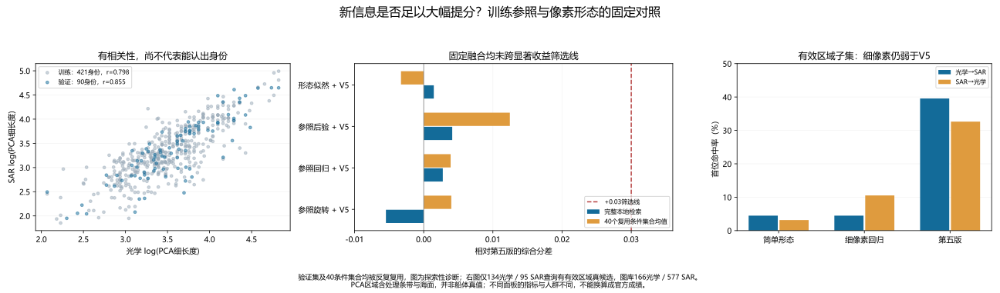

第一项用2,819个已知训练身份的光学/SAR原生CLS原型作参照，分别拟合中心化正交旋转、双向ridge映射和温度0.07的共享身份后验。每项再做一次固定等权融合：完整可见验证分数库的均值/标准差归一化后与V5平均，没有权重搜索；这是依赖可见候选集合的探索性缩放。三种单模型完整分0.566861/0.575778/0.460048，均弱于V5的0.645383。最佳固定融合为后验参照，完整0.649508，40个原条件集合0.847253，分别比V5增加0.004125/0.012453；复用报告组0.653655。它没有跨既定+0.03筛选线，不扩训练或生成提交。独立标量评分、40个原native控制和V5排名精确重放全部通过。验证工具的mean_gain和bootstrap字段以native为基准，不能当作相对V5的新增收益。

第二项检查PCA细长度，按身份平均log值：有效区域训练421身份相关系数0.798，验证90身份0.855。这是处理内容条带的形态相关，不是真船长，也不是身份准确率。只在421训练身份的644观测对上拟合二维形态（log细长度、log连通面积）的联合/模态独立Gaussian似然比，身份等权，固定1%对角收缩；加到V5原logit（保存成本为logit/20）。完整分仅0.646844（+0.001461），40集合0.831520（−0.003280）。完整O2S首位救回3张、改错4张；S2O救回5张、改错1张。没有调融合权重。

第三项进一步提取有效区域的32×8强度/梯度/非黑支持条带，训练正对仅按支持掩码选择180度方向、同时增广双向，拟合固定正则双向ridge。验证候选为全部有效区域166光学/577 SAR；134光学、95 SAR查询至少有一个有效区域真候选。细像素回归的O2S/S2O首位命中为4.48%/10.53%，简单形态4.48%/3.16%，同条件V5为39.55%/32.63%。V5在该候选库的成对AUC虽为0.9929，首位仍不高，说明大量容易负对的AUC不能替代最相似候选的身份辨别。没有将部分区域结果当作整体检索或官方分。

本轮否决的是这几个固定配置，不能推断更强像素配准或所有训练参照方法无效。公开论文线索另外核查了[DRI](https://github.com/TingfengXian/DRI)：其辅助物理尺寸在本题不可直接取得，仓库仍未提供完整训练/权重，暂不列为已可用强基线。[Phy-OSShip-MS作者仓库](https://github.com/lilili0612/Phy-OSShip-MS-Dataset)固定46e2061f，日期2026-02-12，含少量合成场景样本、未含完整生成代码；README列CC BY-NC与实际MIT LICENSE存在差异，源数据许可需分别核对。只检查两对样本的外观不足以确认比赛数据来源，没有将其检测论文的提升换算成ReID收益。

工具为study_training_reference.py、study_geometry_likelihood.py、study_pixel_profiles.py和plot_reference_geometry_screen.py；两个完整屏幕用study_pair_verifier.py独立复算。所有新增工具格式/静态检查通过。参照矩阵格式化后在screen-v2重跑并核验；图已逐像素查看。私有模型/条带/成本/真实ID保留local，公开文档只保存匿名SVG与[来源绑定记录](evidence/2026-10-09-reference-geometry-screen.json)。

## 新的来源事实：245张训练光学逐像素复现HOSS，2026-10-10

继续核查数据来源，读取作者[HOSS公开归档](https://zenodo.org/records/15860212)版本15860212，记录日期2025-07-11、数据许可CC-BY-4.0。83MB归档MD5与作者发布值fc9d603e633235e1271a451f903a05fa完全一致，SHA-256为49c9c81d017c7d5a937a8237f4ae92ad4a314ad7bb19eaeb9c4a4c52216d8955。

审查只读取外部bounding_box_train内的RGB像素，对比本项目固定划分的train_images中3,052张光学图；没有读取HOSS query/test图、本题验证或测试图，也没有传递外部身份标签到预测。先对字典序前64张公开训练光学做非黑裁切/D4/缩略图候选检索，31张相关超过0.995。原图QA确认复用候选后，在第一对训练候选上恢复了处理算子：RGB，长边缩至256，短边四舍五入，PIL双线性，黑色正方形画布整数居中。

将这个算子原样用于全部574张HOSS训练光学，**245张变换结果与本题训练图的196,608个RGB字节完全一致**，不是缩略图近似。245张均属于已定义的有效黑边区域，涉及114个HOSS训练身份与114个本题训练身份；同一个已匹配HOSS身份没有对应多个本题训练ID。这里的标签只用于已知训练数据一致性诊断，来源复用由精确像素证明。另用ImageOps.contain路径独立复现全部245对，逐数组比较通过。

这确认**部分困难黑边数据来自真实多时相HOSS**。[原作者论文](https://arxiv.org/html/2506.22027v1)说明该数据由Jilin-1光学与TY-MINISAR卫星采集，原SAR保存32位浮点，物理尺寸辅助由原裁切尺寸/GSD计算。当前结果没有证明其余451张黑边训练图的来源，没有证明其他背景数据是合成图，也没有确认测试源身份。更不能据此认定0.9队伍方法。

这项发现使后续强模型比较需要核查来源重叠：HOSS身份训练权重与比赛训练内容并非完全无关，换权重得到的漂亮本地分数可能包含源身份记忆；本轮没有检查本题验证/测试与这些权重的训练身份交叠，因此目前不能量化这一风险。仍未找到跨显著收益门槛的新方案。来源确证支持重新研究不同来源的表征误差，不能单独证明“全骨干源域专家”或外部权重会大涨；此前冻结域专家的小幅结果继续有效。

复现工具audit_hoss_training_pixels.py（前64候选）与audit_hoss_training_exact.py（全训练光学精确摘要）；只保存匿名[来源证据](evidence/2026-10-10-hoss-training-source.json)，原图、源文件名和对应训练ID保留local。全归档校验和、逐成员CRC、静态检查和两条图像复现路径已通过。全程无GPU训练、付费算力或提交。

## HOSS预处理复原及固定输入对照，2026-10-10

先只用已确认来源的训练对恢复SAR规则，再固定用于全部489张公开训练SAR：其中5张含负值（包括-9999及其他负值，疑似nodata与插值污染）排除，其余484张执行每源裁切p0.5/p99.5截断、线性缩放、np.rint到8位，再沿用光学双线性缩放/黑色画布。**151张与本题训练SAR的完整RGB像素精确一致，涉及113个源训练身份；151张均有光学来源对应，身份一致性冲突为0。** 另一进程用np.quantile、ImageOps.contain和独立PIL画布逐数组复现151张。来源审查始终限定双方训练图，没有读取外部query/test或本题验证/测试图来恢复规则。245张光学加151张SAR共396张不同模态训练图得到像素证据，不能外推剩余图的来源或转换。

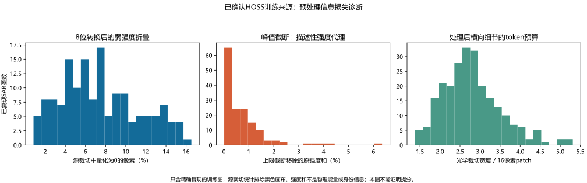

151张精确源SAR的裁切在8位转换后，零值像素占比中位6.99%，源浮点唯一值中位5,600降为227个8位值；超过上限的强度和占比中位4.56%，实际截断移除的超额强度和占比中位0.482%。后者不是电磁能量，也不量化身份信息。245张精确源光学的处理宽度中位44像素、画布内容占比17.19%，以16像素patch粗计约3列，原空间面积保留比例中位81.25%（放大者上限计1）。这些统计给出可检验的空间预算假设，不能单凭黑边占比认定模型主要依赖黑边。

随后在本地RTX4060Ti做冻结权重输入对照：完整V5成本矩阵逐元素精确重放后，固定三项方案，参数不扫描。裁切放大用对向边框98%近黑、全非零包围框细长度至少2/面积不超过45%的像素门控，将长轴放为纵向、双线性拉伸到128×256，再居中放回256方图。它覆盖验证166张光学/276张SAR，不使用源身份映射、船体标注或验证标签选择区域。只替换接受光学行的配对成本，其余行保持V5；SAR拒绝裁切者保持原图。另一项对全部SAR的现有8位值做平方根增强，不能恢复已被量化/截断的原值；第三项组合。没有原浮点测试输入、优化器步或新增模型训练。

| 固定输入 | 完整本地综合分 | 相对V5 | 40组共享身份联合分 | 相对V5 | 困难27观测配对正确率 |
|---|---:|---:|---:|---:|---:|
| V5精确重放 | 0.645383 | — | 0.834800 | — | 47.59% |
| SAR平方根增强 | 0.568495 | −0.076887 | 0.817368 | −0.017432 | 45.65% |
| 裁切放大，条件行 | 0.615425 | −0.029958 | 0.785819 | −0.048981 | 33.80% |
| 放大加平方根，条件行 | 0.614469 | −0.030914 | 0.776675 | −0.058125 | 31.48% |

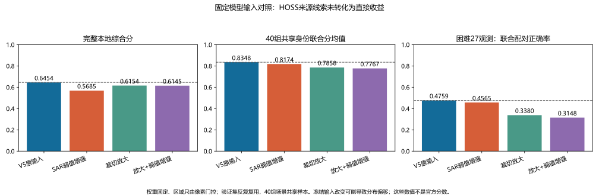

相对V5，裁切放大在40组里2组改善、38组下降；完整O2S首位救回14张、改错37张，S2O救回6张、改错29张。光学黑边单图身份宏R1从36.67%到20.00%，多图从33.33%到19.32%。平方根使多光学黑边宏R1增加2.65个百分点，但其他背景单图下降7.18、黑边单图下降15个百分点，整体不合格；不能只摘有利组。完整复用报告身份簇的相对V5加权差值条件95%区间：平方根[−0.1126,−0.0517]，放大[−0.0384,−0.0128]，组合[−0.0451,−0.0148]。区间只包含固定模型/图库条件下的身份抽样，不包含多次选择、验证复用或官方分布差异；40组大量共享样本也不是40个独立实验。

**本轮没有显著提分候选，结束这三个直接推理输入改法。** 它排除的是“只改现有模型输入就改善”的方案；模型与输入分布不适配可能构成混杂，因此不证明细节无身份信息，也不证明专门训练的更宽输入无效。对原图额外信息的利用应与其在可提交输入中是否存在分别验证；不得将源身份对应或标签oracle伪装成模型。没有证据把来源复用归因于0.9队伍的方法。

GPU任务内约34.7秒、峰值allocated766MiB，本地进程已退出。四套排名独立标量分与160个原native集合控制全部通过；公开匿名图和私有训练输入QA已查看。SAR诊断最初因源负值停止的v1/v2目录保留，修复后在新v3目录完成；当前脚本格式化后的摘要可与历史快照不同，完成报告绑定的是各运行source.py。原始像素、源成员与训练ID对应、逐查询排名留local。来源统计见[预处理证据](evidence/2026-10-10-hoss-preprocessing.json)，相对V5检查见[输入对照证据](evidence/2026-10-10-hoss-input-screen.json)。

## 全模型源域与任务选模对照：运行前协议，2026-10-10

继续训练流程审查。当前作者配置每身份4实例、256×128输入，本项目原生身份训练每批1光学/1SAR；已有多观测平衡主要更新局部头，完整骨干续训保留了冻结的全局配对头。不能据此认定实现错误或必然欠训练：原训练已完成73轮、选中53轮，真实多观测训练身份也被反复看到。作为额外拟合诊断，原生CLS在完整训练SAR图库最近邻中，其他背景单图2,351身份R1=85.71%，黑边单图308身份=62.34%，黑边多图160身份/393图的身份宏R1=59.48%（图均59.29%）。这是已见训练身份，且不同于此前按每身份平均SAR作候选的62.85%，两种图库不能混用；它支持进一步检验源域训练，不证明某个改法有效。

新工具train_hoss_expert.py固定相同462个像素门控训练身份（原黑边468身份中6个未满足更严格的裁切门控；没有改阈值来凑数）。每身份2真实光学/2真实SAR，有多观测无放回、单图才复制；8身份/批，32图，最后6身份，58更新/轮，8轮共464步。原尺度和裁切放大两组仅输入不同，seed20261010、实际图/翻转摘要逐轮核对。骨干双stem、全部层、BN/原2,819身份分类器、全局/局部配对头同时更新；native SGD5e-4/momentum0.9/wd1e-4，pair AdamW1e-4/wd0.01。目标为原CE+softplus batch-hard triplet，加0.5所有正观测的双向配对CE和0.25局部独立CE。没有新模块、外部身份映射或原浮点测试输入。条件成本仍只替换166张接受光学行，其余V5成本、原Top50及O2O保持。

单步检查确认两stem、第1层、原classifier和global pair网络均有非零有限梯度，初始V5条件银行和保存模型精确重放。最初把新的裁切训练门控误当成原黑边468身份导致assert停止；smoke-v1保留，按门控实际462记录后的smoke-v2通过。采样、逐正观测损失及固定集合控制三个测试通过。原尺度首轮8轮以旧完整development指标选模，损失4.976→2.858但末轮0.633580仍低于起点0.635904，选第0轮；该试验未保存每轮集合成本，不能据此否定集合配对效果。

为验证“完整检索选模漏过目标集合收益”的可能性，明确追加一轮目标协议，两组重新用相同代码/初始化各8轮。选模只用development的20个固定120身份集合（seed20261050..69），该半集只有26个多光学身份，额外光学移除26，其余94；不能假称本轮为官方精确27/93模板。最终选中模型才计算复用reporting的20个80身份集合（seed20261070..89，18额外/62其余，保持22.5%比例），并再独立复算原40个120/27诊断集合。图库仍为完整原验证图库，尾部及O2O桥接使用原native成本；两组每轮保留成本银行及完整/目标development轨迹。reporting不参与本轮选轮次，但此前反复参与研究，仍不是新独立确认；80身份更容易，必须相对其同协议V5控制比较。

门槛预先按目标任务检查：原40联合诊断至少+0.03，当前未参与选轮的reporting目标集合也有提升，困难额外观测正确配对至少+0.05、容易组不明显退；完整检索和报告下降同时披露，不能因不同目标出现小幅完整下降就自动隐藏联合收益。只有强信号才扩大另一训练种子；没有新分数前不能宣称旧筛选确实漏掉了强模型。训练代码清理了继承自旧冻结头协议的过时字段；第一轮原尺度档案保留原协议，由其明确training字段和实际梯度检查解释，新的两组明确global_head_frozen=false并绑定源码快照。

## 全模型与目标选模：完成结果，2026-10-10

两组均完成8轮/464步，实际采样图与翻转、更新次数、源码快照相同；保存模型成本精确重放，两stem/第1层/classifier/global head实际梯度检查通过。原尺度再训练与首轮完整选模试验的8轮损失、采样和完整development轨迹逐项完全一致，差别只在选择目标。训练损失下降没有转化为稳定的大幅任务收益。

| 已选模型 | 轮次 | 完整验证 | 原40联合场景 | 相对V5 | 本轮报告20联合相对V5 | 困难27配对正确率 |
|---|---:|---:|---:|---:|---:|---:|
| V5控制 | 原10 | 0.645383 | 0.834800 | — | — | 47.59% |
| 原尺度全模型专家 | 8 | 0.641177 | 0.852603 | +0.017803 | −0.004453 | 57.04% |
| 裁切放大全模型专家 | 3 | 0.621849 | 0.834352 | −0.000448 | +0.011135 | 48.52% |

原尺度组开发20联合+0.016068，原40中30组改善/10组下降；裁切组开发20联合−0.012263，原40中19组改善/21组下降。原尺度困难组增加9.44个百分点，但报告集合下降，原40未跨+0.03；裁切组也不合格。**不扩大第二种子或生成提交。** 这证明完整检索选模可能漏掉小幅目标收益，没有证据表明此前漏掉一个强模型；不能把目标选模修正本身当作大幅提分方法。

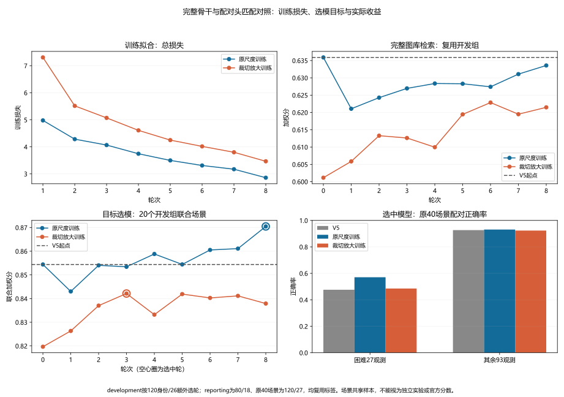

另做固定行偏移机制反例：对处理光学行加±0.25成本（±5logit），完整分分别0.645300/0.645383/0.644147，但20个开发集合的所有Hungarian排列完全不变、联合均0.854388。原因是方阵分配每行恰好一次，行常数对所有排列加同一总和；独立S2O却比较不同行。这仅解释两个指标可能不同，不是候选模型或证明某个被丢弃轮次有收益。独立标量/120个native控制和两模型保存重放通过；两任务内计时330.3/339.8秒、峰值allocated1,940MiB，均本地GPU并已退出。匿名记录见[全模型源域证据](evidence/2026-10-10-hoss-source-expert.json)。

## 原尺度全模型延长训练：早停协议，2026-10-10

用户授权本地GPU充分训练原尺度全模型专家。撤销此前对这一组“不扩大”的决定，仅扩大训练时长，不更换损失、采样、学习率或输入。上一轮最优恰为第8轮终点，支持检查是否尚未收敛；报告联合下降仍为负面证据，不能预设继续训练有效。

从相同native/V5初始化、seed20261010重跑，不把仅有模型参数的旧expert.pt称为优化器状态续训。新输出local/hoss-expert/original-earlystop-v1，核对前8轮损失、采样、完整开发及目标开发分数与original-joint-v3逐项一致。最多64轮，至少16轮；仅按固定20个development联合场景判断，累计超过0.001的提升重置耐心，连续10轮无此提升早停。每次实际最高分（含小于0.001的改进）均保存，初始第0轮也可胜出；reporting不选择轮次。

停止后重载最佳模型、独立复算完整检索和原40联合场景，对照V5与旧8轮模型，报告困难27/其余93及复用报告20场景。绘制完整训练轨迹与最终收益图；这些仍是反复使用的本地验证，不能直接换算官方成绩。只使用本地4060 Ti、共同GPU锁，没有付费实例或提交。

### 首轮早停结果与增大耐心

original-earlystop-v1完成18轮/1,044步，第18轮按10轮耐心早停，最高仍为第8轮。前8轮所有采样、损失、完整开发与联合开发逐项精确复现；最佳模型的完整成本银行与旧8轮逐元素相同，全部最终指标没有新增收益。第8→18轮总损失2.858→1.708，但开发联合0.870456→0.850781；这只说明当前种子和训练配置延长至18轮没有改善，不证明更晚轮次必然无效。独立标量、原40控制、早停历史重算、最佳模型重载通过，图见[早停曲线](figures/2026-10-10/hoss-original-earlystop.svg)，证据见[首轮早停记录](evidence/2026-10-10-hoss-original-earlystop.json)。任务约12.6分钟，GPU进程已退出。

用户随后要求更大耐心或更有效训练。按原输入、目标、学习率和采样保持对照，第二次original-patience24-v1从相同初始化重跑，最多64轮、最低32轮、耐心24轮、累计最小提升0.001；报告仍只最终评价。首轮未保存最后一轮优化器状态，不能声称从18轮连续恢复；本次每轮原子覆盖保存training-state.pt，含当前参数、两个优化器、采样与Torch/CUDA随机状态、停止状态，供今后恢复。第二次应复现首轮前18轮，不以报告分数选择新规则。后期各损失走势用于诊断目标侧重，不边跑边调整训练超参。

### 增大耐心的完成结果

original-patience24-v1完成32轮/1,856更新，第32轮按24轮耐心停止，最高仍为第8轮。前18轮所有采样、损失和两个开发指标与首轮早停逐项精确一致；最后保存的最佳成本银行仍与旧8轮模型逐元素相同，新增收益为0。V5/选中模型：完整验证0.645383/0.641177，原40联合0.834800/0.852603，报告20联合0.859555/0.855102，困难27正确率47.59%/57.04%。困难组的原有提升没有继续扩大，报告退步没有消失。

第8→32轮总损失2.8581→1.1455，身份分类CE2.1186→0.5314，占总下降约92.7%；配对CE0.7907→0.7369，局部CE1.0521→0.7985。开发联合最终0.856184，低于第8轮0.870456。只能据此判断本配置/种子的更长固定学习率训练没带来改善；没有验证完整收敛或其他调度无效。目标选轮、早停状态、全部历史与原生集合控制、3份完整排名独立标量、最佳重载及最后一轮优化器/随机状态保存均核验通过。模型保留，GPU进程退出；单任务约24.4分钟，allocated峰值约1.90GiB，无付费GPU或新提交。10项相关CPU测试及Ruff通过。

曲线见[32轮损失与开发曲线](figures/2026-10-10/hoss-original-patience24-v1.svg)，结果见[增大耐心证据](evidence/2026-10-10-hoss-original-patience24-v1.json)。后续候选更偏向改变训练竞争与数据暴露；需要与当前原配置做对照，不把CPU诊断替代提分实验。

### 训练效率诊断：候选竞争与损失组成

首轮第8→18轮总损失下降1.1500，其中身份分类CE下降1.0454，约90.9%；加权配对和加权局部项只下降0.0169、0.0411。这是损失变化分解，不能解读成梯度占比或因果贡献。每批8身份、每模态2观测，实际每锚16候选、2正例、14负例（7个不同身份）；开发联合推理是120身份，119个不同身份竞争。这一候选规模差异支持下一步检查更大身份批次，尚无其提分结果。

当前all-positive CE要求两个同身份观测均被支持；理想情况下两正例概率各为1/2，所以理论下界为log(2)，而不是0。第18轮配对CE0.7569仅比0.6931下界高约0.0637，局部CE0.8876差约0.1944。这反映训练批次内的剩余损失，不证明泛化足够；减去常数下界不会改变梯度。待更大耐心对照结束后，更大批次需要实际显存/梯度单步核验，并按相同样本暴露及更新次数解释收益，不能以同轮数却更少更新当作公平因果对照。

训练竞争CPU诊断使用固定seed20261011从同一462个TRAIN身份取100身份/200光学查询，每身份固定两个真实SAR观测（单图复制）。在初始原生CLS及V5局部头上计算完整训练候选银行，再用无放回组合公式精确计算随机8/16/32/64/120/462身份集合排除所有更高分负例的概率；概率公式与5身份穷举核验一致，无GPU或验证/测试图读取。

| 初始固定特征/事件 | 8身份 | 32身份 | 120身份 | 462身份 |
|---|---:|---:|---:|---:|
| 原生CLS，至少一个正例最高 | 98.63% | 94.33% | 82.18% | 56.00% |
| V5局部头，至少一个正例最高 | 99.68% | 98.65% | 95.38% | 86.00% |
| V5局部头，两个正例均胜过负例 | 99.53% | 98.07% | 94.13% | 84.00% |

说明已见训练身份上，小随机批次确实隐藏了部分竞争负例，32身份随机批次仍很容易。下一项候选应检查更大的身份竞争和困难身份成组，并有随机批次对照；旧冻结头动态挖掘不稳定，不能因为本次诊断就忽略该负面证据。这里是固定观测下独立单向排名事件（不含正例并列与1e-6内差异），不是实际CE、Hungarian准确率、训练后模型或验证提分，也不证明泛化错误由批次单独造成。图见[训练竞争曲线](figures/2026-10-10/hoss-batch-competition.svg)，记录见[竞争诊断证据](evidence/2026-10-10-hoss-batch-competition.json)。

### 创新训练研究：先检验机制，再排优先级，2026-10-10

用户要求寻找创新训练方法。重新核对旧32身份困难成组dual CE/Sinkhorn失败，不能把扩大集合或软匹配重新包装为未试创新。本轮探索精确决策目标：对一身份一真实观测的方阵，最大化`总配对分 + margin×错误边数`找出损失增强竞争排列，减去真实排列总分，再除以身份数。梯度来自两组被选中分数之差，Hungarian本身在detached CPU上求解。这里是结构化间隔损失，不是直接对离散argmax求导，也不是[黑盒组合求解器反传论文](https://arxiv.org/html/1912.02175v2)的精确复现。重复身份正例目前明确拒绝；不能直接塞进现有2观测专家批次。

assignment_margin_loss实现完成，3身份排列穷举、逐元素有限差分、行列偏移/候选重排不变性、间隔满足后零梯度及非法输入检查通过。合成三环在两次自由分数矩阵更新后修复，**不是模型训练或泛化证据**。

真实诊断复用先前TRAIN抽样，取100个已见身份各一个固定光学/SAR观测；原生CLS与V5头银行使用同一组图。随机8/32各30个重叠集合，困难8/32按V5 TRAIN对称分数选择相似身份，各30组；另外完整100身份一次。两模型采用相同集合，间隔0/0.01/0.05仅作分数单位机制探针，没有根据验证搜索。每组损失与手工总分、梯度与排列差精确复核。使用缓存TRAIN、CPU，无新验证/测试图读取、GPU训练、预测或提交。

| 完整100个已见TRAIN身份 | 逐行错误率 | Hungarian错误率 |
|---|---:|---:|
| 原生CLS | 15% | 2% |
| V5局部头 | 3% | 0% |

V5在所有本轮随机/困难集合上也没有实际联合错配；0.01间隔没有激活梯度，0.05间隔在随机32/困难32中激活30%/66.67%集合。这些是人为安全间隔不足，不是实际错配比例。激活时与dual CE的分数空间梯度余弦均值约0.81/0.72，并非完全不同的学习方向；这不是共享骨干任务梯度冲突测量。仅100已见身份、固定单观测，不能证明整个TRAIN已解决，更不能单独证明验证瓶颈原因。结果降低了“单独替换整组损失即可大幅提分”的优先级。

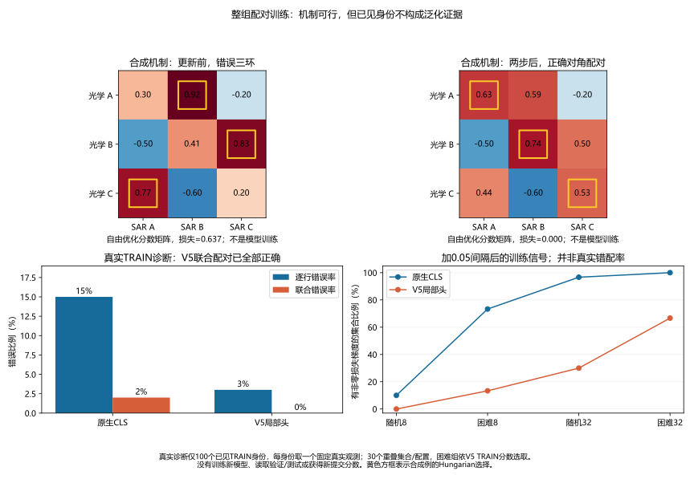

匿名证据见[决策训练机制](evidence/2026-10-10-assignment-training.json)。原始银行、抽样索引和逐集合记录留local。batch-competition-v4与历史v2汇总完全相同；v3运行中被格式化过，源码快照与最终源码SHA不同，保留为非正式产物，正式诊断绑定重新执行的v4。

**下一项首选是跨身份元训练，而非追加难例损失。** 参考[MLDG](https://arxiv.org/abs/1710.03463)要求一组数据上的学习步也帮助另一组数据，以及[ReID的M³L](https://arxiv.org/abs/2012.00417)模拟训练/测试过程。比赛适配：每个episode取身份互斥的TRAIN集合A/B；在A上做临时下降步，再以更新参数评估B的真实光学/SAR配对，外层优化A和B目标。B不依赖同一固定身份分类器标签，使用身份对应的配对损失。A/B轮换，临时参数与优化器/BN状态不得污染基线。真正meta梯度包含内步导数；若用一阶近似，必须明确记录，不能称二阶MAML。只换TRAIN批次并做普通SGD不构成元训练。

局限：原生初始化已看过这些TRAIN身份，B只是当前内步未见，不是初始化未见身份；当前没有可靠采集域标签，身份互斥也不等于多源域隔离。这是受文献启发的新比赛适配，**尚未实现或获得训练结果**。不用合成D4替代真实观测，以免重复此前增强失败。

**第二项是参数扰动训练SAM，必要时扩展2026 XSAM。** [SAM](https://arxiv.org/abs/2010.01412)约束参数邻域内的坏情况损失，[XSAM原文](https://arxiv.org/html/2603.10048v1)显式搜索附近高损失方向，已核对[作者代码入口](https://github.com/Cccjl219/XSAM)，未导入执行或安装依赖。首先应检查第8/32轮的配对邻域敏感度，不能把损失下降与开发下降直接证明为尖锐极小值。若有信号，再与普通SAM对照；不能从分类/鲁棒性论文成绩换算舰船比赛收益。XSAM每轮约20–40额外前向的低开销结论基于每轮400以上更新，本专家只有58更新，开销需本地实测，不能照搬“近乎免费”。

后续公平实验先分开普通训练、跨身份元训练、SAM三个臂，同一初始化/输入/采样池，计实际样本暴露、优化器更新、前后向数和时间；各方法至少两种子，用既定开发集合选轮、报告集合最终评价并注明反复复用。首先测元训练的临时步是否帮助互斥身份，再训练；若没有机制信号就停止。整组间隔只作之后单独消融，不与元训练/SAM同时堆叠；新方法当前没有本地或官方提分证据，V5官方0.7185908014保持。

### 跨身份元训练执行协议，2026-10-10

用户授权放手执行。本轮比赛适配采用**明确的一阶近似**：每episode先取8身份A、8身份B（462身份尾组A8/B6），两组互斥，各身份两真实光学/两真实SAR，仅原水平翻转。A配对目标反向，按原生5e-4/头1e-4的10倍率做无动量临时下降；在临时参数上计算B配对梯度；精确还原原参数，以`(gA + gB_virtual)/2`作一次正式更新。没有内步Jacobian/Hessian，不能称完整MAML或证明优化了精确二阶元目标。SGD/AdamW状态只在正式更新中改变。两个批次的损失是`.5 pairCE + .25 localCE`，所有正观测均受监督。

本次主动选择不使用原生分类/Triplet目标，BN颈与分类头冻结且不执行；全ViT双入口/12层以及两个配对头训练。**因此需要新的pair-control对照，同样停用分类/Triplet、同样A/B采样和平均梯度，不能把对旧native专家的差异都归因于元训练。** 原native代码默认仍不变。每轮全部462身份一次，29正式更新，与旧58更新/轮不同；新两臂实际暴露与更新相同。初始V5逐元素复现，按既定开发20集合选轮、报告20集合最终评价，均为反复复用。seed20261010，最多24轮、最低12轮、耐心8轮、min_delta0.001，每轮保存完整训练状态。

episode_gradients单元检查包含解析一阶梯度（明确区别二阶梯度）、参数精确还原、异常路径还原以及探针不消耗随机流。每轮前8episode在相同Dropout/Drop-path随机状态下比较TRAIN B的更新前/后损失；B用于正式外层目标，初始化也已经看过TRAIN身份，不是独立未见身份验证。GPU首步检查通过，约1.86GiB allocated峰值，B损失1.352063→1.267988；只能说明这一临时更新有TRAIN迁移信号。该一步开发联合没有超过初始，最佳仍0轮，不能当作提分。

正式pair-control-v1已启动；随后pair-meta-v1。准备独立标量/原40联合核验、抽样前缀一致、冻结BN/分类头逐元素未变、最佳选轮与模型银行重载，以及训练曲线/真实B迁移变化科学图。普通SAM实现已完成可逆L2参数扰动和随机流重放的CPU检查；仍未训练，若元训练缺乏显著收益则单独对照，不堆叠二者。所有任务仅本地4060 Ti，通过共同GPU锁，无付费GPU、测试推理或提交。

### 跨身份元训练完成结果，2026-10-10

上述待执行阶段现已完成。pair-control和pair-meta各完成24轮/696次正式更新，均选第18轮，耗时20.19/20.45分钟。独立标量评分、原40联合基线复现、冻结BN/分类头逐元素未变、真实采样及翻转摘要一致、最佳模型分数银行精确重载均通过。

| 方法 | 完整检索 | 开发20联合 | 报告20联合 | 原40联合 | 困难27配对准确率 |
|---|---:|---:|---:|---:|---:|
| 配对目标普通对照 | 0.640148 | 0.863244 | 0.844345 | 0.837826 | 0.496296 |
| 一阶跨身份元训练 | 0.637383 | 0.865254 | 0.845225 | 0.837508 | 0.494444 |
| 元训练减对照 | -0.002765 | +0.002010 | +0.000880 | -0.000318 | -0.001852 |

192个TRAIN B探针中，临时学习A后45.31%的B损失降低，平均变化为+0.001883（升高）；第一轮平均-0.035444的帮助未持续。普通对照192次零内步探针变化全部精确为0。训练目标几乎平行下降，两条开发曲线存在轮次噪声，没有值得扩种子的大幅候选。停止这个固定一阶、无分类锚定的配置，**不据此否定所有元学习**；二阶内步、分类锚定及不同内步尺度并未检验。它对历史native的比较同时混有目标与每轮更新次数变化，不能用于宣称分类目标有害。

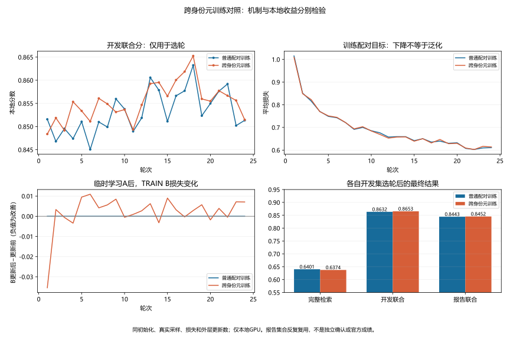

绑定证据见[跨身份元训练](evidence/2026-10-10-identity-meta.json)。只有一个种子；报告集合反复复用，没有新的官方分数。

### 完整原目标SAM对照执行，2026-10-10

元训练缺乏显著收益，按先前协议单独执行标准SAM（不是XSAM）。保留原native身份CE、Euclidean softplus batch-hard triplet、0.5 pairCE、0.25 localCE和BN分类颈，8身份/2光学2SAR，每轮58次正式更新；全参数梯度L2归一化上升，固定rho=0.05，扰动点反传后精确还原权重，再执行原SGD/AdamW一步。两次前向重放相同Dropout/Drop-path随机状态，第二次后将BN缓冲还原到第一次前向状态，只累计一次统计更新。

首先完成rho=0的真实GPU整轮复现：58步的损失分量、采样摘要、开发分数及整张765×718成本银行与历史native首轮逐元素一致；每步两次损失完全相等，BN计数只增加58，AdamW步数58，当前模型权重有限。随后正式SAM沿用seed20261010、最高24/最低12/耐心8/min_delta0.001，不随报告分调整。历史native32轮轨迹按同规则重放作为对照，必须核验仍选第8轮。17项相关单元检查通过。当前正式SAM尚在运行，不能提前报告提分。

### 标准SAM完成结果，2026-10-11

上述运行阶段已完成：第16轮触发早停，928次正式更新，选第8轮，训练及最终推理共22.57分钟，allocated峰值约1.89GiB。历史native轨迹按同样最高24/最低12/耐心8规则重放也在第16轮停止、选第8轮；同初始化、目标、优化器、采样/翻转和每轮正式更新数，SAM多一次前后向，**不是等计算量**。对照是已绑定历史轨迹，不是新的同时运行实验。

| 方法 | 完整检索 | 开发20联合 | 报告20联合 | 原40联合 | 困难27配对准确率 | 源93配对准确率 |
|---|---:|---:|---:|---:|---:|---:|
| 原完整目标，第8轮 | 0.641177 | 0.870456 | 0.855102 | 0.852603 | 0.570370 | 0.931183 |
| SAM完整目标，第8轮 | 0.639977 | 0.868480 | 0.866582 | 0.859889 | 0.611111 | 0.934140 |
| SAM减原训练 | -0.001200 | -0.001975 | +0.011480 | +0.007286 | +0.040741 | +0.002957 |

原40共享场景25改善/4持平/11下降，中位差+0.006283，范围-0.031912..+0.036795；重叠场景不是40个独立样本。困难27配对准确率提升4.07个百分点，有局部正面线索，完整检索/开发分却下降。**保留模型和机制作为候选，不称显著、稳定或官方收益，不扩种子/半径搜索，也不生成提交。** 本轮只有一个固定种子/半径；原计划扩种子用于发现显著候选后的确认，目前结果未达到全指标显著收益门槛。不能否定其他SAM或二阶元训练配置。

928次参数扰动的训练损失增量全部为正，均值0.687228；首轮均值1.3134、末轮0.5520。它依赖参数化、固定半径及训练批次，不是泛化证书，更不能由这条曲线单独证明错误来自尖锐极小值。

独立标量评分/原40基线复现、源快照与历史协议、早停重放、所选银行逐元素重载、最新训练状态SHA全部通过；最新BN计数仅增加928、AdamW步数928、模型和优化器状态有限、随机流/采样状态存在。训练状态仍没有自动恢复CLI。四个完成的正式对照/零半径运行清单已标记核验；GPU计算进程已退出。开发/报告/40集合反复复用，V5官方0.7185908013668432保持，未读取外部验证/测试像素、付费训练或提交。

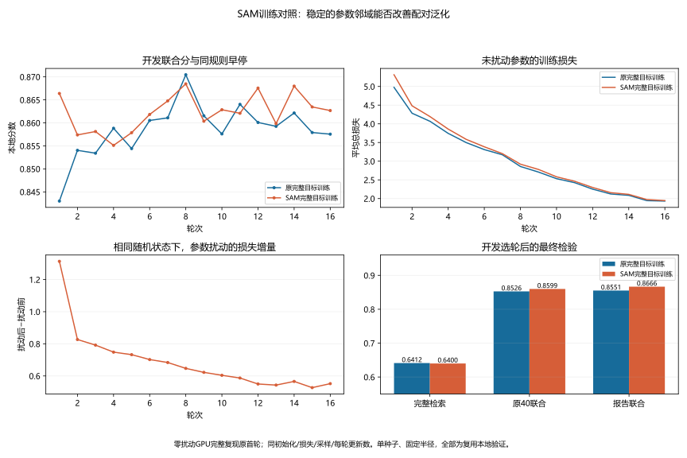

绑定证据见[SAM对照](evidence/2026-10-10-native-sam.json)。实验10月10日启动、11日完成，证据与图目录按启动日保留。

## 缩放整数格点反推裁剪尺寸，2026-10-10

新的像素机制不同于船体轮廓：缩放前8位整数经双线性放大后，输出像素对相邻两个源整数产生一组量化区间约束。对未知原高度H=32..224逐一建立半像素位置链，用动态可达集合判断每列是否存在0..255的源整数序列，容许量化边界±0.501。选最小全列可行H；没有源高度、源宽度、源身份或标签输入。原高度大于输出时无法这样反推；H≤224限制至少32个冗余输出行，最初根据12张SAR的近似反演失败固定。全黑/极低变化图拒绝。恢复的是带背景/边距的裁剪高度，不是真实船长。

最初四舍五入最小二乘在151张SAR中107个接受全部精确，但245张光学中91个接受仅71个精确，含3个缩小图误接受；这些失败保留在fingerprint-v2。随后增加严格整数链约束，在同一批396张已确认源TRAIN图中，SAR107/151、光学72/245被接受，**179/179高度精确，165张缩小源图误接受0**。217张拒绝，其中52张原高度小于256但超出224上限。该整数方法是在看到光学近似失败后开发的，所以179/179是机制复现，不能包装成新独立数据的准确率，更不能认为未知验证/测试接受即保证正确。实际Pillow随机整数上采样与全黑拒绝测试通过。历史integer-v3报告的method/模块SHA正确，但fixed_rule/limitations继承了旧近似描述；原档案保留，公开证据补充正确解释，后续工具元数据已修正。

第一项固定提分检验只取这179张的像素估计值，在37个本题TRAIN身份/100个正观测对上拟合log(H光学/H SAR)的正/负Gaussian似然。正身份等权、负身份对等权，σ下限0.03；正分布μ=0.293459、σ=0.119973，负分布μ=0.015953、σ=0.411481。所有原源尺寸只作机制诊断，未进入拟合。融合固定V5+LLR/20，只改两端均有估计的边，不扫描系数。

验证沿用原166光学/276 SAR像素门控，仅把横向条带旋转，不裁切/放大；接受61光学/61 SAR，38个身份/66个真观测对两端均有估计。完整分0.645383→0.644466，原40联合0.834800→0.841596（+0.006796；23改善/6持平/11下降），困难27正确率47.59%→52.31%，容易93略降0.08个百分点。开发20仅+0.000036，报告20−0.005190，未跨显著门槛，不提交。

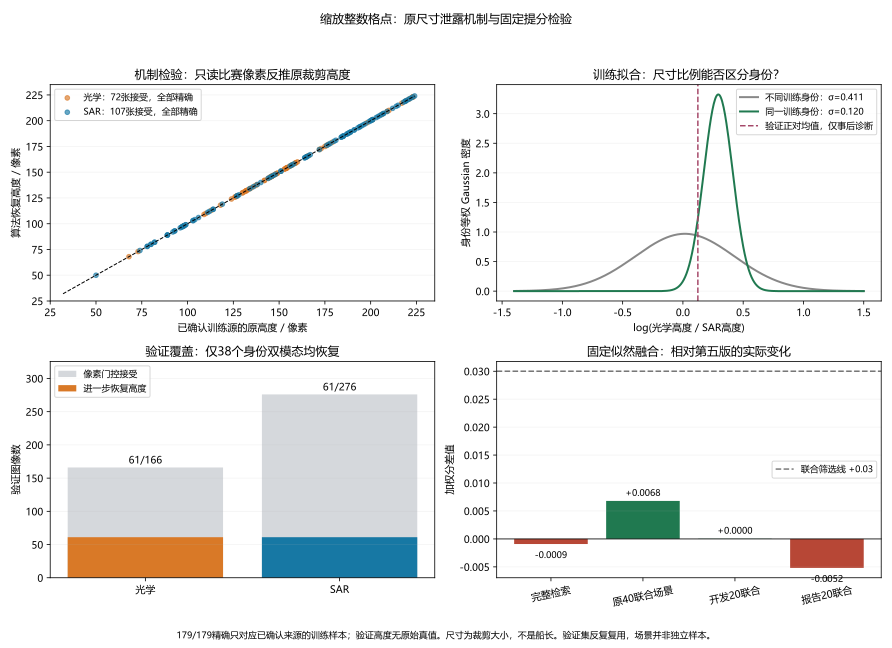

事后标签诊断发现，这38个验证身份的正比例μ=0.124021、σ=0.202033，偏离源TRAIN子集；它没有用于调整系数或先验。来源样本选择、视角/边距、空间分辨率差异以及未知接受精度均可能混杂，不能只称物理尺寸规律失效。下一步固定检查全部本题TRAIN的同一像素估计，检验小源子集的校准是否偏置；还需先在已知TRAIN源检查接近256的整数约束是否仍可靠，才能扩大覆盖。第一项两排名独立标量、80个原native控制通过，图已查看；全程CPU，无测试像素/预测/提交。匿名证据见[缩放尺寸检验](evidence/2026-10-10-hoss-resampling-height.json)。

## 全TRAIN校准、尺寸覆盖扩展及互补对照，2026-10-10

全部5,926张本题TRAIN执行同一像素门控和整数高度算法；原规则接受281光学/277 SAR，184个身份/304个正观测对。已确认源TRAIN的396张只复用之前盲估计的image_id/estimated_height，原始源尺寸和外部身份没有进入拟合。全TRAIN正比例μ=0.089040、σ=0.174669，比源子集μ=0.293459更接近验证事后μ=0.124021。**小源子集存在明显校准偏置**，但更代表性的训练先验是否有效仍需检验，不能根据事后验证均值直接重设先验。

另先在396张已知TRAIN源上盲扩候选H225..255：新增71个接受，其中52精确、19错误，错误均为缩小图被判H254（3张）/255（16张）。所以不能无条件把“存在整数解”当作原高度唯一可恢复。根据这个TRAIN机制边界，在验证扩展前固定上限248，保留8个冗余输出行；已知源接受226张、226张精确。这是基于TRAIN真尺寸选择的保守上限，仍不是新独立数据的普适置信度。没有用验证成绩扫描高度上限。

上限248让全TRAIN接受355光学/342 SAR，220个身份/376个正观测对，正比例μ=0.086612、σ=0.179463；完整负对121,034个，按训练身份对等权。验证接受77光学/75 SAR，比原61/61多30图；48身份/82个真观测对两端均可估，仍有大量未知/缩小图。验证正比例事后μ=0.124898、σ=0.204799，没有用于拟合或权重。所有新增估计仍只读原图像素，横向旋转，不读外部验证/测试映射。

在看到后续结果前固定三项CPU对照：全TRAIN224先验、全TRAIN248先验、后者与已按开发集合选好的原尺度8轮专家相加。系数均LLR/20；专家权重1，不调融合系数或再挑专家轮次。因为追加发生在源子集验证之后，这些是纠正/互补的探索性对照，不能称新独立确认。

| 配置 | 完整本地分 | 原40联合分 | 原40相对V5 | 本轮报告20相对V5 | 困难27正确率 |
|---|---:|---:|---:|---:|---:|
| V5 | 0.645383 | 0.834800 | — | — | 47.59% |
| 源子集37身份，224 | 0.644466 | 0.841596 | +0.006796 | −0.005190 | 52.31% |
| 全TRAIN184身份，224 | 0.647755 | 0.838221 | +0.003421 | +0.001273 | 49.91% |
| 全TRAIN220身份，248 | 0.647710 | 0.837492 | +0.002692 | −0.001478 | 49.07% |
| 原尺度专家单独 | 0.641177 | 0.852603 | +0.017803 | −0.004453 | 57.04% |
| 原尺度专家加全TRAIN248尺寸 | 0.643744 | 0.853188 | +0.018388 | −0.001774 | 55.65% |

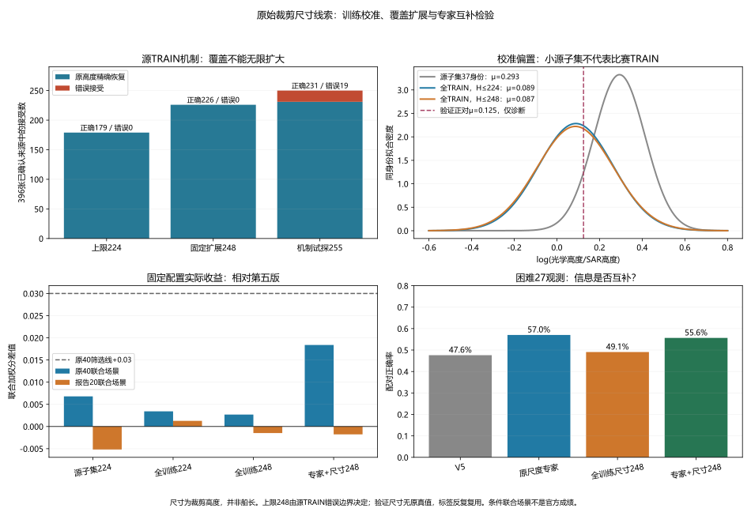

组合的0.018388大部分来自专家，尺寸的独立新增仅0.000585，不能把整段组合收益都归因于新线索；相对专家的完整检索+0.002566、报告联合+0.002680，但困难正确率下降1.39个百分点。容易93由93.12%到93.55%，显示这个固定先验没有解决当前主要难例。扩大恢复覆盖也没有产生更大收益。原40相对V5改善/持平/下降分别为：全TRAIN224=21/9/10，全TRAIN248=17/11/12，组合=31/0/9；均未通过预设显著门槛。

**原裁剪尺寸泄露是明确的像素事实，但这次Gaussian先验及固定组合不是大幅提分方法。停止该固定方向的系数微调、进一步上限扩展或第二GPU种子，不生成新提交。** 裁剪大小包含边距/背景、覆盖有限以及未知来源接受精度均构成限制；本轮不能把其中某一项单独认定为全部失败原因，也不否定其他物理尺寸方法。第五版官方0.7185908014继续保持，没有查到0.9队伍的方法证据。

四次尺寸配置的所有银行从原成本、TRAIN拟合参数和盲高度独立逐元素重建通过；9套排名独立标量、360个原native场景控制通过，组合中的专家控制也精确重放。6个CPU测试覆盖真实Pillow整数上采样（含H255）、随机缩小负控制、全黑拒绝、训练身份等权/不读取源真尺寸、真实观测采样、逐正对监督和集合行偏移；静态/格式检查通过。两张新增匿名科学图已查看，所有CPU进程完成，没有新GPU/付费/测试像素/预测/提交。原源文件、ID映射、估计与排名继续留local，匿名数据与源码绑定见[全TRAIN尺寸对照](evidence/2026-10-10-hoss-scale-census.json)。

## 2026-10-11：大收益训练候选的重新筛选

用户明确搁置SAM小幅收益，继续寻找更有希望的大幅训练方法。重新核对直接舰船论文DRI/MOS/SDF和既有失败，DRI仍不是本项目新发现，也不能忽略其物理尺寸与权重供应限制。局部强监督参考[TransReID原文](https://arxiv.org/html/2102.04378v2)的重叠patch/局部身份分支；大竞争训练参考[XBM](https://openaccess.thecvf.com/content_CVPR_2020/html/Wang_Cross-Batch_Memory_for_Embedding_Learning_CVPR_2020_paper.html)、[GradCache原文](https://aclanthology.org/2021.repl4nlp-1.31.pdf)及[作者实现](https://github.com/luyug/GradCache)。这些不是新发明，也没有理由将其其他任务收益直接换算为本题成绩。尚未引入外部权重、身份映射或新数据。

先证伪“源专家训练只见462个SAR身份，遗漏其他来源负例”。复用原100个已见TRAIN身份的200个光学观测和同一两SAR观测，保持源462身份银行前缀，追加其他2,357身份的两个真实SAR观测；单图身份复制。全候选2,819身份/5,638观测。native与V5评分原前缀分别最大漂移2.98e-7/4.02e-7（GPU/CPU算子差异），首选事件与旧记录完全一致。V5最强/全部正观测胜负例比例在源库和全库均86%/84%，额外身份产生更高分的负例0；native最强正首选仍56%，仅一查询有一个域外身份超过正例。扩大随机身份群反而稀释源内困难竞争。只用TRAIN、无参数更新；这否决该批固定观测上的域外漏负假设，不证明所有大源内批次、缓存训练或未见身份泛化无用。未启动全库记忆训练。

当前优先执行**原像素重叠token的全骨干训练**：不改256原图、16px卷积核、权重参数数量、16节点读出头和原完整损失，步长16→8，token地图16×16→31×31。沿实际patch中心插值原16×16位置参数，align_corners=True，原中心在新图每隔一个token处保持；位置参数仍原257个、可训练。奇数31地图用不重叠7/8token空间分区读出4×4，避免CUDA非确定池化。没有JPM随机shuffle、新局部分类损失或物理尺寸嵌入，所以不能称完整TransReID复现。它改变中间表征采样，与冻结头64节点、原图裁切放大、SAM分别不同，但增加token不等于增加原像素信息，也可能增加冗余或分布漂移。

18项相关CPU检查通过：重叠卷积保留原窗口、位置插值保留原中心和梯度、native读出精确一致、31地图全部token参与且常数有限、非法地图拒绝。GPU烟雾中原stride16先精确重放V5全矩阵，stride8首步完整模型梯度通过，未训练stride8开发联合0.875783，高于历史原训练最高0.870456；第一步0.874479，并未提升。此时只作为执行门槛，不读报告挑配置，不当作提分。

正式先导固定seed20261010、最高24/最低12/耐心8/min_delta0.001，8身份/2光学2SAR、462 TRAIN像素门控、原SGD/AdamW、原翻转、CE+Triplet+0.5pairCE+0.25localCE保持。历史native轨迹按同规则重放作背景对照，仍需要独立指标/银行/停止核验。完整检索或原40联合相对历史原尺度专家至少+0.03，同时另一项和最终报告组退步不超过0.005，才扩第二种子/额外训练；低于门槛停止这一配置。该门槛在正式先导评分前固定，只是本地筛选标准，验证已反复复用，不是显著性检验或官方收益预测。未训练stride8银行独立保存，用于区分改采样与正式训练的新增效果。仅本地GPU、不提交。

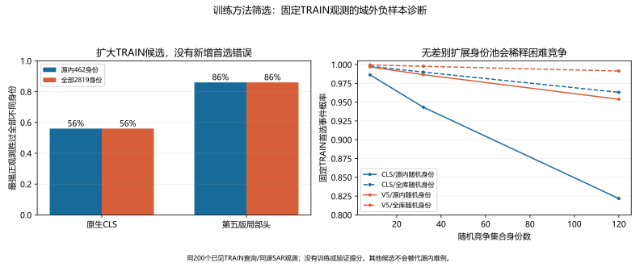

该诊断的私有银行由另一脚本按真实TRAIN身份与两观测顺序独立重算排名事件，来源/划分/源池及原银行前缀核对通过。匿名证据见[本轮负样本诊断](evidence/2026-10-11-full-gallery-competition.json)。图中的随机集合曲线描述的是固定观测的首选事件，不是训练后分数。

追加核对[FD-GA出版方正文](https://doi.org/10.1109/JSTARS.2026.3708907)：7月1日发表，频域幅度混合、共享/特有特征分离和可学习图节点约束。出版方消融文字称单独TGAM的R1为59.2%→65.3%；没有据此推算本题或V5收益，且其消融基准与TransOSS主表不同。查到的[drickzsy仓库NOTICE](https://github.com/drickzsy/FD-GA/blob/a8f43545337aa710b7557097e7e375b615fdec40/NOTICE.md)明确称独立实现、不是作者官方代码；README所写hoss_fdgnn.yml不存在，实际文件是fdga_hoss.yml，weights只有初始化说明，未提供FD-GA识别权重。四份提交均早于9月1日，但这不构成复现成绩或具体权重资格证明。仅远程阅读固定提交的配置、模型、幅度增强、图模块和损失代码，没有导入或执行代码/权重，也没有把先前仅查索引的FD-GA称为本次新发现。

独立实现中shared与specific只作余弦正交，specific没有额外模态监督；图节点只对正配对作OT对齐。根据实际目标，正交本身不能保证特有分支包含模态信息，正配对图对齐也不能独立保证身份判别。这是目标结构分析，尚未实验测得坍塌，也不能据此认定论文无效。当前不把整套频域/双ViT/GCN模块直接叠加为有把握的大幅方案。

另对全部3,052张TRAIN光学做原像素空间预算诊断：同一pack_strip门控接受695张（此处不是早期区域探测器的696张）。含非黑内容的16px窗口数中位64→217，窗口比例中位25.0%→22.6%；其他光学两种步长均100%。积分图统计与每图4个直接像素窗口校验通过，所有旧窗口精确包含在新地图每隔一个窗口的位置。非黑内容包含背景，不能称船体或注意力，黑窗口也仍有stem偏置、位置与模态信息。它说明改步长增加采样而不自动聚焦内容，不是身份信息增加的证明。

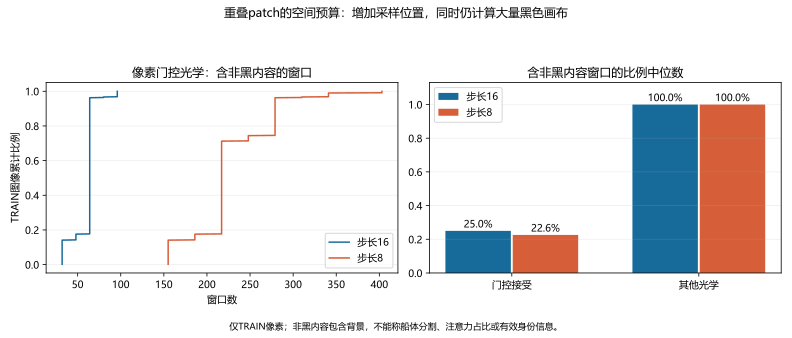

匿名记录见[空间预算证据](evidence/2026-10-11-overlap-spatial-budget.json)。CPU执行，没有读取验证/测试像素或改变训练参数。

在已有TRAIN精确来源对应上追加一次文件名计数：114个已映射HOSS TRAIN身份总共245光学/152 SAR，其中245/151已经精确复现本题TRAIN；最多只有一个额外SAR候选，不能据此指望通过补齐这批来源身份的真实观测显著扩大数据。该项只读取public TRAIN目录成员名及既有TRAIN匹配清单，没有读取外部query/test像素或把其他未知源身份加入训练；一张额外图还未做有效性审核。它排除的是已确证114身份上的大规模多观测扩充，不排除其他训练数据方案。

再审[MOS原文表3](https://arxiv.org/html/2512.03404v1#S4.T3)以避免将总收益误归因于扩散模块：在作者HOSS S2O协议上，TransOSS R1为29.9%，单独MCRL为40.3%，单独CDGF为32.8%，组合46.3%。生成单独+2.9个百分点，MCRL单独+10.4，不能把组合+16.4全部算作生成收益，也不能假设组合收益简单相加。作者[README](https://github.com/yjzhao1019/MOS)要求QXS-SAROPT上100轮预训加HOSS250轮微调BBDM，并更正融合系数为0.02；12月预印本仍写0.2。此次没有下载新的生成数据/权重或把生成模型排成主攻；MCRL在本题的强收益仍未验证，其去噪/均值方差约束不等于已完成的DSMCL或SAM。

追加MCRL输入与真实观测前提核验：读取截止前固定作者[datasets/bases.py](https://github.com/yjzhao1019/MOS/blob/793dc39ef828bbd77c59570aa081389620345e06/datasets/bases.py)与[loss/make_loss.py](https://github.com/yjzhao1019/MOS/blob/793dc39ef828bbd77c59570aa081389620345e06/loss/make_loss.py)，只作远程阅读，未导入执行。默认下分位是5%，不是去掉最低5%位置后再恢复位置；实现为逐图5/100分位截断和线性拉伸。CMAL先L2归一化CLS，再按身份计算均值和有偏逐维方差，两差的L2范数等权相加。代码不是论文平方范数，也不是严格的Gaussian W2（后者对齐标准差）；不能混称精确数学复现。

本题全部2,874张TRAIN SAR的5%分位都为0，默认处理没有移除任何正灰度像素；2,848张最大值已经255，2,865张（99.69%）的最大变化仅0或1个灰度级。当前462身份训练池509张SAR也全部下分位为0，500张（98.23%）最大变化不超过1。浮点乘除再截断可造成一灰度级变化，所以没有把零阈值粗略说成逐字节完全恒等。独立排序/线性插值重算每图分位通过。该检查使用本题已经量化的uint8图，不是作者原始32位SAR输入，不能假设原文去噪收益可直接移植；也没有据此否定统计对齐或适配后的输入处理。

2,819个双模态TRAIN身份中，2,657个（94.25%）仅1光学/1SAR，115个有至少2光学但单SAR，2个反向，45个两端至少2；当前462身份池对应300/115/2/45。两张采样并不等于两次真实观测，随机翻转与Dropout仍可能产生特征方差，但不能称额外物理观测。均值对齐对单观测身份仍可用，真实多观测的方差估计前提则有限。只测前提，没有训练MCRL、扫描alpha或新GPU任务。匿名证据见[MCRL适配检查](evidence/2026-10-11-mcrl-compatibility.json)，私有逐图明细留local。

追加既有原生TransOSS TRAIN CLS缓存诊断：严格绑定缓存/提取报告/划分SHA，所有5,926个缓存ID与TRAIN集合精确相等；每个真实观测L2归一化后，用该身份的全部独立真实观测计算作者代码的均值差/有偏方差差L2范数。全部身份平均两项为0.518956/0.000184，当前池0.534622/0.001124；方差项分别仅占无权项值之和0.0355%/0.2097%。所有双单观测身份的方差项精确为0。独立脚本从TRAIN记录重新核验身份/模态数量、图像归属和保存项的聚合通过。

这是旧原生CLS与全部真实观测的机制检查，不是当前重叠模型、实际两个随机观测/翻转/Dropout的训练批，也不是梯度占比或MCRL提分结果。不能以项值小否定其梯度或作用；若继续该候选，优先分开检验归一化类均值对齐，再考虑数据适配后的去噪，避免一次把论文组合的收益全归给方差或扩散。

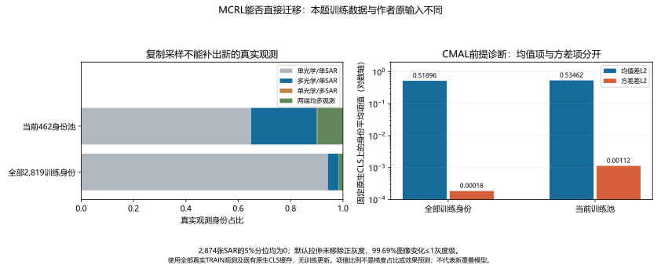

### 重叠patch完整训练完成结果，2026-10-11

本地4060 Ti完成17轮/986更新，第17轮按最高24/最低12/耐心8规则早停，开发联合分选第9轮。总任务68.18分钟，allocated峰值7,581MiB；历史原尺度同规则重放16轮/928更新选8。本次增加token与计算量，不是等计算量对照，当前只有一个种子。

| 模型 | 完整检索 | 开发20联合 | 报告20联合 | 原40联合 | 困难27准确率 |
|---|---:|---:|---:|---:|---:|
| 原尺度全模型专家，8轮 | 0.641177 | 0.870456 | 0.855102 | 0.852603 | 0.570370 |
| 重叠未训练起点 | 0.644004 | 0.875783 | 未评分 | 0.839799 | 0.508333 |
| 重叠训练，9轮 | 0.654299 | 0.887802 | 0.860166 | 0.861168 | 0.615741 |
| 重叠训练减原专家 | +0.013122 | +0.017347 | +0.005064 | +0.008565 | +0.045370 |

开发分的增量没有等量迁移到报告/40场景；完整与联合两项均未达到事先固定的+0.03门槛。**有小幅收益，停止扩大这个固定步长8配置，不扩第二种子或按报告结果扫参数，不生成提交。** 当前困难观测提升4.54个百分点提供局部信号，不能据此预测官方突破。

相对重叠自身未训练起点，完整+0.010295、原40+0.021368、困难准确率+10.74个百分点；这段较大变化包含修复其未训练状态的下降，不能替代与更强原尺度专家的比较。40个共同场景27改善/13下降，中位差+0.010876；场景重叠且验证反复复用，不是40个独立确认样本。原始报告未对未训练起点评估report20，表中明确保持缺失。

独立标量评分/40个原始控制、初始stride16 V5精确重放、所选stride8银行和重新加载模型精确一致、源码/模块/协议SHA、实际采样与历史前缀一致、早停独立重放、最新BN计数增加986及AdamW986步、模型/优化器/RNG有限状态核验全部通过。最初CPU等待任务因未带绘图库路径被中断，保留记录；只重启正确环境的CPU核验任务，正式GPU生产任务持续运行并正常退出。最终图已人工查看，GPU锁释放，无付费GPU、测试推理或新官方提交，V5官方0.7185908013668432保持。

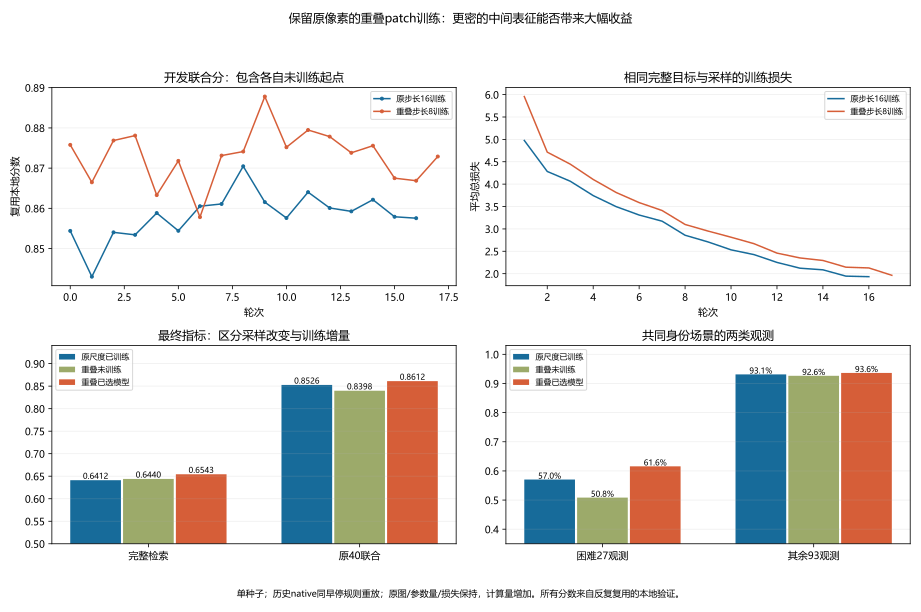

匿名绑定结果见[重叠训练证据](evidence/2026-10-11-overlap-training.json)。该阶段下一候选是归一化类均值对齐的单独作用；MOS论文的组合消融只提供候选依据，不能说单独均值项已经证明+10.4或预计本题能到0.9。此处为启动前记录，后续实施与结果如下。

### 归一化类别均值对齐：单组件新对照协议，2026-10-11

用户明确授权本地GPU对照。新增独立实现modality_alignment.py：原生CLS逐图L2归一化，按真实TRAIN身份分别取光学/SAR均值，计算两个均值的L2距离，再按身份等权平均；使用显式模态字段，不按文件名推断。与固定MOS作者代码的均值部分一致，不平方范数、不加方差、去噪、扩散或新数据，不称完整MCRL复现。原身份分类、Euclidean batch-hard triplet、全局/局部所有正例配对CE均保留，以维持身份区分。

权重固定2.0，沿用论文设置作为单组件先导，未根据本地成绩搜索。先做真实GPU单步烟雾：必须证明辅助项独立地对光学/SAR stem与第一层产生有限非零梯度，全目标梯度、原stride16 V5及保存模型重放通过。然后重新运行两个正式分支：权重0的新鲜普通对照、权重2的均值对齐；同原native/V5初始化、seed20261010、462身份像素门控池、8身份/2光学2SAR、横向翻转、58更新/轮、SGD/AdamW。最高24轮/最低12/耐心8/min_delta0.001，只按开发20联合分选轮，各自初始模型可被选中；报告20和原40不选轮。两支实际共同轮次的图像/翻转采样摘要必须一致；各自早停可以导致不同最终更新数，不称严格等更新对照。权重0需要与历史native轨迹/银行重放一致。

在取得正式候选结果前，继续固定扩大门槛：相对本轮新鲜权重0对照，完整检索或原40联合至少+0.03，另一项及报告20退步均不超过0.005。通过才考虑第二种子确认，未通过不扫权重或扩大该固定配置。所有本地集合已经反复复用，门槛不是统计显著性或官方收益证书。只用本地GPU，不付费、测试推理或提交；正式结果及科学图待训练/独立核验完成。

单步GPU检查已通过：辅助均值项为0.609639，独立对两个stem与首层的梯度有限且非零，分类器/全局头的完整目标梯度正常。保存重载、初始V5银行、独立标量/40个历史场景、源码/协议/最新模型与优化器/RNG状态核验通过；烟雾只更新一步，开发选回第0轮，不能拿它宣称收益。均值项5项CPU检查与已有训练/观测20项检查通过。

两版固定选轮之后，还将对同一462身份池的全部真实TRAIN观测重新编码，无增强/Dropout，测归一化模态类均值距离、类均值半径/夹角、身份等权的正例与最强异身份余弦间隔及首选准确率。均值距离用独立NumPy计算并与损失函数核对。此诊断不参与早停、权重选择或扩大门槛，仅解释训练机制；TRAIN已经参与优化，不能视为泛化证据，也不能将原始CLS余弦指标混同最终全局/局部配对头指标。额外3项诊断检查验证“零对齐损失仍可身份坍塌”、重复观测不改变身份权重、尺度/旋转不变性。

### 均值对齐完整对照结果，2026-10-11

普通训练重新跑完16轮/928更新，开发选第8轮；均值对齐跑13轮/754更新，第13轮早停、选第7轮。两支共同13轮的真实图像/横翻采样摘要一致，初始化、模型、完整原目标、优化器和早停规则相同；分别早停与选轮，所以最终更新数/所选轮次不同，不称严格等更新对照。新普通控制16轮的全部训练数值与每轮完整评分银行均精确重放历史native，历史选轮也按当前规则独立复现。

| 所选模型 | 完整检索 | 开发20联合 | 报告20联合 | 原40联合 | 困难27正确率 |
|---|---:|---:|---:|---:|---:|
| 新普通控制，8轮 | 0.641177 | 0.870456 | 0.855102 | 0.852603 | 57.0370% |
| 均值对齐权重2，7轮 | 0.628948 | 0.864360 | 0.858807 | 0.848387 | 56.4815% |
| 对齐减普通 | −0.012230 | −0.006096 | +0.003706 | −0.004216 | −0.5556百分点 |

**固定权重2的均值项没有明显收益，完整检索退步，未过预设+0.03扩大门槛；不扫权重、不扩第二种子、不生成提交。** 原40共同场景15改善/3持平/22下降，中位差−0.003424。报告组单独+0.003706不足以推翻其他项下降；所有集合复用、场景有重叠，不是独立显著性检验。若仅与第五版比，原40仍+0.013587、困难正确率仍+8.889百分点，但其中包含原尺度专家底座收益，不能算均值项新增收益。

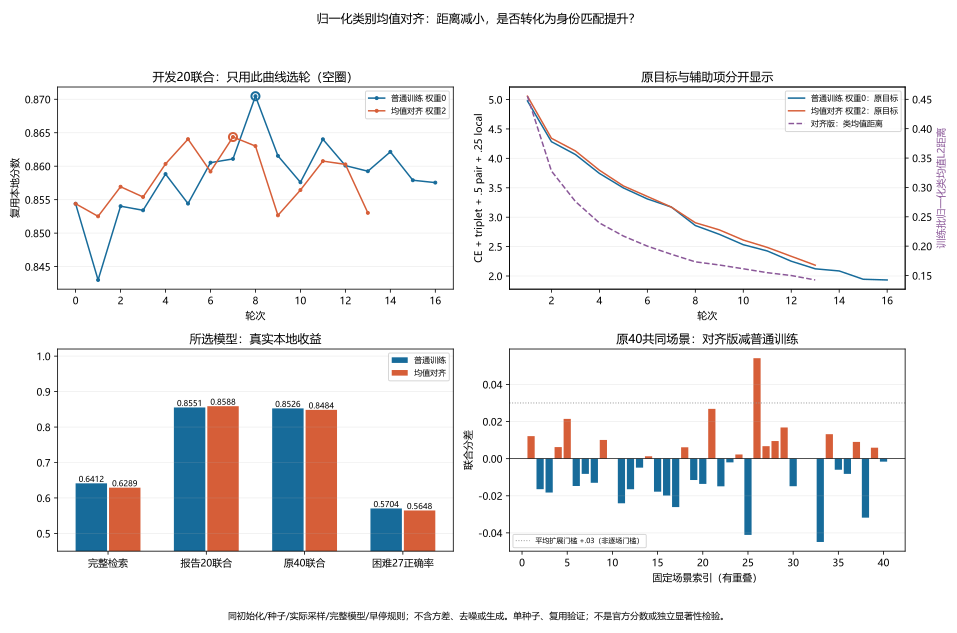

所选模型固定后重新编码同一462 TRAIN身份的全部1,204真实观测（695光学/509 SAR），原像素、无增强/Dropout：

| 身份等权TRAIN诊断 | 新普通控制 | 均值对齐 |
|---|---:|---:|
| 跨模态归一化类均值L2距离 | 0.447728 | 0.160691 |
| 最好真配对余弦相似度 | 0.891336 | 0.985934 |
| 最强异身份负例余弦相似度 | 0.857188 | 0.980578 |
| 正例减最强负例余弦间隔 | 0.034149 | 0.005356 |
| 原始CLS余弦首选正确率 | 86.7605% | 85.9307% |

模态距离降低64.11%，但异身份负例相似度上升0.12339，比正例上升0.09460更多；身份间隔压缩84.32%，首选率下降0.83个百分点。光学/SAR类均值半径反而由0.99354/0.99773升至0.99907/0.99967，不是靠类内多观测互相抵消、缩短均值向量降低损失；类均值跨模态余弦从0.89744升至0.98688。**该所选配置在TRAIN上确实更强对齐，同时角度上的身份分离减弱。** 这支持“把正负身份都拉得更近”的解释，不证明它是验证退步的唯一原因，也不称完全身份坍塌（TRAIN首选仍85.93%）。原始CLS诊断不是最终可学习配对头，且两版所选轮次不同；没有做多种子或其他损失权重的因果消融。它否决的是这个均值单组件固定先导，不是整套MCRL或所有模态约束。

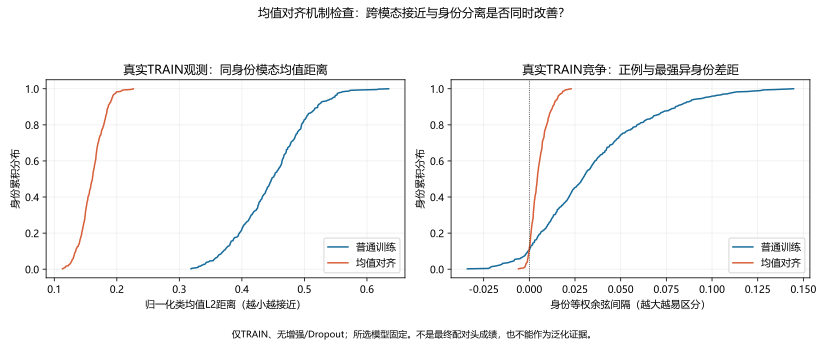

两支各自保存重载银行与独立标量/40个历史控制、模块/源/协议SHA、损失CE+Triplet+.5pair+.25local+2CMAL分解、最佳银行、早停、最新BN计数/AdamW步数及有限模型/优化器/RNG全部通过。机制数据又由另一CPU脚本重建像素门控TRAIN池、全部观测、真实身份划分/显式模态，逐查询独立复算8项汇总及三个逐身份数组，与保存值误差≤1e−12；两个模型元数据精确一致。共28项相关CPU检查通过，新增源码静态/格式检查通过，两张图已实际查看。

两正式训练任务内合计26.72分钟（含CPU/I/O），加单步检查和固定TRAIN编码为28.41分钟；非GPU内核耗时。训练allocated峰值约1,595MiB，TRAIN编码约765MiB。本地GPU任务均退出、共同锁释放，无付费GPU、测试推理或新提交，官方最好第五版0.7185908013668432保持。匿名绑定见[训练对照](evidence/2026-10-11-cmal-training.json)、[TRAIN机制](evidence/2026-10-11-cmal-geometry.json)、[独立机制复算](evidence/2026-10-11-cmal-geometry-audit.json)，原像素、身份、特征、成本和权重仅留local。

## 早期区域研究的复现与核验

本轮公开方法消融图和逐项来源记录见[论文组件证据](evidence/2026-10-11-training-method-evidence.json)。此图是原论文实验，不能混入本地或官方成绩表。已映射来源身份的额外观测计数见[TRAIN成员证据](evidence/2026-10-11-hoss-extra-observations.json)，原始成员名留local。

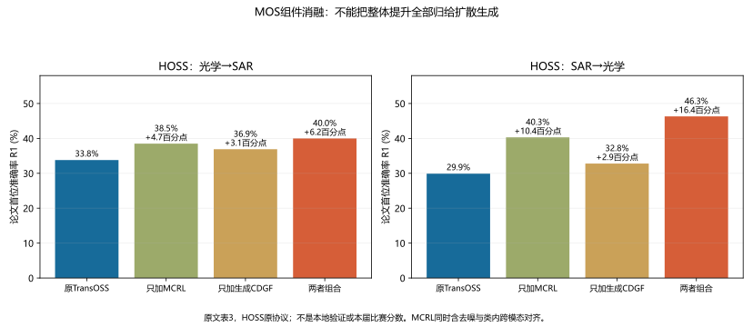

准备区域使用prepare_axial_regions.py，在查看private-region-quality.png之后，由extract_axial_features.py通过共同GPU锁提取新目录。train_domain_axial_head.py分别以--mode control|domain|axial运行新目录，24轮上限和seed固定。study_pair_verifier.py独立复算保存排名和40个native场景；verify_domain_axial_models.py在新进程重建三模型，550k成本矩阵均精确复现。analyze_domain_axial.py输出身份成对区间和三张科学图；study_domain_complement.py只做一次等权平均，publish_domain_axial_evidence.py发布匿名SVG/统计。

两个新增CPU测试覆盖池化权重/常数特征/轴反向、旧网格距离等价、模型置换不变与冻结全局头梯度；静态检查通过。4组独立排名综合分和160个原native集合控制通过，三模型保存重载、同训练源快照及采样/更新一致通过。融合脚本补齐显式变量初始化和源快照后在v2目录重放，矩阵/排名/分数与第一份完全一致。

三个训练进程内计时约490.7秒，提取128.7秒，独立模型重放13.6秒，合计633.0秒；这是含CPU/I/O的任务内耗时，不是GPU内核计时。峰值allocated约1,239MiB。本地GPU任务结束、无付费算力/测试图像/新提交。区间条件于固定模型和图库，不包含反复选模、训练随机性、区域规则选择和官方分布变化。完整匿名证据见[本轮记录](evidence/2026-10-09-domain-axial-matching.json)。
