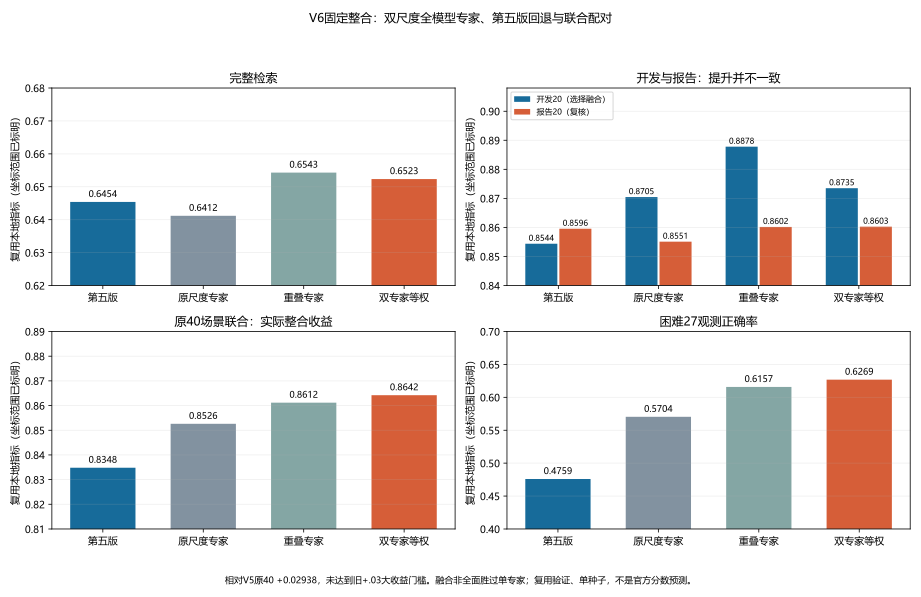

# V6：双尺度全模型专家与第五版联合匹配

2026-10-11。用户要求形成可用V6，复用已经训练并固定的检查点，不再训练、扫权重或租GPU。后经用户明确授权，20:30已正式提交，今日1/3、总计第6次；原[待评审回执](evidence/2026-10-11-sixth-submission.json)保留。随后网站确认已评审，Public为**0.7176979442239859**，比第五版0.7185908013668432低**0.0008928571428573**，基本持平略退步；官方最佳仍为第五版。见[正式成绩证据](evidence/2026-10-11-sixth-score.json)。

官方结果没有支持这组融合的泛化提分；原40和困难额外观测上的本地改善不能换算成官方增益。报告20仅+0.000710的弱改善与官方近乎持平相符，但总分不含分方向/逐查询反馈，不能据此判定是融合、处理域规则或具体专家造成退步。保留V5为官方最好，不把V6固定融合升级为最佳基线。

## 组合与边界

在既有像素规则接受的黑边处理域光学行，使用原尺度全模型专家（patch步长16，固定第8轮）与重叠patch全模型专家（步长8，固定第9轮）的配对成本等权平均。两支沿用各自训练的全局/局部配对头及既有成本尺度，没有额外标准化。其他光学行的成本逐元素保留第五版；全局指派仍可能因竞争改变其最终伙伴。

随后沿用第五版跨查询联合指派、像素重复桥接与第三版候选尾序；O2O及常量SAR查询不变。119对是算法指派数量，不能解读为119对正确匹配。公开任务的共享身份假设尚未取得隐藏标签验证。没有用外部HOSS测试标签对照公开查询，也没有新增推断身份的元数据规则。

均值对齐固定权重2的实验整体退步，因此不加入。SAM、此前失败的冻结特征重组、DSMCL等也没有因为“集大成”被混入。V6的主要新增收益来自全模型专家，融合本身只有有限互补。

## 固定比较

这里“困难27”是统计简称，严格指每个120身份验证模拟中，从多光学观测身份抽取的27张查询，并把这27张查询本身移出光学图库；图库保留同船其他观测。其余93张查询本身保留在图库。分组在评分前固定，使用本地验证标签构造，未按模型输赢挑选，也不是全部难例或独立难度标签。所报正确率是跨查询身份配对正确率，不是完整检索分数。

V6没有部署简单/困难分类器，也不使用公开隐藏标签路由。实际专家启用条件只是既有黑边/细长内容像素规则；这个处理域可以同时包含容易和困难样本。因此不能把困难27的收益理解为公开任务中已准确找出所有困难查询。

比较三种事先固定的融合：原尺度/重叠等权、第五版/重叠等权、三支等权。只在三种融合之间按development20联合分选择，专家轮次已固定。完整检索、reporting20和原40场景不选权重或轮次；它们也不是新的独立留出集。单独重叠专家在完整检索和development20上更高，不能称融合全面优于单模型。

| 方案 | 完整检索 | 开发20联合 | 报告20联合 | 原40联合 | 困难27正确率 |
|---|---:|---:|---:|---:|---:|
| 第五版 | 0.645383 | 0.854388 | 0.859555 | 0.834800 | 47.59% |
| 原尺度专家 | 0.641177 | 0.870456 | 0.855102 | 0.852603 | 57.04% |
| 重叠专家 | **0.654299** | **0.887802** | 0.860166 | 0.861168 | 61.57% |
| **V6：原尺度/重叠等权** | **0.652339** | **0.873513** | **0.860265** | **0.864183** | **62.69%** |
| 第五版/重叠等权 | 0.654912 | 0.869256 | 0.865978 | 0.856064 | 58.24% |
| 三支等权 | 0.654357 | 0.865700 | 0.870429 | 0.858352 | 59.07% |

表中加粗单模型数值用于突出其相对V6的优势，不是所有行的全局最优标记。完整检索包含原生Top50规则下保存的排名，联合场景为同一套历史条件模拟；最终公开预测则继承第三版尾序，口径不能混用。

V6相对第五版完整检索+0.006956、原40联合+0.029383、困难正确率+15.09百分点；报告20仅+0.000710。原40中34改善、0持平、6下降，差值中位数+0.029569，但场景重叠且验证长期复用，不能当作34次独立确认。

相对单独重叠专家，V6原40仅+0.003016、困难正确率+1.11百分点，完整检索−0.001960、开发20−0.014289。不是加入第三支就更好，也没有全面优于单专家的证据。

此前研究的“原40相对第五版至少+0.03”扩大门槛仍未通过，准确差距0.00061693018353168；不能四舍五入改成达标。这次生成的是用户新要求的实用整合版本，并不据此扩大训练或宣称显著突破。无法把本地数字换算成官方0.8或0.9。



## 文件、验证与资源

候选：`local/submission-v6-native-overlap/prediction.json`，48,063字节，SHA256：

```text
97ef995f3e252888864a460f49d5601f603c40010806bc198d7a490dd2731770
```

267条查询：O2S120、S2O120、O2O27，每条10个唯一合法候选。相对第五版29处指派改变，排名改变O2S29/S2O28/O2O0。公开光学规则接受84/120，本地验证166/765；两者构成不同，尤其不能直接从局部分组收益预测官方涨幅。非接受域公开36行成本精确回退。

生产器先重放第五版公开预测，并在GPU重编码后精确重放两支专家全部验证成本银行，再计算公开查询特征；重复公开评分一致。独立CPU审计绑定数据、划分、程序、检查点、协议、成本及特征摘要，重建像素桥接与等权成本；以NetworkX blossom匹配算法替代生产器的自写Hungarian算法，重放第五版与V6最终预测及私有配对。提交格式验证只检查结构，隐藏标签准确率未验证。

本地4060 Ti任务用时81.125秒，含CPU/I/O，allocated峰值4,245.93MiB；零优化器更新、零付费GPU。生产任务退出，GPU锁释放。生成与审计阶段没有上传；随后20:30的正式提交已另存回执，原生产报告及独立审计作为提交前记录保持不改写。

规范研究目录为`local/v6/fusion-screen-v3`。早期v1旧协议字段读取失败保留，v2补充非门控行浮点精确回退后重跑v3，指标不变。生产器早期导入错误、审计初次缺少SciPy的失败记录保留；审计改用已安装NetworkX，没有安装依赖。正式结果仅取成功且独立审计通过的记录。

工具：`study_v6_fusion.py`固定CPU比较；`study_pair_verifier.py`独立标量复算六份完整排名及原40；`analyze_v6_fusion.py`聚合、画图和匿名证据；`build_v6_submission.py`GPU生产；`audit_v6_submission.py`独立CPU预测审计。源数据、图像、特征、身份、预测与检查点仅留local；公开[融合证据](evidence/2026-10-11-v6-fusion.json)及[提交审计证据](evidence/2026-10-11-v6-submission.json)只含匿名汇总与摘要。
