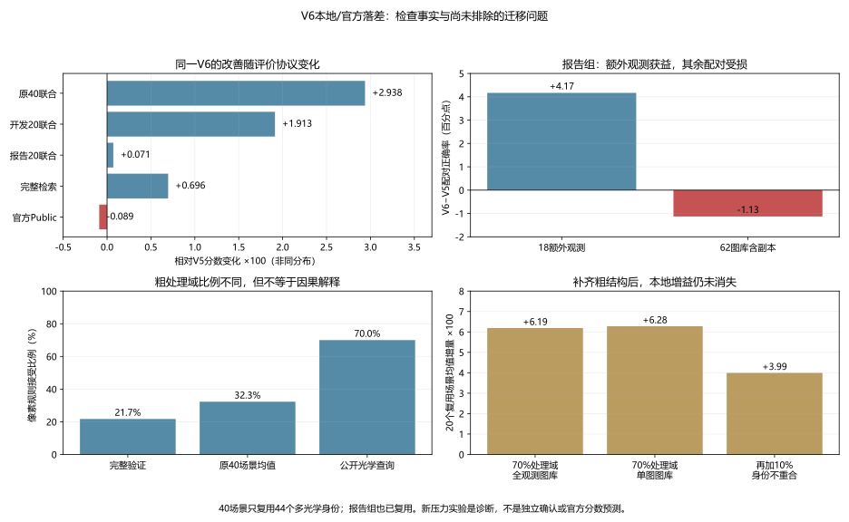

# V6本地改善与官方持平：诊断和下一阶段方向

2026-10-11。V6 Public 0.7176979442239859，V5 0.7185908013668432，差−0.0008928571428572507。V5仍为正式最佳。下面区分已核验事实、排查范围和下一步假设；不是已经定位隐藏查询错误的结论。

## 早已有不一致信号

| V6相对V5 | 改变量 |
|---|---:|
| 原40场景联合分 | +0.029383 |
| 开发20场景联合分 | +0.019125 |
| 报告20场景联合分 | +0.000710 |
| 完整检索分 | +0.006956 |
| 官方Public | −0.000893 |

本地不是普遍提高0.03。我们在发布时没有隐瞒其他指标，但判断上对原40与困难27的正面信号赋予了过大权重。尤其只在三种融合里选择，尽管单独重叠专家完整检索及开发20更强：用户要求整合并不构成限制候选必须融合的技术理由。这是选型限制不足，不证明改提交单专家必然更好；它尚无官方结果。

报告20中每场80身份，18额外光学观测、62图库含副本查询。V6对前者配对正确率55.28%→59.44%（+4.17百分点），对后者96.21%→95.08%（−1.13百分点）；整体配对正确率仅87.00%→87.0625%。额外观测收益和其他配对退步相互抵消，早于官方反馈已经提示不稳定迁移。

原40反复从同一44个多光学验证身份抽27个额外观测；开发/报告的多光学身份分别26/18。重抽场景增加的是条件组合，不是新身份或新来源。报告集合也已长期复用，不能称独立确认。对同一验证反复做研究和选择会损害外部泛化证据，这与[自适应数据分析和验证复用研究](https://arxiv.org/abs/1506.02629)的一般问题一致；没有据该论文估计本项目具体偏差量。

联合指派要求多个查询竞争同一个伙伴，分数变化可以引起整组交换；局部子组改善不保证其他配对不受损。官方只给总分，不能判定哪些交换纠错、哪些引入错误。隐藏共同身份和不同身份假设仍未验证。生产时两专家验证银行精确重放、公开成本重复一致，独立NetworkX重建最终预测通过，上传SHA匹配。因此目前没有实现或错文件证据支持把这次差距解释为提交故障。

## 新做的粗结构排查

CPU冻结V5/V6/单独重叠三银行，20个固定新抽样种子202610110–202610129。这些身份及标签仍来自已复用验证；是在已知官方结果后的诊断，不能当新留出或再次挑权重。没有训练、GPU或提交。

像素规则接受比例：完整验证166/765=21.70%，原40平均38.725/120=32.27%，公开光学84/120=70%。公开27张额外光学观测均接受同规则；像素关系可知，但没有公开跨模态身份真值。

固定构造120身份，其中27额外光学、57其他接受域、36非接受域查询。保留同一组真实观测，比较以下图库/身份压力；图库稀疏化时每个双模态验证身份各留一张，数量小于公开900文件，也没有保证公开每个文件为不同身份。

| 诊断场景 | V5 | V6 | V6−V5 | 单独重叠 |
|---|---:|---:|---:|---:|
| 70%处理域，全观测图库 | 0.642201 | 0.704080 | +0.061880 | 0.722641 |
| 70%处理域，单观测图库 | 0.652369 | 0.715139 | +0.062770 | 0.733829 |
| 再替换10% SAR查询为不重合身份 | 0.592884 | 0.632808 | +0.039925 | 0.650380 |

三组均20/20增益，但不是20个独立测试集。查询两端独立随机重排后，所有汇总与排序输入版差≤1e−12；源绑定和逐场景均值复算通过。银行冻结，仅匿名汇总公开，原始排名/身份仍local。新评分沿用既有独立标量程序，本轮没有再实现第三套指标程序，审计范围据实记录。

**在这些模拟中，匹配粗处理域比例、稀疏图库和轻度不重合都没有消除本地增益。因此不能把官方失败简单归因于这些因素，也不能说已经证明它们毫无影响。** 同一像素规则不等于相同图像来源、分辨率、船型或SAR散射分布；身份/内容迁移以及长期验证选择是仍未分离的主要嫌疑。更大的不重合比例与其他结构本轮未测试。

## 下一步优先级

先改变证据标准：旧40只用于诊断，不再作为“明显收益”的主要凭据。冻结新协议，在身份/近重复图像簇上隔离训练、开发和封存评价，按可见处理方式/分辨率分层；没有可靠来源标签时只能称图像簇隔离，不能谎称来源隔离。重新训练对应控制与候选，避免新划出的评价身份已被当前微调初始化或配对头监督。预训练是否见过相关来源另行记录，不能承诺初始化完全未见。封存评价只在预先固定的候选与选轮规则完成后打开，不逐轮观察后修改方案。完整检索、匹配模拟、额外观测和其他查询分别报告；不重合压力为敏感性检查，不解释成真实测试比例。

主攻候选改为**更广训练覆盖的端到端跨模态配对表征**。当前两支V6全模型专家只在462个接受域TRAIN身份上微调；全部双模态TRAIN有2,819身份。V5基础模型/头此前已使用更广训练，所以这不是“以前从未用过其他身份”，新点是把最近这套全模型配对优化从狭窄专家池扩大到更广训练分布。匹配初始化、损失、输入和更新预算，比较462池与全TRAIN分层采样，不同时引入新损失或大架构；记录身份覆盖、样本暴露、正式更新和实际计算成本。若兼顾两处理域需要分支或V5保持约束，作为之后单独消融，不能预先把其收益算进去。

这项方向改变当前任务微调的身份/负例/处理方式覆盖，针对泛化问题，比继续延长同462身份训练、堆SAM/均值项或扫融合权重更值得先检验；**仍没有明显提分的实测结果，也不能保证0.9**。首先以新协议判断是否有跨身份改善，至少第二种子复核，并要求额外观测收益不以其他组持续退步换取；达不到预先固定的显著增益标准就停止该配置。若确有明显信号，再用正式训练数据重训部署，并通过官方提交做外部检验。

V5保持比赛最佳；暂不直接再上传另一种等权融合。实现/证据：`study_v6_transfer_gap.py`、`analyze_v6_transfer_gap.py`，[诊断汇总](evidence/2026-10-11-v6-transfer-gap.json)、[审计范围](evidence/2026-10-11-v6-transfer-gap-audit.json)。这一轮只完成诊断与方向制定，没有新GPU训练或预算消耗。
