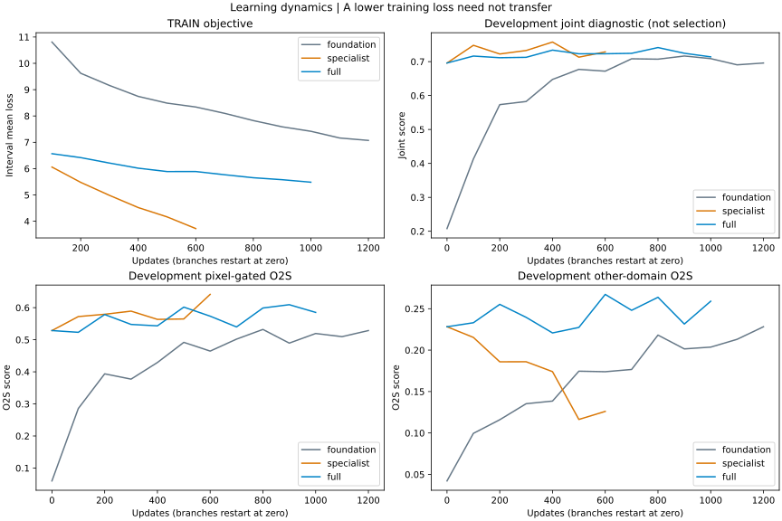

# 新封存评价与训练覆盖对照

2026-10-11。V6官方0.717698未超过V5的0.718591。新封存对照已完成：扩大池继续训练改善完整检索，但联合配对几乎不变，未通过事先门槛，不扩第二种子或提交。

重新划分全部可用标注TRAIN，将同身份与已有审计检测到的近重复组件放在同一分区。沿用无效图、冲突与精确副本排除；三分区精确像素哈希无重叠。没有可靠来源编号，不能声称已隔离所有拍摄来源或未知近重复。

| 分区 | 身份 | 跨模态成对身份 | 接受处理域 | 其他域 | 图像 |
|---|---:|---:|---:|---:|---:|
| TRAIN | 2479 | 2471 | 402 | 2069 | 5199 |
| 开发 | 528 | 526 | 82 | 444 | 1108 |
| 封存 | 527 | 525 | 82 | 443 | 1102 |

这是新的监督/选型划分，整个标注语料此前已研究过，不是新获取的数据。分区准备只用标签、已审计关系和像素处理域检测，不看封存模型成绩。作者预训练来源声明为场景配对，未独立确认每张源图；不保证绝对未见来源。

旧V5及旧身份微调权重不能用作起点：新封存身份可能曾进入旧监督。公共起点重新加载经严格核验的TransOSS场景配对预训练骨干，随机初始化分类器与全局/局部配对头。在2471个TRAIN成对身份上训练，开发集选择公共起点，然后复制给两支；分支优化器均重置。

固定原尺度256、stride16，每批8身份，每模态2观测；单观测允许重复，不把增强称为新观测。原身份分类/三元组目标加0.5配对与0.25局部目标。骨干SGD 5e-4，头AdamW 1e-4。公共起点最多1200步，两支各最多1000步；每100步评价，最少600步，耐心4次，显著改进阈值0.001，保存开发完整跨模态分最高模型。

小池专家每步8接受域身份，全TRAIN组每步4接受域+4其他域身份，组内均匀抽样。最大更新预算相同，但目标域暴露8对4，比较的是两种训练方式，不能把差异单独归因于身份数量。

预算限制：旧TransOSS起点在53轮被选择，本次公共起点上限1200步明显较短；这次是预算固定的筛选，不是所有模型都训练充分后的容量比较。未通过门槛只能否定当前预算和配置，不证明充分训练的全TRAIN路线无效。若选中点仍紧贴预算上限且曲线上升，需要另外设计开发阶段的训练预算，不能先看封存再用同一封存集调轮数。

开发选择指标是0.5×(完整图库O2S分+完整图库S2O分)，两方向分均为0.5×(R@1+mAP@10)。联合模拟仅诊断：10个固定80查询共同身份场景，18额外观测、38接受域源观测、24其他观测；0.45/0.45/0.10方向权重。该模拟不是官方120查询协议，也不保证全部官方身份共同出现。

两支均完成并锁定后，只做一次封存评价。事先固定扩大门槛：全TRAIN减小池专家，完整跨模态至少+0.03、联合至少+0.01、额外观测配对不降、源观测配对最多下降0.005。满足后复跑两支第二种子；不根据封存结果改采样、损失、融合或轮数。

本地4060 Ti 16GB，冒烟梯度检查通过，allocated峰值1435MiB。无付费GPU、自动比赛提交。协议见[匿名证据](evidence/2026-10-11-coverage-protocol.json)。

## 完成结果

| 模型 | 实际更新 | 开发选择步 | 开发完整跨模态 | 封存完整跨模态 | 封存联合 |
|---|---:|---:|---:|---:|---:|
| 新公共起点 | 1200 | 1200 | 0.287328 | 0.242214 | 0.683692 |
| 小池专家 | 600 | 0 | 0.287328 | 0.242214 | 0.683692 |
| 全TRAIN组 | 1000 | 600 | 0.324974 | 0.275988 | 0.684539 |

小池600步到最低步数后耐心耗尽，选回第0步；全TRAIN组1000步时耐心耗尽，选600步。公共起点触顶且最佳点在末尾，未证明训练充分。两支最大预算相同，实际早停步数和最终选用模型的更新量不同。

封存完整跨模态差+0.033774，按522个身份/已有近重复组件成对重采样5000次的95%区间为[+0.010292,+0.057547]。这是对固定标注语料与选型的条件区间，未覆盖新来源偏移、选型多重性或预训练来源不确定性。接受域O2S从0.415594到0.440048，其他域从0.210949到0.239357；两组的完整图库排序均改善。

但是，封存联合仅+0.000847，未达+0.01。额外观测配对43.89%→42.22%（−1.67百分点），源观测68.39%→68.87%（+0.48百分点）。10个固定场景共800次配对中，两模型都正确503次：全TRAIN组额外观测79→76、源观测424→427。这里是重复场景的配对次数，不是800个独立身份；联合得分还包含尾序和O2O桥接，所以正确对数相同而分数有微小变化。没有形成比赛核心配对能力的显著收益。

小池优化的开发接受域O2S由0.528645升至末步0.641456，但其他域由0.228230降至0.126066，完整跨模态降至0.220534，尽管训练损失从约6.05降至3.72。它表现出明显的域间取舍，不能仅依据接受域或联合场景高点选模型。

## 覆盖与因果限制

公共起点实际抽到2272/2471身份，小池402/402，全TRAIN分支2177/2471。两阶段全TRAIN采样使用相同种子，分支重复公共训练的前1000步采样，合计仍只见2272身份。故这不是所有2471身份都遍历的实验，也不是向公共起点增加了新身份的独立消融。它检验的是在共同广域起点上，继续混合训练和窄域继续训练的差异。来源混杂、每步接受域曝光、实际选用步数、欠训练均限制因果归因。

## 结论与下一阶段约束

这轮证明完整图库的排序收益可以迁移到新的监督封存身份，却不保证联合配对收益。当前配置停止扩大，不生成V7。第五版0.718591继续是官方最好；此处绝对分数与旧验证或官方不能横比。

下一阶段先在开发数据上定位额外观测的错误：单对首选是否已经错、全局指派是否改错、光学桥接是否失败，再决定是否改训练目标。更充分的公共骨干训练仍未排除，但不能把本轮完整+0.034当作支持官方大涨的证据。新的损失/批次/预算需在开发阶段确定，并使用新确认协议；已经打开的封存集只留作历史诊断，不能继续冒充未见确认集。

三份模型的选中开发特征/节点/成本精确重载；起点相等、身份/近重复/精确像素隔离、每步采样与摘要、选轮与早停、封存排名和独立标量R@1/AP、固定门槛均核验。最初审计误把日志换行纳入摘要，失败记录保留；按生产定义只哈希JSON正文后通过，没有改变模型或分数。两图已实际查看。正式训练共2800步，allocated峰值1585MiB；内部计时含解码/I/O，正式训练约35.81分钟，另有冒烟20.33秒和封存35.97秒。全部本地GPU，未使用隐藏Query/Gallery像素，无付费或新提交。详见[结果与独立核验](evidence/2026-10-11-coverage-results.json)。

收尾重新取得并释放共享GPU锁，确认无计算进程；8份相关完成任务标记本地指标已审计，失败审计记录保留。GPU任务实际墙钟合计37.69分钟，包含CPU/I/O，不能解释为纯GPU忙时。[收尾证据](evidence/2026-10-11-coverage-closure.json)。
