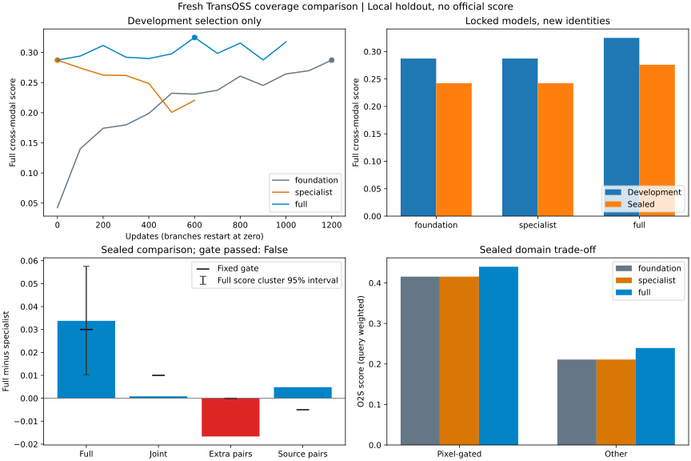
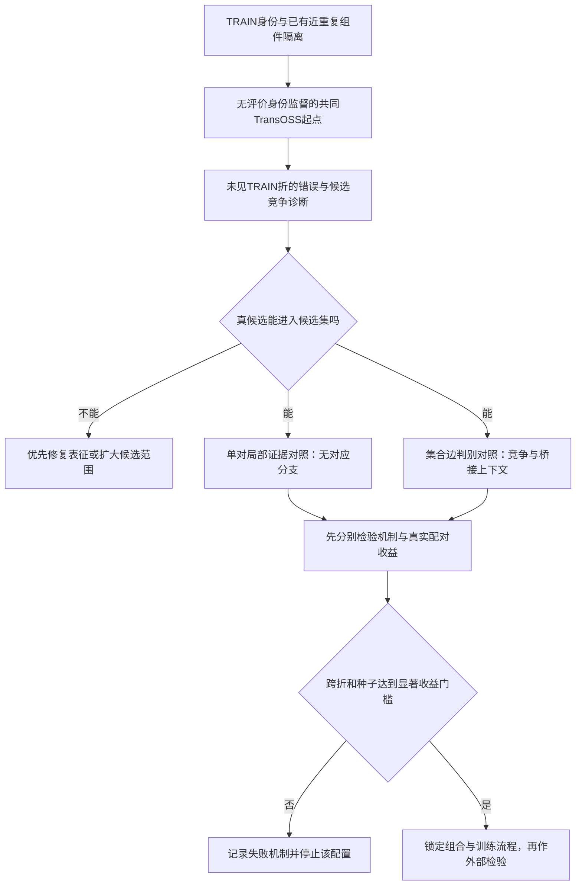

# 从局部身份证据到集合配对的研究方案

2026-10-11。本轮重新阅读TransOSS、MOS、DSMCL的方法与消融，并阅读局部特征匹配、数据库实体关联、组合决策学习、多目标跟踪和单细胞多模态整合的相关原文。目的不是再列一批损失函数，而是解释：为什么完整检索改善，却没有稳定改善比赛中的联合配对。

后续用户建议跳出训练范围，因此本文训练实验暂缓，当前主线转为[冻结模型的图像关系与联合决策研究](39-inference-research.md)。本文保留为文献与候选方案记录，不代表将继续启动新头或骨干训练。

当前官方最好仍为V5的0.7185908014，V6为0.7176979442。本文是研究方案，尚未实现新模型或取得新分数；本轮没有GPU训练、付费算力、隐藏测试图像访问或提交。文中的实验门槛是事前决策标准，不是预计收益。

## 一、目前真正知道的瓶颈

**已经确认的瓶颈是：未见身份的困难候选辨别没有稳定改善，而我们常用的训练和选模指标不能充分反映这项能力。** “局部不可见证据被强制匹配”和“集合竞争信息被过早压缩”是解释这个瓶颈的两个可检验假设，尚不是已证实原因。还不能声称现有像素信息不足，也不能排除公共骨干训练不充分。

| 证据 | 支持的判断 | 不能据此推断 |
|---|---|---|
| 原40场景，Hungarian救回620次、改错159次，净增加461/4800次正确配对 | 集合约束已经有效，直接取消它会损失已有收益 | 改错的159次在推理中可被自动识别 |
| 分配后839次错误，其中680次单对首选已经错误，约81.0% | 大多数残余错误需要改善候选身份证据或其使用方式，不能只修求解器 | 680次都是不可辨认图像，或全局上下文完全无用 |
| 新覆盖对照完整跨模态+0.033774，联合仅+0.000847，额外观测配对−1.67百分点 | 完整图库排序的迁移收益不等于比赛核心配对收益 | 扩大训练覆盖普遍无效；公共起点1200步触顶、仍可能欠训练 |
| V6原40联合+0.029383，复用报告组仅+0.000710，官方−0.000893 | 旧条件场景的正面结果不足以支持显著外部收益 | 已定位隐藏测试的具体错配或官方失败原因 |

上述配对次数包含同一身份在不同场景的重复出现，不是独立样本数；本地配对准确率、联合模拟分和官方总分不能互相换算。来源见[可视化错误分析](32-visual-observation-analysis.md)、[覆盖对照](37-coverage-research.md)和[V6迁移诊断](36-v6-transfer-gap.md)。

这张图来自已经完成的覆盖实验，不是新方案的结果或预测。小池组选择回公共起点，全TRAIN组选择600步；目标域曝光、实际选用更新数、公共起点欠训练以及采样前缀重复都限制因果归因。

困难组也存在重要混杂：原40中的额外观测反复来自44个多光学身份，多光学图全部属于黑边处理域，同域单光学图也更难。因此应分别控制身份、处理域和观测角色，不能把47.59%与93.59%的差异直接叫作“视角问题”。

## 二、本领域论文究竟解决了什么

### TransOSS：提供共享表示，但没有解决本题的集合关联

TransOSS使用模态专属tokenizer、共享Transformer及模态嵌入，并引入基于图像尺寸与GSD的近似船舶尺度。原文也承认裁剪边界和未精确校正会影响尺度。我们的比赛输入没有可靠GSD，恢复裁剪像素高度不能替代物理船长。原论文的检索设置也不等同于本题查询间的条件联合配对。[TransOSS原文，第4节](https://arxiv.org/html/2506.22027v1)

当前V5在这个表示上另加全局配对头与局部判别头。核对`track6/local_pair_verifier.py`（局部头源码）：layer-6特征池化为4×4节点，每个节点对另一图全部节点做softmax加权平均，再汇总局部比较特征。重要性权重可以降低一些节点影响，但每个节点的匹配过程没有显式“无对应”选项；这些节点也没有船体部件标注。故存在一个具体疑问：不同观测只共享部分可见身份证据时，平均匹配是否混入不可对应区域？

### MOS与DSMCL：分布一致性有价值，但不是身份证据充分性的保证

MOS包含SAR去噪、类条件均值/方差对齐，以及生成SAR后的特征融合。其HOSS消融中S2O R@1：基线29.9，MCRL单独40.3，生成分支单独32.8，组合46.3。不能把组合收益全部归于生成。论文先从标准差距离推导近似W2，最终式12写方差距离；现有项目还记录了作者代码与论文范数的差别，后续若复现必须指定版本与公式。[MOS，第3节及表3](https://arxiv.org/html/2512.03404v1)

DSMCL将空间一致性具体化为类条件均值与标准差距离，并用频域身份对比保留判别细节。原文指出少量类内样本使完整协方差估计秩不足，采用对角近似。我们很多身份只有单次真实观测，重复增强不能创造新的跨观测分布。[DSMCL，第III-B、III-C节](https://arxiv.org/html/2608.06943v1)

本项目只测过固定权重2的归一化类均值组件，完整检索下降；训练模态均值距离减少的同时，身份间隔也缩小。它不是完整MOS或DSMCL的否定实验，更不能据此断言所有对齐都会塌缩。它足以说明：**模态更接近必须同时检查真对相对最近假对的优势，不能把对齐量下降当作成功。** 本轮不把完整分布损失或扩散生成列为第一项投入。

## 三、跨领域找到的可迁移结构

### 局部特征匹配：允许部分证据无对应

SuperGlue在上下文交互后进行带dustbin的部分匹配，明确表示不可匹配关键点；训练对应与无对应标签由位姿/深度或单应变换得到。可借鉴的是“匹配性”和“拒绝局部对应”，而不是直接换成Sinkhorn就能提分。我们没有光学/SAR真实部件对应标签，跨时间观测也未必满足刚性平面几何，必须改成身份监督下的弱监督模型。[SuperGlue，第3.2–3.3节](https://arxiv.org/pdf/1911.11763)

迁移假设H1：在相同16节点输入与冻结骨干下，显式无对应分支能提高困难正对相对于最相似负对的辨别间隔。若只改善填充扰动测试，却不改善真实未见身份，则不能认为解决了比赛瓶颈。像素网格距离仍只是特征关系，不能冒充物理配准。

### 数据库实体关联：身份链接是相互依赖的整体决策

Sadinle把两个文件的实体链接直接建模为二部匹配，而非独立判断每一对再修补冲突；模型可表达匹配不确定性，并在某些损失下保留未决链接。原方法依赖其比较字段模型和先验，不保证能直接用于视觉特征。[Bayesian Estimation of Bipartite Matchings for Record Linkage，第4–5节](https://arxiv.org/pdf/1601.06630)

迁移假设H2：保留候选竞争和桥接的不确定性，比“单对压成标量→一次硬配对→桥接”更能判断容易混淆的身份。比赛仍须给每个查询10个合法图库结果；未决只发生在内部集合耦合，输出使用完整图库回退，不能提交空答案。相同图像的像素副本不是独立身份证据，不可重复计数。

### 多目标跟踪：学习关联阶段，而非只学习外观距离

Brasó与Leal-Taixé把检测作为节点、关联作为边，通过节点/边消息传递学习边是否属于同一轨迹，并将约束结构融入信息聚合。它提供了学习整个候选竞争图的实例，而不是仅在独立特征后套优化器。[Learning a Neural Solver for Multiple Object Tracking，第3.3–4节](https://arxiv.org/pdf/1912.07515)

这里借鉴的是集合条件下的边判别。我们的节点没有视频时间顺序，不引入运动、位置或成像时间；按光学/SAR/图库桥接关系分别聚合，而不是复制原论文的过去/未来流。它与曾失败的64-patch两图注意力不同：交互对象是不同查询及其竞争候选；也不同于此前固定余弦关系图的FAQ/QAP目标。

### 组合决策学习：优化预测不等于优化最后选择

SPO提出按预测成本导致的决策损失学习，而不是仅按成本预测误差学习。这支持用最终关联质量来检验模型。我们有身份对应标签，未获得真实连续成本分布，不能直接继承SPO+的一致性理论。[Smart Predict, then Optimize，第3节](https://arxiv.org/html/1710.08005v4)

一个与现有行常数反例一致的直接推导：对方形完整一对一分配，设成本越大越好，若

\[
C'_{ij}=aC_{ij}+u_i+v_j,\quad a>0,
\]

则任意置换P的总分为

\[
\sum_i C'_{i,P(i)}=a\sum_i C_{i,P(i)}+\sum_i u_i+\sum_j v_j.
\]

最优置换集合不变。统一温度、加行/列偏置以及将矩阵作行/列**log-softmax**不能改变这一决策；有限次log-Sinkhorn对固定矩阵也只是温度缩放加行列偏置。此处不包括对普通softmax概率求和、部分/矩形分配或改变训练后成本。已有32身份Sinkhorn训练改变了学习目标，不属于这个推导中的纯推理变换。

真正需要改变的是竞争环路的相对优势。例如两身份交换由

\[
\Delta=C_{ij}+C_{kl}-C_{il}-C_{kj}
\]

决定。某一行检索排序改善，未必改善整个交换的Δ。研究应同时追踪错误环路、纠错与损害，而不是继续扫描没有决策作用的校准参数。

### 单细胞多模态整合：几何对齐无法独自确定正确身份

Nature Communications的一篇方法评论用模拟实验展示：不同模态的结构可以都保留下来、投影也没有明显模态间隙，却对应错误的细胞类型；缺少可靠锚点时可能存在数学上同样合理的错误对齐。这不是船舶实验，却警示我们不能以关系图一致或模态混合证明身份正确。[Diagonal integration of multimodal single-cell data，第“pitfalls”与“path forward”节](https://www.nature.com/articles/s41467-022-31104-x)

本题合法锚点应来自公开图像内容及TRAIN身份监督。若新方法只是把同一成本重新排列得更整齐，未增加能排除错误置换的证据，仍可能没有收益。HOSS训练来源的确认不能变成测试身份映射，也不能提供未公开AIS、位置或时间。

## 四、完整方案：先检验证据，再学习竞争

主线是**保留可匹配的局部身份证据，并在候选竞争图上学习关联**。两部分分开验证，只有各自有信号才组合。更充分的共同骨干训练作为公平前提检查，不与新模块捆绑计功。

### 阶段0：建立能产生真实困难决策的研究输入

先用既有开发缓存拆分错误：真候选未召回、真候选已召回但单对落后、单对正确而分配牺牲、桥接/尾序错误。按身份组件计数，再按处理域、观测角色分层。标签只用于离线诊断，推理不能据标签挑选困难样本。共同身份模拟和不重合压力分别报告，不能拿后者推断隐藏测试的重合比例。

保存候选召回@5/@10/@20、最近错误候选间隔，以及禁止当前选中边后重新求解的替代分配。记录两方案差异环路、每条被改变边的平均总分差和真值纠错/损害；推理时只能用分数与候选关系判断不确定性，不能知道哪个环路正确。分差不是校准后的概率。

稀疏图首先取两方向top20并集。若开发中真边召回低于99%，先扩大候选或使用完整查询矩阵，不能让新模块承担被剪掉真边的不可恢复错误。候选召回超过99%也不代表图库首位能够达到99%。

训练输入必须含未见身份式错误。既有100个已见TRAIN身份上的V5 Hungarian错误为0，说明那批小集合没有提供需要纠正的真实置换；它不是全部TRAIN的结论。增大margin让损失激活，不等于获得新判别知识。详见[已有结构损失诊断](evidence/2026-10-10-assignment-training.json)。

采用两层隔离：外层身份组件用于评价；内层将TRAIN身份组件分折，教师仅在其余内折从场景配对预训练起点训练，在未监督内折生成候选、竞争环路与比较统计。关联头可用这些内折标签学习；外层标签绝不参与候选挖掘或梯度。第一轮只做一个内折机制探针，确有足够错误且模型能学到纠错后，才扩为两折覆盖。

跨折骨干坐标可能不同，不能把其原始CLS直接混成一个特征空间。集合头第一轮只接收每个教师内部计算的标量/关系统计与局部证据摘要；局部模块在各自教师训练折内训练。部署教师重训后，必须在开发侧检查这些统计分布是否漂移。这个过程增加的是未见身份式训练错误；它不同于已试过的一阶身份元训练，也不保证优于普通困难负例。

如果共同起点仍在预算末尾上升，先在开发阶段延长共同起点至合理平台并冻结，再复制各分支；不通过查看外层结果反推训练轮数。按轮遍历全部训练身份，记录每模态真实观测覆盖，分支使用独立RNG。避免覆盖研究中“继续训练重复共同前缀”的问题。

### 阶段1A：弱监督局部部分匹配

输入、骨干、16节点数量、候选身份和训练预算固定。当前局部头作为控制；新局部头为节点增加匹配性与无对应分支，保留匹配质量、有效质量总量、双向一致性与不确定性，而不是把所有节点必然匹配后的均值作为唯一证据。先保留softmax匹配实现，仅增加null选项；不同时更换骨干、提高节点密度或加入新损失族。

监督来自TRAIN正负身份对，负例包含相同处理域的最相似身份。对已知人工添加的填充可监督无对应，真实黑色区域和海面不直接标为无身份证据；SAR低值也不等于无信息。正身份只能证明两图同船，不能证明某两个patch对应。因此还要监测“全部拒绝”和“只匹配背景”等退化，并保存固定验证案例的匹配质量图。

添加一个参数量近似的独立门控池化控制：它可降权节点但没有null对应。若新头与此控制一样，不能把收益归于部分匹配。另做null关闭、节点位置/内容打乱压力，分开验证区域选择和真实局部比较；压力图只解释机制，不成为选模主指标。

主输出仍是基线成本加零初始化的局部残差。冻结基线，先验证真实困难正对的最近假对间隔和联合配对是否改善。若只有训练损失下降、合成压力测试变好或普通负对AUC提高，停止扩大。我们此前大量容易负对的AUC很高而首位差，不能再用AUC代替候选身份辨别。

### 阶段1B：集合条件下的边判别

不等待局部模块成功，先在冻结证据上单独测试集合头。节点表示查询或合法图库观测，跨模态候选边保留V5分数、局部证据向量、该候选的竞争强度与可用光学桥接证据。分别聚合共享光学节点和共享SAR节点的竞争边，做两轮消息传递，输出每条边的残差，再由明确约束的分配器决定关联。

没有新视觉观测的像素副本只提供源关系与索引桥接，不当作第二次独立测量。对于确有不同光学观测的候选，保留观测间桥接分布，不先把桥接压成唯一伙伴。是否采用部分分配必须在已知不重合压力中单独检验；主对照保持原硬配对规则，避免模块和可行域一起变化。

集合头首先用相同边标签CE，与独立边MLP对照；控制参数规模、候选图、采样与更新次数。只有新信息聚合有效，才独立比较结构margin辅助项。我们已经实现过Hungarian结构损失，重复这个公式不能算创新。

必要的机制控制是：保留目标边证据，打乱来自其他查询的竞争上下文。如果图模型收益不依赖正确上下文，则它可能只是一个更大的局部判别器。另分别删除图库桥接分支与竞争分支，识别究竟哪一项带来新信息。任何上下文都不能携带身份编号、文件编号答案或评价标签。

训练集合先用8/32个不同身份，再验证80/120规模迁移。每侧每身份选一个真实观测；同一身份的重复增强不是互斥的不同实体，多观测不能被错标成负对。困难集合与普通集合共同训练，不只保留失败案例，否则会引入新的采样与校准偏移。处理域标签只用于分层或内容可见特征，不能强迫所有黑边图同身份。

### 阶段2：只组合通过机制检验的部分

四组最小对照为：共同基线、仅局部部分匹配、仅集合边判别、两者组合。若单模块没有真实收益，不为了“集大成”而加入组合。第一次冻结骨干；有跨身份信号后再将骨干微调作为独立第五组，而不是把头收益、更多更新和新表征混在一起。

若阶段0发现真候选经常根本无法召回，或者阶段1的正负证据在同处理域内无法区分，应转到表示学习和信息量诊断。此时优先检验更充分的共同训练及原始尺度的可保留细节，不能继续以集合求解器修复缺失证据。生成式SAR、更多节点或分布对齐只在发现相应机制后另立对照；没有依据宣称生成模型能恢复输入没有的身份细节。

## 五、评价协议与停止规则

已经打开的覆盖封存集保留作历史诊断，不能再次称作未见确认集。整个标注语料已被研究，重新随机拆分不会创造全新数据。接下来用事前固定的身份/已有近重复组件外折重训练进行条件复核：外折身份必须从初始化微调、教师、头和挖掘中全部排除；开发内折选型，外折只在候选锁定后评价。来源隔离仅在有可靠来源标签时才能声明，像素处理域不是来源编号。

第一轮机制筛选用一个外折、一种子；固定至多上述四组，不扫融合权重。通过后只确认预选候选，在第二外折和第二种子重复。它仍不是对新拍摄来源的独立保证；真正外部证据需要新来源标注或锁定后的官方反馈。不能事后从确认结果中再挑最好一组叫作验证。

开发选择以固定联合模拟分为主，同时设完整检索和其他查询保护约束；完整跨模态排名不再独自决定选轮。官方共同身份条件未证明，另外固定0/10/25/50%不重合压力曲线，明确其属于敏感性分析。保留O2S、S2O、O2O各方向指标和完整图库回退，避免一侧收益掩盖另一侧损害。

显著收益的扩大标准提前固定为：

1. 每个预定确认外折/种子的联合分相对同协议控制至少+0.03，额外观测配对至少+0.10绝对值；完整跨模态分和源观测配对各不得下降超过0.005。
2. 对固定候选和已计算的成对决策，按身份/已有近重复组件重采样权重，报告条件95%差值区间；联合增量区间下界应大于0。该区间不覆盖集合重新决策、训练随机性或反复选型。另用不放回身份子集重新运行两模型的集合决策，报告组合敏感性，不把其分位数叫作同一种置信区间；不能把bootstrap抽到的重复身份直接塞入一对一图。场景数、独特身份数与训练种子分别报告，不把重抽场景当独立复现。
3. 不重合压力中候选相对同协议控制的下降不得超过0.005；如改变拒绝/回退规则，作为单独策略对照，不事后调阈值拯救成绩。
4. 成本/排名重载、独立标量指标、训练与评价身份/像素隔离、候选覆盖、实际更新与采样摘要全部通过。

这些数值刻意要求明显信号，符合用户不继续投入小幅收益的目标；不是统计功效保证。若困难身份太少、区间过宽，应据实报告无法确认，而非反复抽同一身份缩小误差条。若两模块都不通过，不再扫描温度、节点数或系数组合。

每项实验必须留下四类图：真对与最近假对间隔分布；纠错/损害及交换环路；按域/观测角色的训练与开发曲线；固定案例的局部对应与拒绝质量。热图反映模型权重，不等于真实部件解释。全体统计公开匿名汇总，原始像素、真实ID与逐图记录留在local。

## 六、执行顺序、资源和交付

第一步是CPU缓存诊断与教师未见身份小探针，交付错误分解、候选召回和环路图；若没有可纠正候选，先停止图模型。第二步分别做局部null与集合边头的小规模对照，交付机制控制及真实配对损益；第一种子通过才扩外折/种子。第三步只组合合格模块，再决定是否微调骨干。

本地4060 Ti 16GB可承担已有规模的TransOSS训练。最近覆盖轮2800更新的任务墙钟合计37.69分钟、allocated峰值1585MiB，但包括CPU/I/O，不能据此承诺新图模型耗时或全部折数显存。先测缓存、稀疏候选边和单步峰值，再给总预算；骨干分批、节点只编码一次、边分块，避免构造图库级稠密patch交互。教师交叉拟合比单头训练贵，首轮不直接训练多折大集合端到端。

执行沿用现有GPU共享锁。新模块与入口单独添加，保持V5可精确复现，禁止无收益就替换默认配置。本轮仅完成文献研究和方案，不启动这些实验；不申请付费GPU、不自动上传新版本。

研究交付应包含：带版本与方法阅读范围的[文献证据清单](evidence/2026-10-11-literature-research.json)，事前冻结协议，匿名逐组结果和科学图，匹配控制的代码/权重/采样绑定，以及通过或停止的明确结论。外部数据或权重若后来使用，须按已归档规则核对2026-09-01前公开日期与许可；阅读方法不意味着其资产已合规，不引入已删除的DINO实现。

## 七、这条路线的判断

目前最有证据的改变，是把研究对象从“整体检索分是否上升”改为“未见身份竞争中是否恢复了正确的关联证据”。局部部分匹配和集合边判别分别针对两个尚未解决的结构缺口，且能用小对照判明机制；它们因此比继续延长窄域训练、重复结构loss或堆融合更值得首先检验。

我们仍未找到能保证0.72跃升到0.9的方法，也没有证据证明高分队伍用了某种hack。这个方案的价值在于能区分：现有证据使用不当、监督困难结构不匹配、共同骨干欠训练，还是新观测确实缺少足够身份证据。先取得这项区分，再决定规模化投入。
