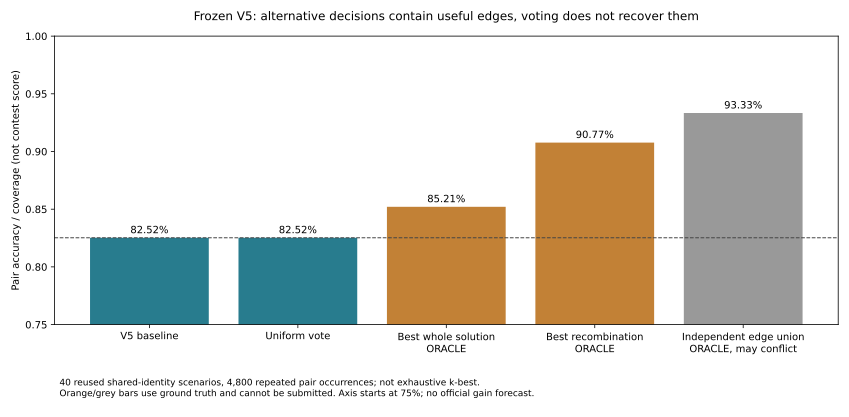

# 暂停训练，研究图像关系与联合决策

2026-10-11。用户建议跳出模型训练范围。后续主线冻结已有TransOSS骨干、全局头、局部头和输入流程，暂停第38章提出的新头训练、交叉拟合教师和骨干微调。下一轮研究对象是公开图像关系、多个配对假设以及最终检索决策，不将训练一个小判别器改称“非训练方法”。

这个转向有历史依据：V3→V4没有新增训练，任务耦合与查询配对使官方0.514408→0.669915，增量0.155507。不过这一层结构已经利用，不能重复包装为新突破；完整匹配的共同不同身份假设仍未证明。

## 已完成的CPU诊断

冻结V5成本，精确复现原40个共同120身份条件场景。对每场景最优分配的每条边，分别禁止该边、重新求其余可行方案的最大总分分配，去重后得到87–100个候选，包含原方案。这不是完整k-best枚举，也不是匹配后验抽样。

40场景的V5正确对数逐场与历史一致；每个禁边替代均符合一对一、未使用被禁止边，原成本总分不超过基线。标签仅用于生成既有场景和评分，候选搜索不使用身份真值。不读取测试像素、不训练或调用GPU；候选研究约82.8秒。

| 全部候选的诊断方式 | 正确对/覆盖次数 | 配对准确率或覆盖率 | 能否部署 |
|---|---:|---:|---|
| 原V5分配 | 3961/4800 | 82.52% | 原基线 |
| 所有候选均匀投票，再求一对一分配 | 3961/4800 | 82.52% | 本轮没有收益，0救回/0改错 |
| 每场用真值挑一套最好的完整方案 | 4090/4800 | 85.21% | 不能；用标签挑选 |
| 在候选边并集中用真值求可行的最佳重组 | 4357/4800 | 90.77% | 不能；目标函数直接用了标签 |
| 逐行检查并集中是否存在真边，不管全局冲突 | 4480/4800 | 93.33%覆盖 | 不能；不是完整可行方案 |

**90.77%是标签辅助的条件配对诊断，不是官方0.9，也不是已经可实现的准确率。** 40场景反复使用同一身份池，其中多光学池只有44个不同身份；没有独立泛化结论。候选按原分数排序前20时，可行重组真值上界4260/4800=88.75%；全候选4357次仅是该有限边集合内的上界，不能作为所有非训练方法的上界。

这轮把问题进一步区分开：单纯换一套完整方案，即使借助标签也只能改善2.69个百分点；局部正确边分散在不同方案中，可行重组的诊断空间约8.25个百分点。**核心缺口是识别哪些局部替代更可信的额外证据。** 简单投票没有提供它。候选彼此高度相关，而且每个替代只针对一条禁边，这项阴性不能否定经过合理建模的后验推断。

Hungarian已经精确优化原成本，换更强求解器不能在相同可行域和目标下得到更高总分或保证更多真对。任何不同决策必须明确来自新观测证据、不同的决策效用或有依据的约束改变。

## 第一优先：光学查询、SAR查询与另一张光学观测共同解释

对于缺源副本的光学查询，不先固定一个O2O首选代理再平均特征。保留少数光学图库候选，同时检查查询→图库光学、图库光学→SAR以及查询→SAR三条关系，再用有限替代环路处理冲突。第三条腿必须来自不同观测；像素副本只作索引桥接，不能重复算作独立证据。

例子：光学查询q直接跨模态更像SAR-A，但另一张光学图库图g与q同模态高度相容，且g的跨模态证据指向SAR-B。研究的对象是这些证据是否足以否定q→A，及改成q→B是否破坏其他查询；不是无条件相信第二跳。

旧第22章已经试过首选第二观测和前二代理平均，native条件收益约0.02，不能将这次称为首次使用第二观测。新的必要差异是：保留代理歧义、利用现有V5对不同观测的成本、联合决定代理与跨模态配对，并对发生冲突的局部环路比较证据。若不能超过原固定代理控制，不继续扩大。

2026-10-11再次核对已有代码与缓存：`tools/study_observation_proxy.py`也已经测试V5固定首选光学代理，再等权融合原查询与代理的跨模态成本。原40场景联合分0.834800→0.847566（+0.012766），配对准确率82.52%→84.27%；困难27组47.59%→54.72%。因此不应仅以旧native的约0.02作为对照，新研究至少必须与这份V5固定代理控制比较。该结果来自复用的条件模拟，不是官方增量，未达到原+0.03扩大门槛。

同一报告的标签诊断中，用已知正确的另一张光学观测替换困难查询、仅依赖替换后的跨模态成本，困难组正确率仅47.59%→49.35%。这不是联合三方融合的上界，但说明“代理身份选对”本身不足以保证SAR匹配；需要检验两张观测的互补信息是否真正区分错误替代，不能假定多保留几个代理自然会提分。既有报告为`local/pair-verifier/observation-proxy-diagnostic-09/report.json`，本次仅核对，没有重跑或新增实验。

[第40章](40-vlm-blind-pilot.md)的GPT子代理试验只比较单张查询与五个候选，未给出第二张光学代理，也未联合决定三方关系。其阴性结果针对通用视觉代理直接判别，不是本节三方联合方案的实测结果。本节目前仍是待完成证据分解的研究假设；已有有限分配诊断和固定代理对照，尚无新的多代理联合算法或收益。

在机器人多视图关联中，[CLEAR](https://arxiv.org/pdf/1902.02256)联合修正成对关联并保证闭环一致；[MatchLift](https://proceedings.mlr.press/v32/chend14.pdf)利用多个实例的冗余关联纠错。它们启发使用真正的第三组观测，但不是现成本题答案：CLEAR要求每个view内实体互异，本题900图库文件不等于900身份；MatchLift的随机错误恢复条件也不能用于同一模型产生的相关错误。本文只借鉴结构，不宣称复现或继承恢复保证。

先在已标注数据上诊断：正确第三观测是否确实增加真SAR相对假SAR的优势；推理可见的候选是否召回该观测；可见三角一致性是否能区分真、假替代。标签选择正确第三观测只用于条件上界，真实算法必须使用完全不含标签的候选与规则。如果所有新增“闭环”只是原分配及其逆的组合，那是恒等式，不是新证据。

## 第二优先：从整套最可能配对转向检索决策

最优总相似度配对不是直接最大化官方R@1/mAP@10。局部不确定时，可以研究多假设边支持与图库结果的关联风险，而不是一次硬选择后把错误传到两个方向。研究必须区分整套方案概率、某条边的边际支持和最终排名的效用；余弦、有限候选出现频率都不能直接叫作概率。

本轮均匀投票已失败，不追加温度和票数扫描。只有第三观测提供可验证的区分后，才检验它能否在候选边集合中选择较好的可行组合。完整排名的改法同时报告首位与AP，保护原尾序并处理多观测身份；不能以更整齐的置换替代真正相关图像检索。

## 第三优先：有机制证据的任务构造审计

重新核实共同身份、重复观测和图库容量约束的依据，避免把人数相等、像素副本或高匹配分数当成身份证明。先在已知标签数据的“单/多观测、重合/不重合”条件中检验哪种约束会纠错、哪种会强迫错配。

已有文件编号、包装时间、有限随机种子流程和精确局部复制调查均未恢复新可靠身份规则。除非出现新的可验证构造线索，不再扩大盲目搜索。物理尺度、近重复和模态内相似也已有负面证据；不把外观接近或HOSS训练来源直接转为隐藏测试身份。

## 接下来如何投入

实施更新：用户授权后已完成本节三方规则与固定代理的CPU对照、已占用源副本过滤、代理图像容量/null补测及独立核验，见[第41章](41-triangle-matching.md)。正确代理候选覆盖提高，但SAR条件选代理反向污染光学桥；容量约束减少损害，仍未超过基线。以下为启动前门槛，当前测试规则均未通过，停止扩大，不将图更复杂或重新扫温度作为下一步。

先做第三观测的证据分解和固定代理对照，仍只使用冻结缓存与CPU。若新信息不能区分真实局部替代，则停止该方向；不转而训练GNN来掩盖缺口。若出现明显信号，再单独实现有限候选环路的联合推理，保持候选身份、模型、输入和查询规模相同。

扩大要求相对匹配基线联合分至少+0.03，同时完整检索/其他查询退步不超过0.005；需要在预先固定的其他身份划分与不重合压力中复核。现有封存已经打开，旧语料也被长期研究，不能把重新抽场景叫作独立确认。本轮未生成比赛预测，官方最好保持V5的0.718591。

代码：`tools/study_assignment_alternatives.py`（候选诊断）、`tools/analyze_assignment_alternatives.py`（匿名核验与绘图）。逐场身份及候选留在local；[公开证据](evidence/2026-10-11-assignment-alternatives.json)仅包含匿名统计、源绑定和审计范围。图已实际查看，两个入口Ruff通过；不是新模型或新提交结果。
