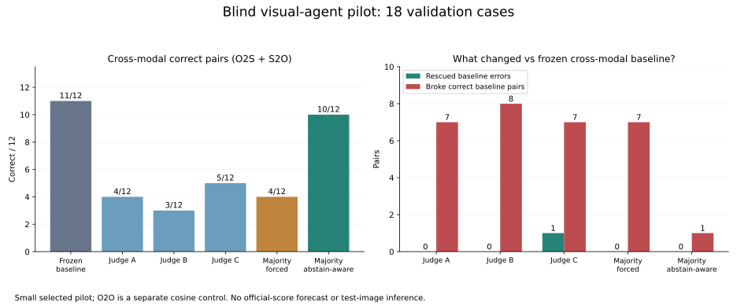

# 三个视觉子代理的验证集盲测

2026-10-11。用户提出让子代理实际看图解题。本轮完成验证集试验：三个独立上下文的子代理查看同一套18道题，仅能访问匿名图板，不提供身份、模型分数、原模型选择或其他代理判断。没有读取比赛测试图、启动GPU、下载模型或生成新提交。

**结果不支持让通用视觉大模型直接替代现有跨模态配对。** 光学同模态辨认有个别纠错，但也存在三者一致误判，没有形成净收益。

## 事先固定的流程

- 光学→SAR、SAR→光学、光学→光学各6题。每方向取原行分数前两名差距最小的3题，再从剩余查询随机取3题；不同方向的查询身份不重复。这个差距不等于全局分配的不确定性。
- 跨模态使用历史seed=20261007的共同120身份条件场景，以及冻结V5成本。基线是整场一对一最优分配；反向用其逆映射。O2O是原验证图库的native CLS余弦首选控制，**不是V5完整O2O流程**。
- 每题候选取冻结分数前五。若基线分配不在其中，用它替换第五名；候选随机排列为A–E，不按真值补入正确答案。
- 图板直接贴入解码的256×256 RGB原图，不裁切、放大、旋转或增强。每题强制报一个最佳字母，另报是否弃权、置信度及可见依据。
- 评分前固定保守融合规则：至少两位代理选择同一字母且均不弃权，才替换基线，否则保留基线。没有看完答案再调置信度阈值。

三位代理均报告只查看了指定18张图板。它们是相同底层模型的独立上下文，不能当作三种独立模型。回答逐字保存，锁定后评分。脚本核验全部查询和90个候选来自验证划分、没有自匹配、图板摘要一致。结果揭晓后，18题的正确候选均自然出现在候选集合内，部分O2O题有多个合法正例。

## 锁定后的结果

| 方法 | O2S正确/6 | S2O正确/6 | 跨模态正确/12 | O2O正确/6 |
|---|---:|---:|---:|---:|
| 冻结基线/同模态余弦控制 | 6 | 5 | 11 | 5 |
| 代理A，强制选择 | 1 | 3 | 4 | 5 |
| 代理B，强制选择 | 1 | 2 | 3 | 4 |
| 代理C，强制选择 | 1 | 4 | 5 | 5 |
| 三者多数投票，不考虑弃权 | 1 | 3 | 4 | 5 |
| 事先固定的保守融合 | 5 | 5 | 10 | 5 |

跨模态多数投票救回0题，改错7道基线正确题。保守融合仅改变1题，也把它改错：11/12→10/12。代理C单独的强制选择确实救回唯一一道跨模态基线错误，但其本人弃权，其他两位也未支持该正确选择；不能用真值事后挑代理C这一题。

O2O多数投票与保守融合均救回1题、改错1题，因此5/6→5/6，没有净收益。整个混合试验的基线16/18，多数投票9/18，保守融合15/18；这个混合准确率没有官方指标的含义。

## 具体观察与解释

跨模态的一道题，三位代理均把正确D改选为A，其中两位未弃权，理由都依赖“较暗中段、两端亮区”。这说明相同模型的共同外观解释可以一起出错；增加代理数和解释长度不会自动提供独立身份信息。SAR亮区不能直接当作光学甲板颜色或可见构件的对应证据。

O2O有一道题，三者均找到正确A，基线首选E错误；但另一道题三者也一致选了错误A，正确是E。一位代理在后一题给出0.88置信度，仍是错误。置信度是自报值，未经校准，不能当成可靠的替换概率。

这些观察支持的只是：本轮通用视觉代理能读出部分光学局部布局，却没有显示可信的跨模态身份判别能力。它们比较的是少量候选的可见相似性，现有V5跨模态基线还使用了全场联合约束，信息量也不相同。不能由此推断所有公开本地视觉模型都无效。

## 决策与边界

停止把这套通用代理的直接跨模态投票作为提分方案，不用它改写比赛测试排名。先保留冻结模型及联合匹配主线；这次试验没有证明值得立即下载或部署大型视觉模型。

18题是一个小规模、按分差抽取的能力试验，跨模态基线只错1题，无法可靠估计总体纠错率或任何官方提分。若将来复查同模态辅助，必须扩大到另行固定的样本，并同时测正确控制、错误、近似外观不同身份、候选缺失及全局冲突；不能只展示被救回的案例。

在线代理只承担本地验证诊断；此前核对的比赛规则限制非公开远程模型直接生成测试预测。若以后出现值得部署的效果，仍需用合规公开本地模型单独复现。

匿名汇总见[证据](evidence/2026-10-11-vlm-blind-pilot.json)。原图板、答案、身份与逐题结果仅留在Git忽略的`local/vlm-blind-pilot/v1/`。准备与评分入口分别为`tools/prepare_vlm_blind_pilot.py`和`tools/score_vlm_blind_pilot.py`；后者只评分已经锁定的三份代理回答，不自动调用在线模型。
