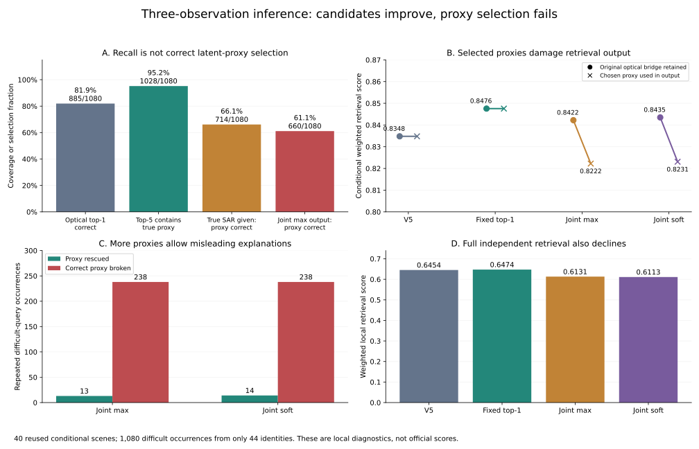
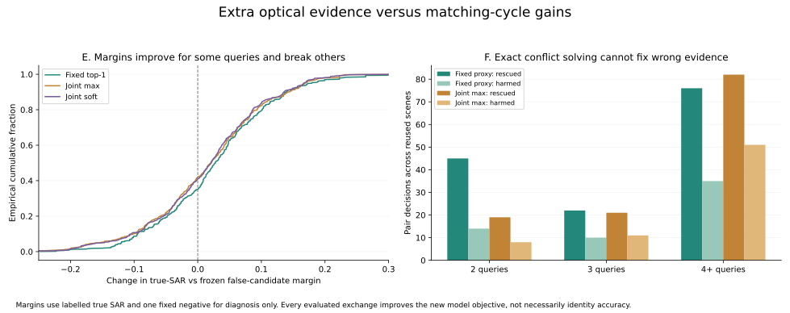
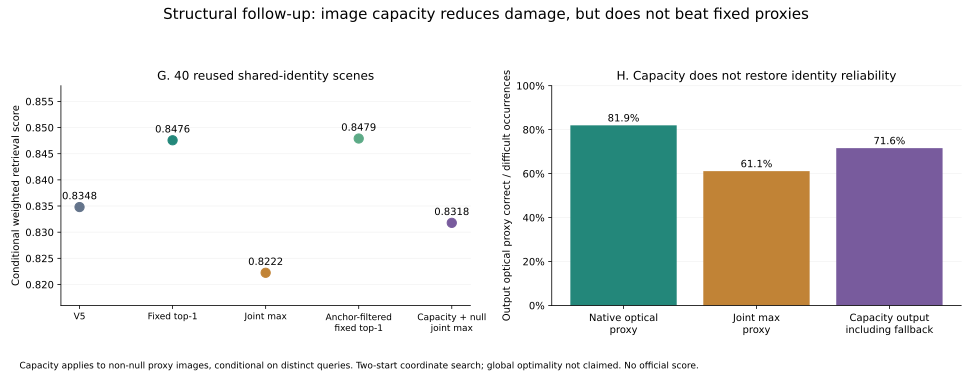

# 冻结V5的三方联合匹配：实现、对照与失败机制

2026-10-11。按用户授权完成“光学查询、多光学代理、SAR查询共同决定对应关系”的CPU研究。**两种直接联合规则均未提分；补上已知副本排他、代理图像容量和弃权后，仍未超过原V5，更没有超过固定代理。** 本轮不是GPT判图、固定代理平均特征或新模型训练。

## 实际做了什么

冻结已有TransOSS特征、V5全局/局部判别头及成本缓存。复现原40个共同120身份、其中27查询缺图库副本的条件场景；另外在前4个种子上分别替换24或60个SAR查询身份，测试共同身份假设失效的敏感性。48场景均使用已标注留出图，测试图不参与研究，不生成提交。

对缺副本查询q保留光学图库前五代理g；对每个SAR候选s分别比较q→s、g→s和q→g。原成本已除以分类头scale=20，其原生项为余弦；光学余弦放在这个原生尺度上，未用验证身份拟合权重。首先固定两种规则：

1. **最强三方能量**：`E(q,s)=0.5*[U(q,s)+max_g(V(g,s)+cos(q,g)-max_h cos(q,h))]`。不同SAR可以选不同代理，不先固定g。
2. **代理软汇总**：对相同代理能量做固定T=1/20的log-mixture，并扣除纯光学归一化项。它是固定能量汇总，不能解释为身份后验概率；输出代理取给定SAR时的最高能量候选。

第一阶段允许不同查询重复选择g，逐边消去代理后，用精确Hungarian选择全场q→s置换。对这个放松的最大能量问题，代理消元与SAR分配是精确的；不代表真实身份判断正确。源副本已知的93行仅保留源图自身，成本精确退回原U，不重复计为第三观测。

同时报告两种输出：保留原光学桥，只隔离q→s分配的改变；以及让所选g进入S2O桥接与O2O首位，检验三方联合最终输出。尾序沿用原native排序，AP按原本地`min_relevant_k`定义计算。

## 第一阶段结果

| 方法 | 40场景联合输出分 | q↔SAR配对准确率 | 困难27配对准确率 | 困难查询的输出光学代理正确率 |
|---|---:|---:|---:|---:|
| 原V5 | 0.834800 | 82.52% | 47.59% | 81.94% |
| 固定首选代理等权融合，旧对照 | **0.847566** | **84.27%** | **54.72%** | 81.94% |
| 固定前五代理分数均值，数量控制 | 0.841585 | 83.56% | 52.22% | 81.94% |
| 多代理三方最大能量 | 0.822237 | 83.60% | 52.13% | 61.11% |
| 多代理三方软汇总 | 0.823077 | 83.75% | 52.41% | 61.20% |

**只看配对正确率，会误以为联合方案有用。** 最大能量配对相对V5救回122次、改错70次，净增52/4800；固定代理则救回143次、改错59次，净增84/4800，本来就更好。更大的损失来自错误代理进入反向检索和同模态检索。

保护原光学桥后，最大能量分0.842223、软汇总0.843491，分别比V5约+0.0074/+0.0087，仍低于固定代理0.847566。把新代理写回输出，分数分别降到0.822237/0.823077。O2O方向分从0.845147降到0.687716/0.688310。

## 主要机制：召回提高，SAR条件下的代理选择失真

困难组1080次观测来自44个不同身份。纯光学首选代理正确885/1080=81.94%；前五中含正确代理1028/1080=95.19%。因此扩大候选确实有更高召回，但不等于能选对。

只在标签诊断中，给规则指定**真实SAR**，其条件最高能量代理仍仅714/1080=66.11%正确，低于纯光学首选。实际联合最大能量输出正确代理660/1080=61.11%。它把238次原本正确的代理改错，只救回13次代理错误；软汇总对应238改错、14救回。在122次观测里，SAR配对已经正确，却选了不同身份的光学代理。

这支持一个具体失败解释：当前跨模态分数可以给外观相近的错误光学图较高评价。允许更多代理后，规则得到更多“解释”某个SAR的自由度，跨模态评分反过来覆盖了较可靠的同模态证据。三条腿都来自相关的现有特征/判别头，闭环能量高不能证明身份正确。最大能量的13次代理救回中，SAR均未配对正确，没有得到完整正确三方关系；这仍是本轮配置的观测，不能推广为所有三方规则的结论。

固定负例的标签诊断也一致：三方最大能量把80次原本非正的真SAR间隔变成正值，又把69次原本正值破坏；固定首选代理是98改善、47破坏。负例固定为V5错配对象，V5已配对正确时取其最强异身份SAR，仅作诊断，不用于推理选型。

用标签固定一个真实光学代理、再等权融合的诊断，q↔SAR配对83.85%，仍未超过固定首选84.27%；其联合分0.861763含用标签直接纠正O2O的收益，不能部署，也不是所有三方算法的上界。这说明光学代理身份选择并非唯一缺口，第二观测的V5跨模态判别本身也不够可靠。

## 补测：排除占用副本，限制光学代理图像容量

第一阶段最大能量比原方案更频繁地重复选择光学代理：40场景共142个重复目标计数；11次困难查询甚至选到了另一查询已知拥有的源副本。在每个查询身份互异的既有条件场景下，这是需要排除的结构冲突。没有把“图库900文件”假定为900个不同身份。

据此在取得补测结果前固定四个结构对照，未扫描权重、温度或候选数：

- 对困难查询排除其他查询已拥有的源光学图，再取前五。已知源查询仍固定自己的源图。
- 在这个候选集合上重测固定首选、最大能量和软汇总。
- 限制每张非空代理图像最多支持一个查询；允许私人null代理，表示只用原q→s成本，不声称有第二观测。null在最终检索中保留原光学桥/排名。
- 交替优化q↔SAR置换和q↔代理图像注入，每块精确求解，最多12轮。从V5分配和过滤后的固定代理分配两个确定初始状态启动，以模型能量选更好状态，**不按验证分挑状态，不声称全局三方最优**。

| 结构对照 | 联合分 | 配对准确率 | 最终输出代理正确率 |
|---|---:|---:|---:|
| 排除其他查询源副本＋固定首选 | 0.847901 | 84.29% | 82.04% |
| 排除副本＋三方最大能量 | 0.822410 | 83.63% | 61.20% |
| 排除副本＋三方软汇总 | 0.824381 | 83.96% | 61.30% |
| 图像容量＋null＋联合最大能量 | 0.831780 | 83.44% | 71.57%（含原排名回退） |

容量方法的全部非空代理均无重复，全部能量轨迹单调，40个共享场景的选中运行都收敛；困难组460/1080次选择null。它减少了误改，仍低于V5和固定代理。排除已占用副本带来的固定代理变化仅约+0.000334，不能称显著提分。容量约束依赖查询身份互异的条件前提，不能直接套到含同身份多个查询的完整留出检索。

## 完整检索与不重合压力

第一阶段还在原完整留出协议上检验，保留原native前50候选池、用同一冻结矩阵重排；S2O使用相同成本转置，O2O使用最优SAR候选下的条件代理。原V5十候选排名逐条精确复现。结果：

| 方法 | 完整独立检索加权分 |
|---|---:|
| V5 | 0.645383 |
| 固定首选代理融合 | 0.647410 |
| 三方最大能量 | 0.613137 |
| 三方软汇总 | 0.611323 |

保留原O2O、只取新方法的跨模态方向分作算术消融，最大能量总分0.645391，相对V5仅+0.000008；软汇总0.645281，−0.000102。这个消融不是新参数配置实验，也没有值得扩大的收益。

在额外8个压力场景中，双方身份不重合时，这两种直接联合规则仍未明显优于固定代理。压力并不推断真实测试集不重合比例。所有方法都未通过事先固定的+0.03相对V5、至少+0.01相对固定代理和保护其他检索的扩大门槛；容量方法也未通过条件初筛，因此没有进入更多种子/新划分或部署级扩大验证。

## 核验、产物与决定

6项专项测试通过：小规模穷举验证放松硬三方消元与全场分配；单代理/源副本退回原规则；SAR条件改变代理且全局解决抢配；软汇总数值稳定；图像容量保留源锚点、正确使用null、非空目标唯一、能量单调，且不超过穷举上界。

另外一个入口独立重建48场景的可见候选、96份三方成本及条件代理，全部与保存决策一致；原40个V5及固定代理控制逐场精确复现。完整检索两套独立指标实现一致。结构补测的192份输出用原独立标量R1/AP实现核验，候选与非空容量约束逐场通过。全部源、缓存、协议和输出均记录摘要；Ruff通过。首轮约8.1秒，结构补测约4.7秒（不含分析绘图），零GPU、零付费、零提交。

**本轮停止扩大这些直接三方规则，保留代码作为负面证据。** 不能说三方信息毫无用途：固定代理已有小幅改善，多候选也召回了更多真代理；但当前证据无法可靠辨别新增的真假三角。改更强求解器或再增加代理自由度，不能补齐这个缺口。未来若重启，必须先找到能在已固定候选中区分真假代理的新证据，再研究联合优化；不通过温度/权重搜索把本次失败包装成收益。

代码：`track6/triangle_matching.py`；入口：`tools/study_triangle_matching.py`、`tools/study_triangle_capacity.py`、`tools/analyze_triangle_matching.py`。逐场身份、原图案例、成本与排名留在`local/triangle-matching/`。图文匿名证据见[汇总](evidence/2026-10-11-triangle-matching.json)。真实图板呈现“保留原代理、SAR配对被救回”及“SAR正确却代理被污染”的首个合格案例，位于`local/triangle-matching/v1/private-triangle-cases.png`，仅为标签揭晓后的机制示例；成功图不表示多代理优于固定代理。

这些场景反复使用旧留出身份；1080次困难观测不是1080个独立样本，40场景也不是40个独立验证集。本文数字均非官方分数，没有新的参赛模型或提交。官方最好仍为V5的0.718591。
